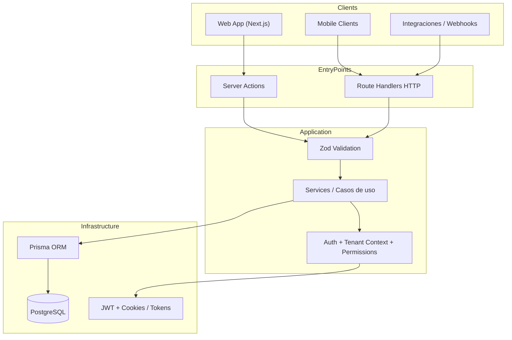
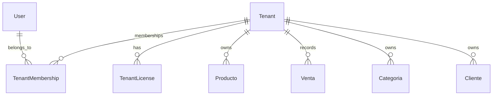
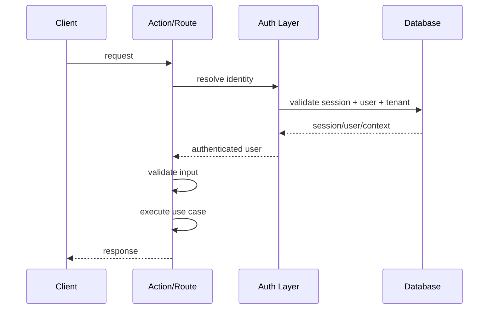
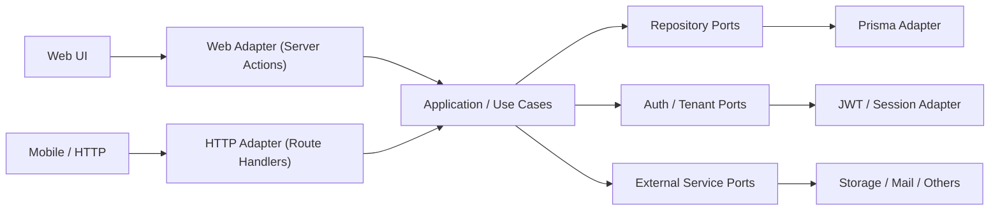

# Arquitectura del Sistema

> **FinanceMDM** es un **monolito modular multi-tenant**, **web-first**, con backend compartido para **web, mobile e integraciones HTTP**.  
> La arquitectura actual usa **Next.js + Server Actions + Route Handlers + Prisma**, con una **evolución progresiva hacia arquitectura hexagonal**.

---

## Quick path

1. **Entender el presente**: hoy el sistema tiene dos superficies de entrada: web y API HTTP.
2. **Entender la decisión**: Server Actions no reemplazan completamente a Route Handlers; conviven porque atienden consumidores distintos.
3. **Entender la dirección**: el objetivo es aislar dominio y casos de uso para que Next.js, Prisma y JWT queden en los bordes.

---

## Resumen ejecutivo

FinanceMDM está construido como una aplicación principal web sobre **Next.js App Router**, organizada por **features** y soportada por una base de datos **PostgreSQL** vía **Prisma**.

La aplicación expone dos superficies de acceso:

- **Web surface**: UI React + Server Actions para la app web principal.
- **API surface**: Route Handlers HTTP para clientes mobile, integraciones, webhooks, exportaciones y compatibilidad externa.

Ambas superficies comparten el mismo núcleo de reglas de negocio, autenticación, permisos y contexto multi-tenant, aunque ese desacople todavía está en construcción.

La **north star** arquitectónica del proyecto es una **arquitectura hexagonal incremental**: mantener el monolito, pero desacoplando progresivamente el dominio de Next.js, Prisma, JWT y detalles de transporte.

---

## Estado actual vs dirección objetivo

| Tema | Estado actual | Dirección objetivo |
|------|---------------|-------------------|
| Forma del sistema | Monolito modular | Monolito modular hexagonal |
| Entrada web | Server Actions | Adapter de entrada web |
| Entrada mobile / integraciones | Route Handlers HTTP | Adapter de entrada HTTP |
| Lógica de negocio | Parcialmente mezclada con transporte | Casos de uso aislados |
| Persistencia | Prisma cercano a la lógica | Prisma como adapter de salida |
| Auth / tenant context | Centralizado parcialmente | Fuente única de verdad reusable |
| Dependencias entre features | Existen acoplamientos cruzados | Contratos explícitos entre módulos |

---

## Stack tecnológico



### Capas principales

| Capa | Tecnología | Responsabilidad |
|------|------------|-----------------|
| UI | React 19 + Tailwind + shadcn/ui + Radix | Experiencia de usuario web |
| Routing | Next.js App Router | Navegación, layouts, segmentación de rutas |
| Web entry | Server Actions | Adaptador de entrada para la app web |
| HTTP entry | Route Handlers | Adaptador de entrada para mobile e integraciones |
| Application | Services + validaciones + orquestación | Casos de uso y reglas de aplicación |
| Persistence | Prisma ORM | Acceso a datos |
| Database | PostgreSQL | Persistencia relacional |
| Auth | JWT + sesiones + cookies httpOnly | Identidad, sesión, permisos |

---

## Principio central de diseño

> **La lógica de negocio no debe vivir en la superficie de entrada.**

Eso significa:

- **Server Actions** orquestan la entrada desde la web.
- **Route Handlers** adaptan HTTP para mobile e integraciones.
- **Services / application layer** concentran la lógica reutilizable.
- **Prisma**, **JWT**, cookies y headers son detalles de infraestructura.

Cuando una capacidad debe ser consumida por **web y mobile**, la regla es:

> **La lógica compartida debe vivir en servicios reutilizables, no duplicada entre Action y Route Handler.**

---

## Superficies de acceso

## 1) Web surface

Consumidor principal: **la aplicación web**.

### Mecanismo
- Componentes React
- Server Components
- Server Actions con `withAction`

### Cuándo usarlo
- Flujos exclusivos de la app web
- CRUD ligado directamente a UI de Next.js
- Interacciones donde no hace falta un contrato HTTP público

### Beneficios
- Menos boilerplate
- Integración natural con App Router
- Modelo más directo para formularios, loaders y mutaciones

---

## 2) API surface

Consumidores principales:

- app mobile
- integraciones externas
- webhooks
- exportaciones
- automatizaciones

### Mecanismo
- Route Handlers en `src/app/api/**`

### Cuándo usarlo
- Cuando existe un consumidor fuera de la app web
- Cuando hace falta contrato HTTP explícito
- Cuando se necesita versionado de API
- Cuando hay integraciones o callbacks externos

### Beneficios
- Interoperabilidad
- Reuso de backend
- Contrato desacoplado del cliente web

---

## Multi-tenant

El sistema implementa **aislamiento por tenant a nivel de fila** (*row-level isolation en aplicación*).



### Reglas

1. Todo recurso de negocio relevante pertenece a un `tenantId`.
2. Un usuario puede pertenecer a múltiples tenants mediante `TenantMembership`.
3. El tenant activo se resuelve desde sesión / token / contexto de request.
4. Los límites del plan se calculan desde la licencia activa del tenant.
5. Ninguna operación de negocio debe ejecutarse sin contexto tenant cuando el caso de uso lo requiere.

### Componentes clave

- `resolveTenantContext()`  
- `requireTenant()`  
- validaciones de permisos por rol / tenant role  
- límites y features de plan cargados desde `TenantLicense`

---

## Autenticación y autorización

La autenticación actual se basa en:

- **JWT**
- **sesión persistida**
- **cookies httpOnly** para la web
- **headers/tokens** para clientes HTTP

### Flujo general



### Riesgo actual

Hoy existe **duplicación parcial** entre mecanismos usados por:

- middleware / auth HTTP
- resolución de usuario actual para Server Actions

### Dirección objetivo

Una **fuente única de verdad** para:

- validar sesión
- resolver usuario
- resolver tenant activo
- calcular permisos
- exponer contexto autenticado reutilizable desde cualquier adapter de entrada

---

## Estructura del proyecto

```text
TCP/
├── src/
│   ├── app/                    # App Router + Route Handlers
│   ├── components/             # UI global y componentes compartidos
│   ├── features/               # Organización principal por dominios/feature modules
│   ├── lib/                    # Infraestructura, auth, server-actions, utilidades
│   ├── hooks/                  # Hooks compartidos
│   ├── contexts/               # React contexts
│   ├── generated/              # Código generado (Prisma client)
│   └── types/                  # Tipos globales
├── prisma/
│   ├── schema.prisma
│   ├── migrations/
│   └── seed/
├── docs/
├── scripts/
└── openspec/
```

---

## Organización modular por features

La estructura por features es la base del diseño actual.

Cada módulo idealmente agrupa:

- actions
- components
- hooks
- services
- schemas
- types

### Intención

Reducir el acoplamiento por capas técnicas y acercar el código al dominio.

### Riesgo actual

Existen dependencias cruzadas entre features. Eso no es automáticamente incorrecto, pero sí indica que algunos límites de módulo todavía no están maduros.

### Regla deseada

Los módulos deberían colaborar a través de:

- servicios compartidos bien definidos
- contratos explícitos
- tipos y adapters controlados

No a través de imports arbitrarios de componentes, hooks o detalles internos de otra feature.

---

## Server Actions vs Route Handlers

| Aspecto | Server Actions | Route Handlers |
|---------|----------------|----------------|
| Consumidor principal | Web | Mobile / integraciones |
| Contrato | Interno a Next.js | HTTP explícito |
| Ergonomía | Alta para UI web | Alta para clientes externos |
| Acoplamiento a framework | Alto | Medio |
| Reuso externo | Bajo | Alto |
| Caso ideal | Flujos web-only | APIs compartidas o públicas |

### Decisión arquitectónica

La coexistencia entre ambos mecanismos es **intencional**.

No se consideran Route Handlers como “legacy” por defecto.  
Se consideran:

- **parte activa de la arquitectura** cuando sirven mobile o integraciones;
- **deuda técnica** cuando duplican innecesariamente lógica ya resuelta en servicios compartidos.

---

## Hacia arquitectura hexagonal

## Objetivo

La meta arquitectónica **no** es fragmentar el sistema en microservicios.

La meta es:

- desacoplar dominio del framework,
- aislar casos de uso,
- convertir transporte y persistencia en adapters reemplazables,
- mantener un monolito modular de alta cohesión.

## Modelo objetivo



## Qué significa “hexagonal” en este proyecto

1. **Casos de uso primero**  
   La lógica vive en application/domain, no en Next.js.

2. **Ports explícitos**  
   Repositorios, auth context y servicios externos se abstraen mediante contratos.

3. **Adapters de entrada**  
   Server Actions y Route Handlers se limitan a traducir requests a casos de uso.

4. **Adapters de salida**  
   Prisma, JWT, correo, storage y otros sistemas quedan en infraestructura.

---

## Plan de migración incremental

## Fase 1 — Alinear documentación y reglas

- Documentar formalmente web surface + API surface
- Dejar de llamar “legacy” a todo `app/api`
- Declarar criterios de uso para Actions vs Routes

## Fase 2 — Centralizar contexto autenticado

- Unificar resolución de usuario, sesión, tenant y permisos
- Exponer un contrato reusable para Actions y Routes

## Fase 3 — Extraer casos de uso compartidos

- Mover lógica reutilizable desde entrypoints hacia services / use cases
- Evitar duplicaciones entre clientes web y mobile

## Fase 4 — Definir puertos

- Repositorios
- auth context
- servicios externos
- storage / mensajería / integraciones

## Fase 5 — Endurecer límites modulares

- Reducir imports cruzados entre features
- Favorecer contratos explícitos y composición controlada

## Fase 6 — Aislar infraestructura

- Prisma como adapter
- JWT/sesión como adapter
- Next.js como framework de borde, no de núcleo

---

## Riesgos técnicos actuales

| Riesgo | Impacto |
|-------|---------|
| Documentación desalineada con el sistema real | Decisiones confusas y expectativas incorrectas |
| Duplicación parcial de auth / tenant resolution | Drift funcional entre web y mobile |
| Acoplamiento entre features | Cambios caros y menor mantenibilidad |
| Archivos demasiado grandes en módulos críticos | Menor testabilidad y revisión más difícil |
| Frontera difusa entre transporte y negocio | Dificulta la migración a hexagonal |

---

## Reglas arquitectónicas recomendadas

1. **No duplicar reglas de negocio entre Action y Route.**
2. **Toda capacidad compartida entre web y mobile debe vivir en services/use cases.**
3. **Toda operación multi-tenant debe validar contexto tenant de forma explícita.**
4. **Los módulos no deben depender libremente de detalles internos de otros módulos.**
5. **Prisma no debería convertirse en la API del dominio; debería ser un detalle de persistencia.**
6. **Next.js no debe definir las reglas del negocio; solo su transporte y rendering.**

---

## Checklist de revisión

- [ ] El lector entiende que el sistema es **web-first**, no web-only.
- [ ] El lector entiende por qué existen **Server Actions** y **Route Handlers** al mismo tiempo.
- [ ] El lector entiende que el objetivo es **hexagonal incremental**, no reescritura total.
- [ ] El lector puede distinguir transporte, aplicación, dominio e infraestructura.
- [ ] El lector sabe cuáles son las deudas reales y cuáles son decisiones intencionales.

---

## Próximo paso

Después de esta documentación, el siguiente paso recomendado es crear un documento corto de **reglas de frontera arquitectónica** con:

- criterio de uso de Server Actions vs Route Handlers,
- contrato único de auth/tenant context,
- y convenciones para colaboración entre features.
