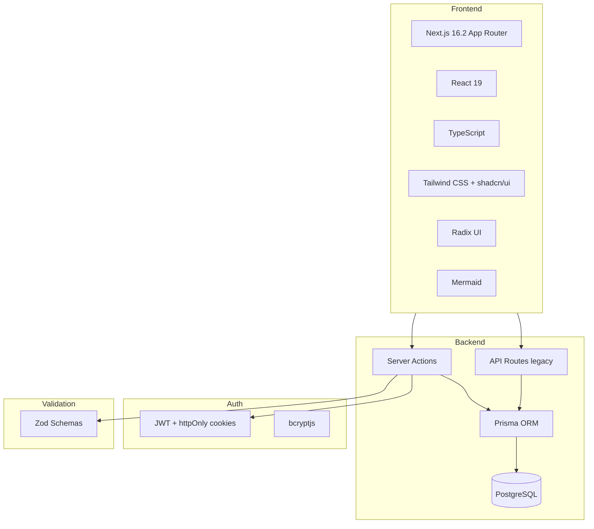
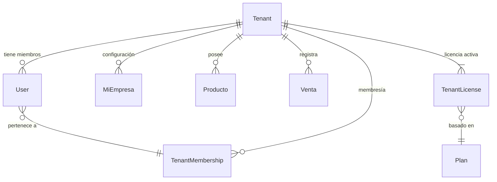
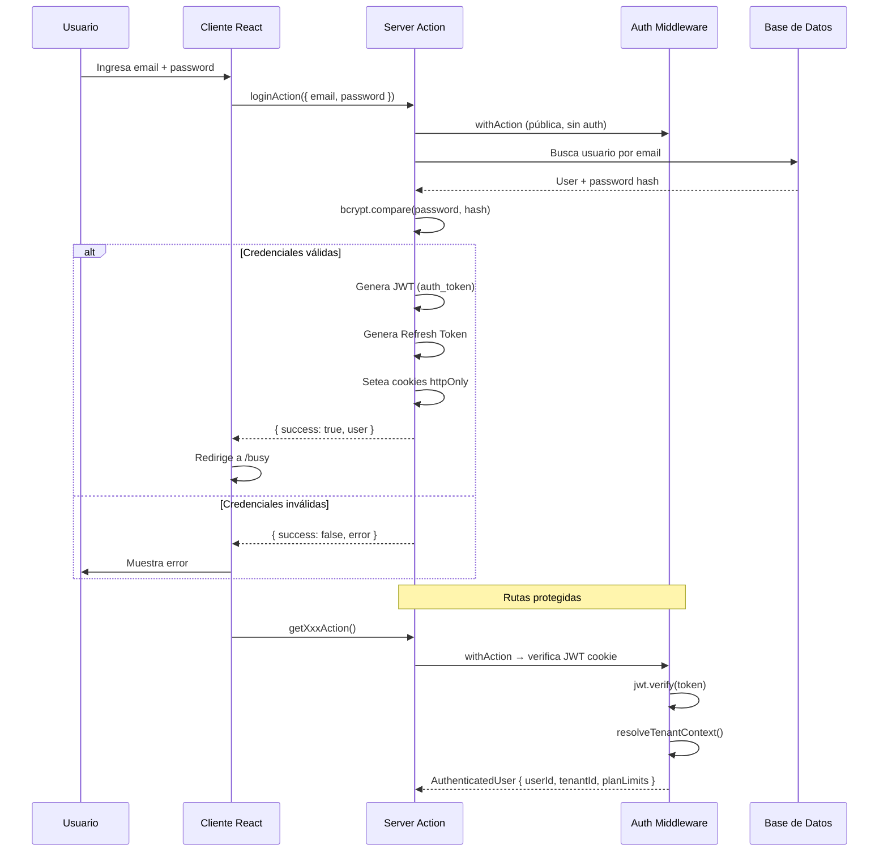
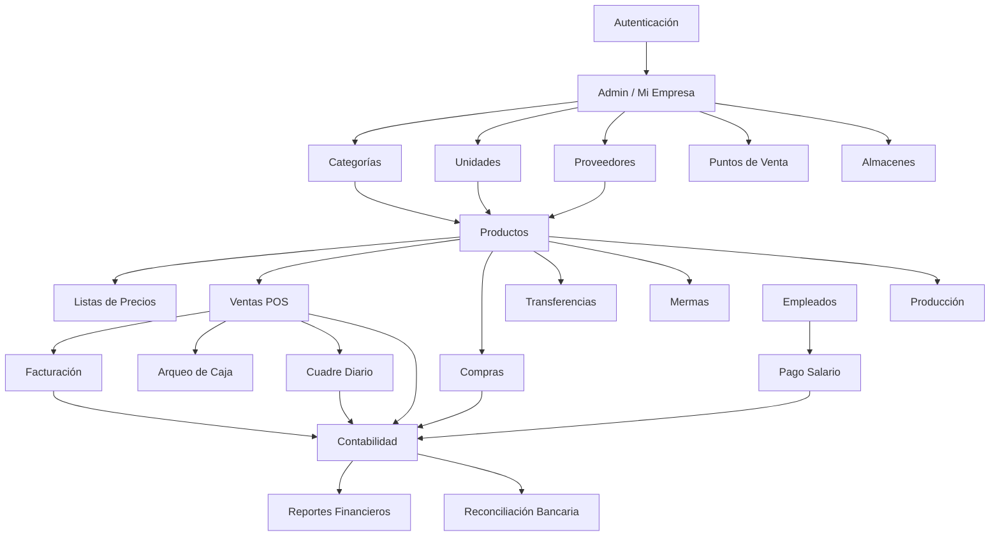

# Arquitectura del Sistema

> **FinanceMDM** — Sistema de Gestión de Inventario, Ventas y Contabilidad
> Stack: Next.js 16.2 + TypeScript + Prisma + PostgreSQL

---

## Índice

- [Stack Tecnológico](#stack-tecnológico)
- [Estructura del Proyecto](#estructura-del-proyecto)
- [Patrón Arquitectónico](#patrón-arquitectónico)
- [Multi-tenant](#multi-tenant)
- [Flujo de Autenticación](#flujo-de-autenticación)
- [Server Actions vs API Routes](#server-actions-vs-api-routes)
- [Feature Structure](#feature-structure)
- [Flujo de Datos](#flujo-de-datos)
- [Modelo de Seguridad](#modelo-de-seguridad)
- [Decisiones de Diseño](#decisiones-de-diseño)

---

## Stack Tecnológico



### Capas

| Capa | Tecnología | Propósito |
|------|-----------|-----------|
| **UI** | React 19 + Tailwind + shadcn/ui | Componentes de interfaz |
| **Ruteo** | Next.js 16.2 App Router | Navegación y layouts |
| **Server Actions** | `'use server'` + `withAction` Wrapper | Operaciones CRUD, lógica de negocio |
| **API (legacy)** | Next.js Route Handlers | Exportación CSV/PDF, webhooks |
| **ORM** | Prisma ORM | Acceso a base de datos |
| **Base de datos** | PostgreSQL (Railway) | Persistencia |
| **Auth** | JWT + httpOnly cookies | Autenticación |

---

## Estructura del Proyecto

```
TCP/
├── src/
│   ├── app/                        # App Router de Next.js
│   │   ├── api/                    # Route Handlers (legacy — solo exportación y webhooks)
│   │   ├── busy/                   # Dashboard administrativo (app protegida)
│   │   ├── login/                  # Página de login
│   │   ├── register/               # Registro y onboarding
│   │   └── models/                 # Modelos compartidos TypeScript
│   │
│   ├── components/                 # Componentes React globales
│   │   └── ui/                     # Componentes base shadcn/ui
│   │
│   ├── features/                   # Módulos del dominio (feature-based)
│   │   ├── auth/                   #   Autenticación
│   │   ├── productos/              #   Productos
│   │   ├── ventas/                 #   Ventas
│   │   ├── contabilidad/           #   Contabilidad (multi-archivo)
│   │   └── ...                     #   38+ features más
│   │
│   ├── lib/                        # Utilidades compartidas
│   │   ├── server-actions/         #   Wrapper `withAction`
│   │   ├── services/               #   Servicios de dominio (tenant-scope, etc.)
│   │   ├── auth-middleware.ts      #   Middleware de autenticación
│   │   └── permissions.ts          #   Permisos por rol
│   │
│   ├── hooks/                      # Custom hooks globales
│   ├── contexts/                   # React contexts
│   ├── types/                      # Tipos globales
│   └── generated/                  # Código generado (Prisma client)
│
├── prisma/
│   ├── schema.prisma               # Esquema de base de datos (~80 modelos)
│   ├── migrations/                 # Migraciones SQL
│   └── seed/                       # Datos de prueba
│
├── docs/                           # Documentación (esta)
│   ├── modules/                    #   Docs por feature
│   ├── guides/                     #   Guías operativas
│   └── assets/                     #   Diagramas e imágenes
│
├── openspec/                       # OpenSpec SDD artifacts
├── scripts/                        # Scripts de utilidad
├── Dockerfile                      # Despliegue contenedorizado
└── docker-compose.yml              # Orquestación local
```

---

## Patrón Arquitectónico

El sistema sigue una arquitectura **Feature-based Modular** con **Server Actions** como capa principal de comunicación backend-frontend.

### Principios

1. **Feature-based organization**: cada módulo de negocio vive en `src/features/<feature>/` con su propia estructura de actions, componentes, tipos y schemas.
2. **Server Actions como API primaria**: las Server Actions reemplazan a Redux/RTK Query para nuevas features. Se invocan directamente desde componentes cliente.
3. **withAction wrapper**: toda Server Action se envuelve con `withAction()` que provee autenticación automática, manejo de errores, y retorno consistente `{ success, data?, error? }`.
4. **Multi-tenant por fila**: todos los modelos de datos tienen `tenantId` para aislamiento por empresa.
5. **Validación en servidor**: Zod schemas validan toda entrada en las Server Actions.

```mermaid
graph LR
    subgraph Cliente
        Comp[Componente React]
        Hook[Custom Hook]
    end

    subgraph Servidor
        SA[Server Action]
        Auth[withAction wrapper]
        Valid[Zod Validation]
        Biz[Lógica de Negocio]
        DB[(Prisma)]
    end

    Comp -->|invoca| SA
    SA --> Auth
    Auth --> Valid
    Valid --> Biz
    Biz --> DB
    DB -->|respuesta| Biz
    Biz -->|{success, data}| Comp
```

---

## Multi-tenant

El sistema implementa multi-tenant por fila (*row-level isolation*).



### Mecanismo

1. Cada usuario puede pertenecer a múltiples tenants (`TenantMembership`).
2. El header `x-tenant-id` opcional permite cambiar de contexto.
3. `resolveTenantContext()` en `auth-middleware.ts` resuelve el tenant activo.
4. `requireTenant()` en `tenant-scope.ts` es el guard que asegura que toda operación tenga tenant.
5. Los límites del plan se leen desde la `TenantLicense` activa y se inyectan en `AuthenticatedUser.planLimits`.

---

## Flujo de Autenticación



### Flujo de Onboarding

1. Registro → `registerAction()` crea usuario + tenant + asociación
2. Verificación de email (opcional)
3. Onboarding multi-paso: `ONBOARDING_MID_FLOW` (pending_email_verification, selecting_user_type, etc.)
4. Redirección a `/onboarding` hasta completar

---

## Server Actions vs API Routes

| Aspecto | Server Actions | API Routes (legacy) |
|---------|---------------|---------------------|
| **Uso principal** | CRUD, queries, mutations | Exportación CSV/PDF, webhooks |
| **Autenticación** | Automática via `withAction` | Manual via `withAuth` middleware |
| **Llamada** | Directa desde componente | fetch() HTTP |
| **Cache** | `revalidatePath()` | HTTP cache headers |
| **Multi-tenant** | Automático via `requireTenant()` | Manual via header |
| **Cuando usar** | Siempre para nuevas features | Solo exportación de archivos |

---

## Feature Structure

Cada feature sigue esta estructura estándar:

```
src/features/<feature>/
├── actions.ts               # Server Actions principales
├── actions-<subfeature>.ts  # Server Actions agrupadas (ej: actions-crud.ts)
├── components/              # Componentes React del feature
│   ├── <Componente>.tsx
│   └── ...
├── hooks/                   # Custom hooks específicos (opcional)
├── api/                     # API Handlers (solo legacy)
├── schemas.ts               # Schemas Zod de validación
├── types.ts                 # Tipos TypeScript locales
└── index.ts                 # Barrel export
```

---

## Flujo de Datos General



---

## Modelo de Seguridad

### Roles

| Rol | Alcance | Descripción |
|-----|---------|-------------|
| `superadmin` | Global | Administración del sistema completo |
| `admin` | Global | Gestión de usuarios, licencias, planes |
| `manager` | Tenant | Dueño/gerente de la empresa |
| `economico` | Tenant | Acceso a contabilidad y finanzas |
| `dependiente` | Tenant | Operador (ventas, inventario) |

### Permisos

- Los permisos se verifican en cada Server Action via `user.role`.
- El tenant scope se resuelve automáticamente y se inyecta en `AuthenticatedUser`.
- `requireTenant()` lanza `ActionError` si no hay tenant activo.
- `requireFeature()` verifica que el plan del tenant incluya un feature específico.

### Cookies

- `auth_token`: JWT de acceso (httpOnly, secure, sameSite=strict)
- `refreshToken`: Refresh token (httpOnly, secure, sameSite=strict)
- El cliente NUNCA almacena el JWT en memoria JS.

---


## Server Action Pattern

Todas las operaciones CRUD usan `withAction()` wrapper:

```typescript
export const getXAction = withAction(async (input, user) => {
  const tenantId = requireTenant(user)
  return prisma.x.findMany({ where: { tenantId } })
})
```

**Response shape:** `{ success: true, data: T }` | `{ success: false, error: { message, code? } }`

## Demo Seeding

| Plan | Seed | Contenido |
|------|------|-----------|
| Básico | `base-seed.ts` | 20 prod, 1 almacén, 1 PV, CUP+USD |
| Profesional | + `professional-seed.ts` | +25 prod, +1 almacén, EUR, ventas |
| Empresarial | + `enterprise-seed.ts` | +50 prod, +2 almacenes, MXN, compras/transfers |

Orquestador: `src/lib/services/demo-seed.ts` → resuelve perfil y ejecuta seeds en transacción.

## EAN-13 / CLAS Classifier

Feature flag: `categorias-ean13` en Plan + `usaCodigoEan13` en MiEmpresa.
- CLAS file: `public/clasificador.md` → parseado en `src/lib/clas-classifier.ts`
- Labels dinámicos: helper `getCategoryLabels(usaEan13)` alterna subcategoría/específico CLAS

## Cron Jobs

`cleanupExpiredDemoLicenciasAction` → cada 1h desactiva demos expiradas (`isDemo:true AND expiracion < now()`)

## Deploy Flow

1. Push a `codex/upgrade-next-16`
2. Railway build + deploy automático
3. Migraciones: `prisma db push` automático en startup

## Decisiones de Diseño

| Decisión | Opción descartada | Motivo |
|----------|-------------------|--------|
| Server Actions sobre API Routes | REST API tradicional | Menos boilerplate, tipado automático, cache integrada |
| `withAction` wrapper | Raw `'use server'` | Manejo consistente de auth, errores y response shape |
| Feature-based folders | Capas técnicas (controllers/services) | Cohesión de dominio, facilita navegación |
| Row-level multi-tenant | Base de datos por tenant | Simplicidad operativa, costo compartido |
| Zod en servidor | Zod en cliente + servidor | Single source of truth, evita duplicación |
| JWT en cookies | JWT en localStorage | Seguridad (XSS), httpOnly, sameSite |

---

## Convenciones de Código

- **Nombres de actions**: `getXxxAction`, `createXxxAction`, `updateXxxAction`, `deleteXxxAction`
- **Response shape**: `{ success: true, data: T }` o `{ success: false, error: { message, code? } }`
- **IDS**: formato cuid (por defecto) o UUID
- **Timestamps**: `createdAt`, `updatedAt` automáticos via Prisma
- **Tenant ID**: columna `tenantId` con índice en todos los modelos multi-tenant
- **Borrado**: soft delete desaconsejado — se usa `isActive` donde necesario
