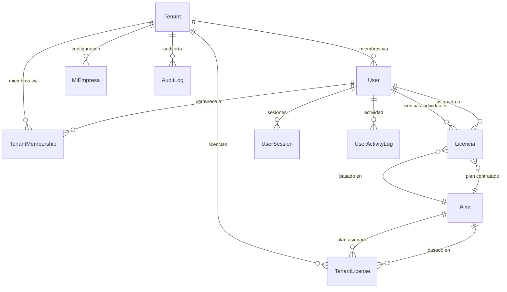
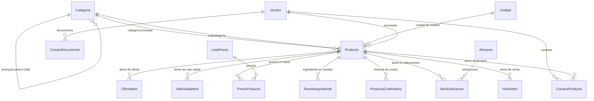
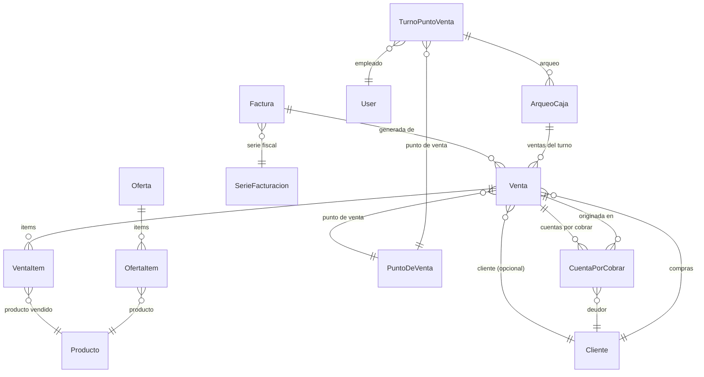
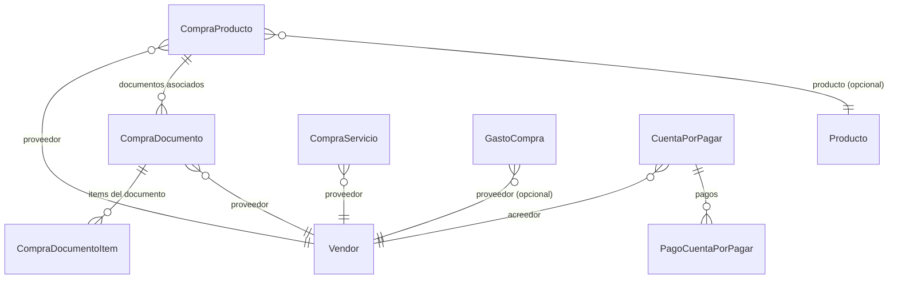
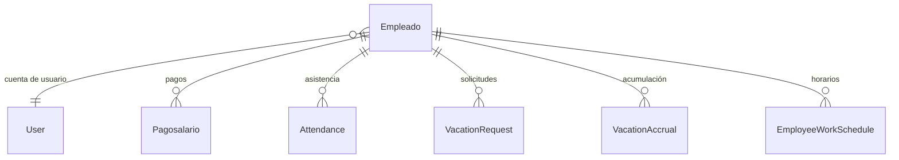
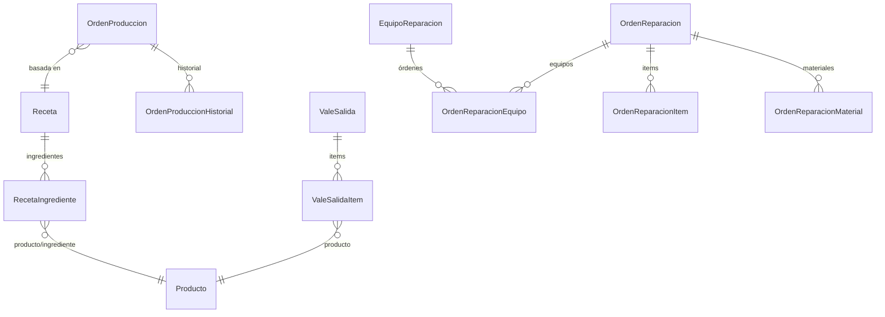

# Modelo de Datos

> Diagramas ER y descripción de los modelos Prisma del sistema.
> Schema completo: `prisma/schema.prisma` (~80 modelos, ~40 enums)

---

## Convenciones Generales

| Convención | Estándar |
|------------|----------|
| **ID** | `cuid()` por defecto |
| **Timestamps** | `createdAt DateTime @default(now())`, `updatedAt DateTime @updatedAt` |
| **Tenant isolation** | Todos los modelos de negocio incluyen `tenantId` con `@@index([tenantId])` |
| **Moneda** | Campos `Decimal` para montos, `String` para tipo de moneda ("CUP", "USD", "EUR") |
| **Soft delete** | No se usa sistemáticamente. Donde existe: campo `isActive: Boolean` |
| **Enums** | Definidos como `enum` en Prisma, no como tablas separadas |

---

## Dominios del Modelo

### 1. Core del Sistema (Tenant, Usuarios, Planes)

| Modelo | Propósito |
|--------|-----------|
| `Tenant` | Empresa/organización. Raíz del aislamiento multi-tenant |
| `User` | Usuario del sistema. Puede pertenecer a múltiples tenants |
| `TenantMembership` | Asociación User→Tenant con rol específico |
| `Plan` | Plan de suscripción (límites y features) |
| `TenantLicense` | Licencia activa de un tenant para un plan |
| `Licencia` | Licencia individual legacy (en desuso progresivo) |
| `MiEmpresa` | Datos de configuración del negocio (nombre, NIT, logo, EAN-13) |

**Campos nuevos en TenantLicense (Jun 2026):**
| Campo | Tipo | Propósito |
|-------|------|-----------|
| `isDemo` | `Boolean @default(false)` | Marca licencias demo para filtrar de métricas reales |
| `createdBy` | `String?` | ID del admin que creó la demo (auditoría) |

---

### 2. Inventario (Categorías, Productos, Unidades, Proveedores)

| Modelo | Propósito |
|--------|-----------|
| `Categoria` | Taxonomía jerárquica de productos (auto-referencia) |
| `Unidad` | Unidades de medida (kg, unidad, litro, etc.) |
| `Vendor` | Proveedores con datos de contacto y códigos internos |
| `Producto` | Catálogo central de productos. Soportes: código interno, EAN-13, costo, precios |
| `StockUbicacion` | Stock por producto + almacén + ubicación física |
| `ListaPrecio` | Listas de precios diferenciadas |
| `PrecioProducto` | Precio de un producto en una lista específica |
| `ProductoCostHistory` | Historial de cambios de costo |
| `VendorCodeSequence` | Secuencia para códigos internos de proveedor |

---

### 3. Ventas y Facturación

| Modelo | Propósito |
|--------|-----------|
| `Venta` | Transacción de venta (POS o factura) |
| `VentaItem` | Línea de detalle de una venta |
| `Factura` | Factura electrónica asociada a una venta |
| `SerieFacturacion` | Series fiscales con prefijo y numeración |
| `CuentaPorCobrar` | Cuentas por cobrar a clientes |
| `Oferta` | Ofertas y promociones |
| `Cliente` | Cartera de clientes |
| `TurnoPuntoVenta` | Turno de empleado en POS |
| `ArqueoCaja` | Arqueo y cierre de caja por turno |

---

### 4. Compras

| Modelo | Propósito |
|--------|-----------|
| `CompraProducto` | Compra de productos a proveedor |
| `CompraDocumento` | Documento fiscal de compra |
| `CompraDocumentoItem` | Línea de detalle del documento |
| `CompraServicio` | Compra de servicios |
| `GastoCompra` | Gastos asociados a una compra |
| `CuentaPorPagar` | Cuentas por pagar a proveedores |
| `PagoCuentaPorPagar` | Pagos realizados a cuentas por pagar |

---

### 5. Contabilidad y Finanzas

```mermaid
erDiagram
    PeriodoContable ||--o{ SnapshotPeriodo : "snapshots"
    PeriodoContable ||--o{ AperturaPeriodo : "aperturas"
    PeriodoContable ||--o{ CierreContable : "cierres"
    PeriodoContable ||--o{ AuditoriaPeriodo : "auditoría"

    SnapshotPeriodo ||--o{ SaldoSnapshot : "saldos"

    CuentaBancaria ||--o{ ReconciliacionVenta : "ventas"
    CuentaBancaria ||--o{ ReconciliacionServicio : "servicios"
    CuentaBancaria ||--o{ ReconciliacionGasto : "gastos"
    CuentaBancaria ||--o{ AjusteBancario : "ajustes"
    CuentaBancaria ||--o{ TransferenciaBancaria : "transferencias"
    CuentaBancaria ||--o{ InyeccionCapital : "inyecciones"
    CuentaBancaria ||--o{ Anticipo : "anticipos"

    Moneda ||--o{ TasaCambio : "tasas de cambio"
    TasaCambio ||--o{ TransaccionMoneda : "transacciones"

    Venta ||--o{ ReconciliacionVenta : "reconciliación"
    VentaServicios ||--o{ ReconciliacionServicio : "reconciliación"
    GastosDE ||--o{ ReconciliacionGasto : "reconciliación"

    DeudaCash ||--o{ PagoDeuda : "pagos"
    PrestamoCash ||--o{ PagoDeuda : "pagos"
    InyeccionCapital ||--o{ PagoDeuda : "pagos"

    Anticipo ||--o{ AnticipoMovimiento : "movimientos"
    Anticipo }o--|| Vendor : "proveedor"
    Anticipo }o--|| CuentaBancaria : "cuenta origen"
```

| Modelo | Propósito |
|--------|-----------|
| `PeriodoContable` | Período contable (mes/año) |
| `CierreContable` | Cierre de período |
| `CuentaBancaria` | Cuentas bancarias de la empresa |
| `Moneda` | Monedas soportadas (CUP, USD, EUR) |
| `TasaCambio` | Tasas de cambio históricas |
| `TransaccionMoneda` | Transacciones en múltiples monedas |
| `InyeccionCapital` | Inyecciones de capital y préstamos |
| `Anticipo` | Anticipos a proveedores |
| `DeudaCash` | Deudas de caja |
| `PrestamoCash` | Préstamos otorgados |
| `PagoDeuda` | Pagos de deudas/inyecciones/préstamos |
| `GastosDE` | Gastos de distribución y explotación |
| `GastoConcepto` | Conceptos de gasto |
| `GastoElemento` | Elementos de gasto |

---

### 6. Recursos Humanos

| Modelo | Propósito |
|--------|-----------|
| `Empleado` | Datos laborales del empleado |
| `Pagosalario` | Pago de nómina (salario, comisiones) |
| `Attendance` | Registro de asistencia |
| `VacationRequest` | Solicitudes de vacaciones |
| `VacationAccrual` | Acumulación de días de vacaciones |
| `EmployeeWorkSchedule` | Horario laboral del empleado |

---

### 7. Producción

| Modelo | Propósito |
|--------|-----------|
| `Receta` | Receta de producción (fórmula) |
| `RecetaIngrediente` | Producto + cantidad en una receta |
| `OrdenProduccion` | Orden de producción |
| `ValeSalida` | Vale de salida de materiales |
| `EquipoReparacion` | Equipo/cliente del taller de reparaciones |
| `OrdenReparacion` | Orden de reparación |

---

### 8. Operaciones (Almacenes, Transferencias, Mermas)

| Modelo | Propósito |
|--------|-----------|
| `Almacen` | Almacén físico |
| `PuntoDeVenta` | Punto de venta / sucursal |
| `Transferencia` | Transferencia de stock entre almacenes |
| `Merma` | Registro de mermas y ajustes de inventario |
| `StockUbicacion` | Stock por producto + almacén + ubicación |

---

### 9. Contratos

| Modelo | Propósito |
|--------|-----------|
| `Contrato` | Contrato con cliente o proveedor |
| `ContratoVersion` | Versiones del contrato |
| `ContratoFirma` | Firmas digitales |
| `ContratoAprobacion` | Aprobaciones |
| `ContratoArchivo` | Archivos adjuntos |
| `ContratoAlerta` | Alertas de vencimiento |
| `TipoContratoCustom` | Tipos de contrato personalizados |

---

### 10. Infraestructura

| Modelo | Propósito |
|--------|-----------|
| `AuditLog` | Log de auditoría global |
| `UserActivityLog` | Actividad por usuario |
| `UserSession` | Sesiones activas |
| `Notification` | Notificaciones del sistema |
| `BackupLog` | Log de ejecución de backups |
| `BackupPlan` | Planes de backup (frecuencia, retención) |
| `AlertHistory` | Historial de alertas |
| `ReportHistory` | Historial de reportes generados |
| `ScheduledReport` | Reportes programados |
| `ScenarioSimulation` | Simulaciones de escenarios |
| `ConfiguracionSistema` | Configuración general del sistema |
| `PeriodoCache` | Cache de cálculos de período contable |
| `Review` | Revisión de asientos contables |
| `ReviewPrompt` | Prompt de revisión de asientos |
| `DefectacionCatalogo` | Catálogo de defectaciones |
| `CatalogoReparacionConfig` | Configuración de catálogo de reparaciones |

---

## Enumeraciones

| Enum | Valores clave | Uso |
|------|---------------|-----|
| `EstadoFactura` | `PENDIENTE, PAGADA, VENCIDA, CANCELADA` | Estado de facturas |
| `TipoDocumento` | `FACTURA, N_CREDITO, N_DEBITO, RECIBO` | Tipo de documento fiscal |
| `EstadoOferta` | `ACTIVA, INACTIVA, VENCIDA` | Estado de ofertas |
| `EstadoCuentaPorCobrar` | `PENDIENTE, PARCIAL, PAGADA, VENCIDA` | Cuentas por cobrar |
| `TipoPeriodo` | `MENSUAL, ANUAL, PERSONALIZADO` | Períodos contables |
| `EstadoPeriodo` | `ABIERTO, CERRADO, BLOQUEADO` | Períodos contables |
| `EventoAuditoria` | `APERTURA, CIERRE, REAPERTURA, AJUSTE` | Auditoría de períodos |
| `ModoContable` | `AUTOMATICO, MANUAL` | Modo de operación contable |
| `EstadoTurno` | `ABIERTO, CERRADO, ARQUEADO` | Turnos POS |
| `MetodoPagoVenta` | `EFECTIVO, TRANSFERENCIA, CHEQUE, TARJETA` | Métodos de pago |
| `TipoAnticipo` | `PROVEEDOR, EMPLEADO, CLIENTE` | Anticipos |
| `EstadoAnticipo` | `PENDIENTE, PARCIAL, CANCELADO` | Anticipos |
| `EstadoContrato` | `BORRADOR, ACTIVO, VENCIDO, RENOVADO` | Contratos |
| `EstadoProduccion` | `PENDIENTE, EN_PROCESO, COMPLETADO` | Ordenes de producción |
| `EstadoOrden` | `PENDIENTE, EN_PROCESO, COMPLETADO, ENTREGADO` | Reparaciones |
| `BackupType` | `COMPLETO, INCREMENTAL` | Tipo de backup |
| `BackupStatus` | `EXITOSO, FALLIDO, EN_PROGRESO` | Estado de backup |
