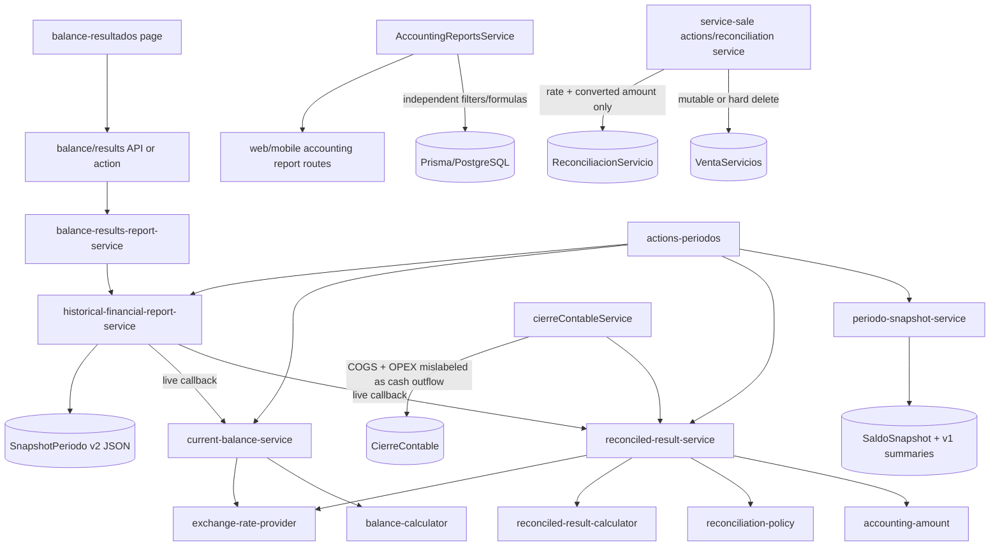
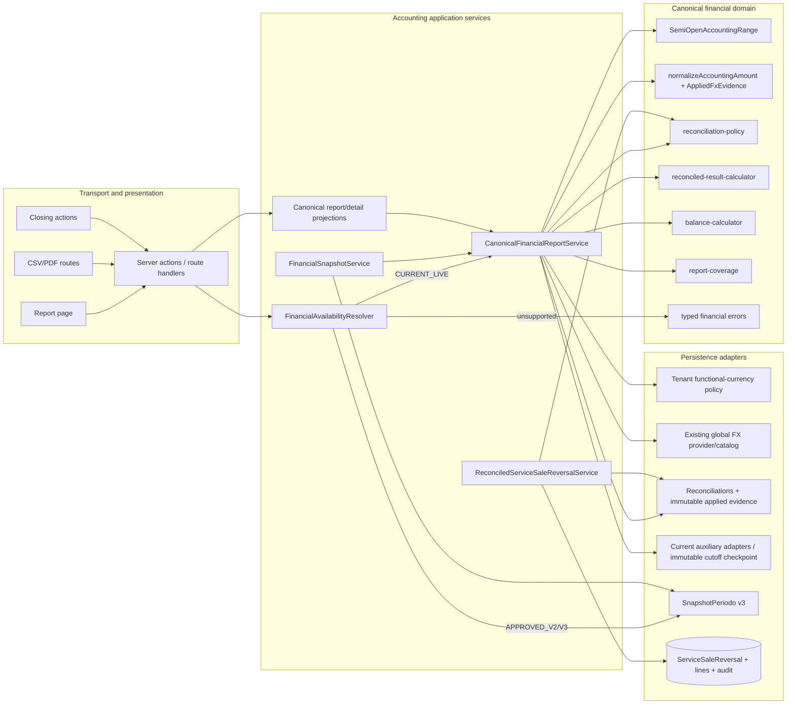
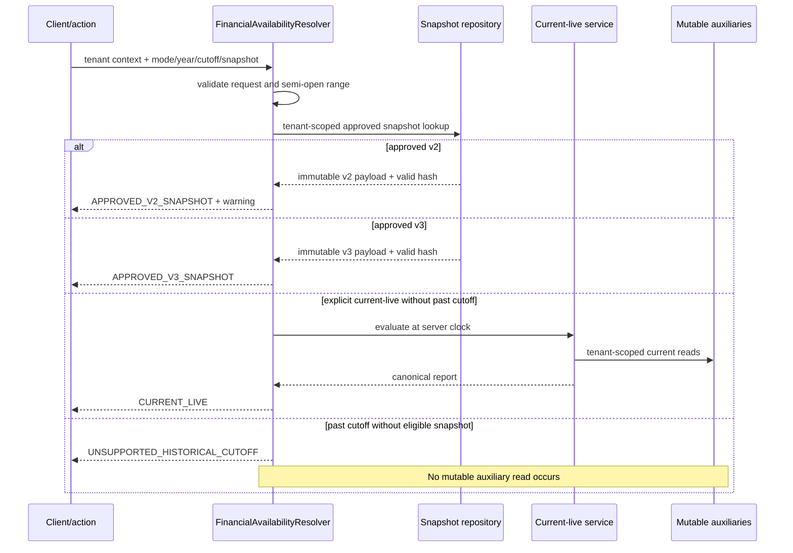

# Design: Truthful, canonical financial evidence remediation

## 1. Outcome and scope

This change makes `src/features/contabilidad/domain/` the only financial-calculation boundary. Current live reports are calculated from tenant-scoped current evidence; historical reports come only from approved immutable v2/v3 snapshots; unsupported historical cutoffs fail before mutable auxiliary reads. New reconciliation conversions carry real FX evidence, foreign bank balances are translated as of the report boundary or reported unresolved, and reconciled service sales are corrected only through an authorized equal-and-opposite reversal.

The design intentionally does **not** add arbitrary event sourcing. It adds immutable evidence at the points the accepted product supports: conversion time, current report evaluation, service-sale reversal, and scheduled/current v3 snapshot capture. Existing approved v2 payloads remain byte-for-byte unchanged.

### Non-negotiable invariants

- Every accounting range is `[gte, lt)`; no end-of-day expansion is allowed.
- Every tenant-owned query has an explicit `tenantId` predicate, including nested ownership checks.
- Approved snapshots and applied FX evidence are immutable.
- A historical label is never attached to later mutable state.
- Financial consumers project canonical values; they do not classify, convert, sign, or aggregate independently.
- Missing evidence is unresolved coverage, never zero, omission, or an inferred timestamp/rate.
- User-visible UI, toast, CSV, and PDF copy is neutral international Spanish.

## 2. Current-state dependency and call-path map



Current duplicate or unsafe paths to retire/adapt:

| Path | Problem | Target disposition |
| --- | --- | --- |
| `reconciled-result-service.ts::normalizePersistedAmount` | Uses reconciliation time as `rateEffectiveAt` | Read persisted evidence; never synthesize provenance. |
| `current-balance-service.ts` | Reads mutable current auxiliaries for a supplied past `asOf`; omits foreign banks | Callable only for current live or an immutable current-cutoff checkpoint; translate foreign banks with as-of evidence. |
| `periodo-snapshot-service.ts::generarSnapshot`, `_calcularSaldoCuenta`, `generarResumenSnapshot` | Inclusive ranges and independent formulas remain on write path | Remove from all new close/capture writes; retain read-only compatibility for existing `SaldoSnapshot`. |
| `cierreContableService.ts` | Uses COGS + OPEX as gross cash egress and performs extra aggregates | Consume canonical closing projection, including gross cash flow and coverage. |
| `AccountingReportsService` | Independent classification, conversion, sign, inclusive ranges, and inconsistent tenant filters | Convert to detail/projection adapters over canonical evidence/report DTOs; delete aggregate formulas. |
| Page/API/export helpers | Can infer loading/coverage and potentially reformat totals independently | Consume typed canonical section/export contracts. |
| `buildPersistedAccountingAmount` | Assumes CUP and accepts caller rate without actual effective evidence | Replace with tenant policy plus governed `AppliedFxEvidence` builder. |
| `VentaServicios` update/delete actions | Reconciled history can be changed or deleted | Guard existing mutations and add one transactional reversal operation. |

The Graphify artifact exists, but this executor had no command-execution tool with which to run the requested bounded `graphify query`. Discovery therefore used the authoritative source files and repository search; implementation must run a bounded query before the first apply slice and record any additional callers.

## 3. Target architecture



### Canonical boundary

`src/features/contabilidad/domain/` owns pure rules and types:

- `accounting-range.ts`: validates and represents `[gte, lt)`.
- `accounting-amount.ts`: validates same-currency and persisted conversion evidence using decimal arithmetic.
- `reconciliation-policy.ts`: classification, sign, recognition, direction, reversal kind, and cash/result effects.
- `reconciled-result-calculator.ts`: result, cost, gross cash inflow/outflow, net cash, and result coverage.
- `balance-calculator.ts`: balance equation and balance coverage from already normalized inputs.
- `report-coverage.ts`: combines result and balance coverage and enforces disposition reconciliation.
- `financial-errors.ts`: typed expected errors/results.
- `financial-report-contract.ts`: canonical report, section, availability, provenance, comparison, and export DTOs.

Application services may select and shape evidence, but only domain modules calculate financial amounts. Formatting code may round for display; it may not alter canonical stored decimal values or derive totals.

## 4. Canonical contracts and consumer migration

### 4.1 Core report contract

The internal contract is a discriminated result, not an empty report or an untyped exception:

```text
FinancialReportResolution =
  | { mode: CURRENT_LIVE, report: CanonicalFinancialReport, evaluatedAt }
  | { mode: APPROVED_V2_SNAPSHOT, report: LegacyV2Projection, warning }
  | { mode: APPROVED_V3_SNAPSHOT, report: CanonicalFinancialReport, snapshot }
  | { mode: UNSUPPORTED_HISTORICAL_CUTOFF, unavailable: { code, requestedCutoffAt } }
```

`CanonicalFinancialReport` contains identity (`tenantId` internally, safe tenant label externally), `range`, `cutoffAt`, `evaluatedAt`, functional currency, result, balance, gross cash flow, report coverage, provenance summary, comparison state, and contract version. External DTOs never expose raw tenant IDs or source IDs unless the authenticated detail endpoint explicitly requires them.

Cash flow becomes:

```text
cashFlow.operating = { grossInflow, grossOutflow, net }
cashFlow.financial = { grossInflow, grossOutflow, net }
cashFlow.total = { grossInflow, grossOutflow, net }
```

All gross values are non-negative sums of eligible cash movements. `net = grossInflow - grossOutflow`. COGS, OPEX, inventory valuation, and non-cash adjustments never contribute to gross cash totals unless an eligible cash movement independently exists.

Coverage uses count and functional-currency amount where an amount is knowable:

```text
candidate.disposition = included + unresolved + excluded
stages = normalized, classified, linked
attributes = estimated
```

An estimated included candidate appears in both `included` and `estimated`; an unresolved candidate does not. Unknown functional-currency amounts retain native amount grouped by currency and do not fabricate a functional amount. Publication and approval fail only when the coverage equation itself does not reconcile; a reconciled but unresolved report is published as partial, not complete.

### 4.2 Consumer ownership matrix

| Consumer | Target source | Formula path retired/adapted |
| --- | --- | --- |
| Result | `CanonicalFinancialReport.result` from result calculator | Synthetic FX date in `reconciled-result-service.ts`. |
| Balance | `CanonicalFinancialReport.balance` from balance calculator | Past mutable reads and foreign-bank omission in `current-balance-service.ts`. |
| Gross cash flow | Canonical result cash movement summary | Net-only fields and COGS/OPEX cash inference. |
| Coverage | `report-coverage.ts` | Incident/estimate counts used as coverage. |
| Balance/results report | `CanonicalFinancialReportService` | Ad hoc assembly in `balance-results-report-service.ts`. |
| v3 snapshots | Exact canonical report payload | `SnapshotService` calculations and v1 summaries. |
| Closing | `CanonicalClosingProjection` | Extra aggregates and inclusive ranges in `cierreContableService.ts`. |
| Actions/API | Typed projection of one resolution | Empty success and generic exception mappings. |
| Previous comparison | Current canonical values + approved stored snapshot projection | Any live reconstruction or current-state estimate. |
| Telemetry | Coverage/provenance aggregates from canonical output | Source re-query and recalculation. |
| CSV | Pure canonical report serializer | Export-time aggregation. |
| PDF | Pure canonical report renderer | Screenshot/HTML placeholder or export-time aggregation. |
| `AccountingReportsService` summary/movements/exchange/impact | Canonical report or canonical evidence detail projections | Service-owned sign/conversion/date formulas. |
| Web/mobile report routes | Shared service DTO adapters | Route-specific accounting behavior. |

Detail endpoints (movements, transfers, overdue accounts, client analysis, advances, and exchange history) may keep endpoint-specific fields, pagination, and sorting. Any financial subtotal in those responses must be supplied by a canonical evidence projection, not `reduce`, raw SQL CASE conversion, or Prisma aggregate formulas in the endpoint service.

## 5. Truthful availability and data flow



Resolution rules are exact:

1. `CURRENT_LIVE` is requested without `cutoffAt`; the server chooses `evaluatedAt`. A client timestamp is not accepted as a live cutoff.
2. An explicit snapshot ID or historical year resolves only an approved tenant-owned snapshot. An explicit cutoff must exactly equal an approved snapshot `cutoffAt` after ISO normalization.
3. A past year/cutoff without an approved snapshot returns `UNSUPPORTED_HISTORICAL_CUTOFF` before bank, inventory, receivable, payable, or other mutable reads.
4. v2/v3 snapshot reads return stored payload only. No current policy, catalog, balance, or result query supplements it.
5. Snapshot lookup, tenant membership, and immutable metadata reads are permitted during resolution; they are not mutable auxiliary calculations.

The legacy `year + cutoffAt` behavior in `getBalanceResultsReport` is replaced by an explicit request mode. Compatibility adapters map old current-year requests without a cutoff to live; any supplied past cutoff fails closed.

## 6. Persistence design

### 6.1 Tenant functional currency and global FX ownership

Add `TenantAccountingPolicy` with one row per tenant:

- `tenantId` primary key and FK to `Tenant`.
- `functionalCurrencyCode` FK to existing global `Moneda`.
- `createdAt`, `updatedAt`, `updatedBy`.
- A server rule blocks functional-currency changes once the tenant has applied FX evidence or approved financial snapshots; a future audited currency-transition change is out of scope.

`Moneda`, `TasaCambio`, `exchange-types.ts`, `exchange-rate-provider.ts`, and the deterministic conversion kernel remain owned by active change `accounting-exchange-rates-improvement`. This change **adapts**, rather than duplicates, those assets:

- Extend the existing provider with `getRateAsOf({ sourceCurrency, targetCurrency, boundaryAt, client })`.
- Deterministic ordering is `fechaVigencia DESC, createdAt DESC, tasaId DESC`, with `fechaVigencia <= boundaryAt`.
- The result contains effective aggregate rate, route, ordered immutable leg values/IDs/effective times, provenance source, and a canonical fingerprint.
- The global catalog remains governed reference data. Tenant policy, source ownership, and persisted applications are tenant-owned.
- Catalog rows used by completed evidence are not updated in place or hard-deleted; new rates are append-only. Existing global UI/actions continue through the overlapping change's provider.

This resolves overlap ownership: the exchange-rates change owns catalog management/provider mechanics; this remediation owns tenant policy, as-of eligibility, immutable application evidence, strict readers, foreign-bank usage, and audit rollout.

### 6.2 Applied FX evidence on reconciliation rows

Add the following nullable-first fields to each of `ReconciliacionVenta`, `ReconciliacionServicio`, and `ReconciliacionGasto`:

- `functionalCurrency String?`
- `rateEffectiveAt DateTime?`
- `fxProvenanceKind String?` (`SAME_CURRENCY`, `GLOBAL_CATALOG_DIRECT`, `GLOBAL_CATALOG_PATH`, `MANUAL_GOVERNED`, `LEGACY_UNRESOLVED`)
- `fxProvenanceSource String?`
- `fxCatalogRateId String?` (direct-rate traceability; no cascade)
- `fxEvidenceJson Json?` (ordered immutable legs and source metadata)
- `fxEvidenceFingerprint String?`
- `fxEvidenceVersion Int?`

The existing `tenantId`, `fechaReconciliacion`, `monto`, `moneda`, `tasaCambio`, and `montoConvertido` remain the operation, original, applied, and converted values. Add indexes `(tenantId, fechaReconciliacion)`, `(tenantId, fxProvenanceKind)`, and a unique partial index on non-null `(tenantId, fxEvidenceFingerprint, reconciliacionId)` only if query plans show value; do not deduplicate distinct reconciliations merely because their economics match.

A PostgreSQL trigger rejects changes to original/applied monetary and provenance fields after `fxEvidenceVersion = 1`. Catalog references use `ON DELETE RESTRICT` for governed rows; immutable copied values remain authoritative. Same-currency records persist rate `1`, converted amount equal to original, functional currency, kind `SAME_CURRENCY`, and no fabricated catalog effective time.

### 6.3 v3 snapshot storage

Extend `SnapshotPeriodo` additively:

- `tenantId String?` with index `(tenantId, status, cutoffAt)`.
- `schemaVersion Int?` (`2` for recognized existing payloads, `3` for new captures).
- `status String?` (`CAPTURED`, `APPROVED`).
- `cutoffAt DateTime?`, `capturedAt DateTime?`, `approvedAt DateTime?`, `approvedBy String?`.
- `canonicalContractVersion String?`.
- Keep `version` as the per-period sequence; do not overload it as payload schema version.

A v3 `resumenJson` contains `version: 3`, `[gte, lt)` range, `cutoffAt`, `capturedAt`, final `approvedAt`, functional currency, canonical result/balance/cash flow, reconciled report coverage, immutable applied-rate provenance summary, source counts/fingerprints, and comparison metadata. The canonical JSON SHA-256 remains in `hashIntegridad`; the period may reference the approved hash but does not own a second mutable copy of payload data.

Chronology is checked in application and database constraints: `cutoffAt <= capturedAt`, and for approved rows `capturedAt <= approvedAt`. Capture writes `CAPTURED`; approval writes `approvedAt`, `approvedBy`, final JSON, and final hash exactly once in the same serializable transaction. A trigger then blocks update/delete of an `APPROVED` row. Auto-approval performs capture and final approval in one transaction.

Existing approved v2 rows and JSON are never updated. The v2 projection emits the exact warning:

> Este reporte usa evidencia heredada v2 y puede no incluir la procedencia y cobertura completas disponibles en v3.

The warning is a structured field plus presentation text in API/action, UI, comparison, telemetry, CSV, and PDF.

### 6.4 Cutoff-safe v3 capture without arbitrary event sourcing

Because current bank, stock, CxC, and CxP fields are mutable summaries, they cannot be backdated. Introduce an immutable `FinancialAuxiliaryCheckpoint` payload only for a supported current cutoff:

- It is captured under `SERIALIZABLE` isolation using the database transaction timestamp as `cutoffAt`.
- Accounting mutation services and checkpoint capture acquire the same tenant-scoped PostgreSQL transaction advisory lock; this prevents a tenant financial write from crossing the checkpoint invisibly.
- The checkpoint copies the tenant-owned native bank, inventory, receivable, payable, debt, and capital inputs needed by the canonical balance, plus source fingerprints and the selected applied FX evidence.
- `capturedAt` is the actual completion instant and may be later than `cutoffAt`.
- The payload and hash are immutable and are consumed by v3 calculation; later state cannot enter.

A scheduled boundary capture may create this checkpoint at a configured period boundary; a manual capture creates a truthful current boundary. If the scheduled boundary was missed, the system does not backdate the checkpoint and v3 capture returns `CUTOFF_EVIDENCE_UNAVAILABLE`. This is snapshot-first history, not an arbitrary replay ledger.

`SaldoSnapshot` remains compatibility evidence only and is not sufficient by itself for v3. New annual/nonannual financial snapshot writes must not call `SnapshotService` formulas.

## 7. Foreign bank conversion

For each tenant-owned bank account:

1. Read its native balance only in current-live or immutable-checkpoint mode.
2. If account currency equals tenant functional currency, include it as same currency.
3. Otherwise call the existing provider's as-of selector with `boundaryAt = cutoffAt` within the same repeatable/serializable evidence transaction.
4. Copy native amount, functional amount, effective rate, all route legs, effective times, IDs, provenance, and fingerprint into the canonical evidence DTO/checkpoint.
5. If no eligible evidence exists, retain native amount/currency in unresolved coverage; do not add a functional amount.

A catalog race cannot mix value and provenance because selection and copying occur in one transaction and the copied evidence is the report/checkpoint authority. Direct and path evidence are both explicit; no current/latest rate after the boundary and no inverse-rate guess are allowed unless the existing provider contract explicitly returns a governed inverse leg.

## 8. Reconciled service-sale reversal

### 8.1 Permission model

Add the named operation permission `accounting.reconciled-service-sale.reverse` to a typed `TENANT_OPERATION_PERMISSIONS` mapping in `src/lib/permissions.ts`:

- `manager`: explicitly granted (not only `*`).
- `economico`: explicitly granted.
- `dependiente`: denied.

`requireTenantOperationPermission` verifies an active `TenantMembership` for `userId + target tenantId` at operation time. Platform `admin` has no bypass: it also needs active target-tenant membership and this operation permission. Route wildcard access and `requireFeature` are additional gates, not substitutes.

### 8.2 Storage

Add `VentaServicioReversal`:

- IDs: `reversalId`, `tenantId`, `ventaServicioId`.
- Request: `effectiveAt`, trimmed `reason`, `actorId`, `idempotencyKey`, `requestHash`.
- Audit: `createdAt`, immutable canonical effect/fingerprint JSON.
- Unique `(tenantId, ventaServicioId)` and `(tenantId, idempotencyKey)`.
- Index `(tenantId, effectiveAt)`.

Add `VentaServicioReversalLine`:

- `lineId`, `tenantId`, `reversalId`, `originalReconciliacionId`, `cuentaId`.
- Positive original native/applied values and immutable copied FX evidence.
- Unique `(reversalId, originalReconciliacionId)` and index `(tenantId, originalReconciliacionId)`.

Add a transactionally written immutable accounting audit row, or extend the existing audit model with explicit tenant, actor, operation, entity, request hash, outcome, and timestamp. Logging after commit is not sufficient evidence.

### 8.3 Transaction flow

1. Validate identifiers, ISO effective time, non-empty bounded reason, and idempotency key server-side.
2. Resolve tenant and active membership; enforce the named permission.
3. Start a serializable transaction and tenant accounting advisory lock.
4. Read an existing `(tenantId, idempotencyKey)`. Same request hash and actor returns the original result; any mismatch returns `IDEMPOTENCY_CONFLICT`.
5. Lock `VentaServicios` and its `ReconciliacionServicio` rows with explicit tenant predicates. Missing and cross-tenant IDs return the same `RESOURCE_NOT_ACCESSIBLE` contract.
6. Require at least one reconciliation and no prior reversal. Validate every bank account and referenced source belongs to the same tenant.
7. Run existing accounting-period write controls for `effectiveAt`; never reopen a closed/approved period implicitly.
8. Create reversal, lines, and audit row. Decrement each original account by the exact original native cash amount using tenant-constrained updates.
9. Feed canonical `SERVICE_SALE_REVERSAL` movements with positive amounts and policy sign `-1`; reverse recognized service revenue, service cost, cash, and coverage in equal-and-opposite amounts without deleting or editing the original.
10. Commit. Database uniqueness makes concurrent different-key attempts produce one effect and one typed `ALREADY_REVERSED` conflict.

`updateVentaServicioAction` and `deleteVentaServicioAction` first perform a tenant-scoped `reconciliaciones: { some: {} }` check. Reconciled rows return `IMMUTABLE_RECONCILED_SERVICE_SALE`; unreconciled legacy behavior remains unchanged. Persistence helpers also enforce the guard so another action cannot bypass it.

## 9. Tenant predicates and typed errors

| Boundary | Required enforcement |
| --- | --- |
| Request/action | Authenticated user, active tenant context, Zod validation, feature/operation permission. |
| Repository read | `tenantId` in every tenant-owned `where`; nested IDs checked against the same tenant. |
| Global catalog use | Source ownership and tenant functional policy are verified before lookup; application is persisted as tenant-owned evidence. |
| Snapshot | `(snapshotId, tenantId, status=APPROVED)` lookup; payload never supplemented. |
| Comparison/export/telemetry | Resolve current and prior resources under the same tenant before projection. |
| Reversal | Membership, permission, original, lines, bank accounts, period, idempotency, and audit in one transaction. |
| UI detail links | Opaque safe IDs; server repeats all checks. |

Typed expected codes include `INVALID_REQUEST`, `RESOURCE_NOT_ACCESSIBLE`, `UNSUPPORTED_HISTORICAL_CUTOFF`, `CUTOFF_EVIDENCE_UNAVAILABLE`, `FX_EVIDENCE_UNRESOLVED`, `SNAPSHOT_INTEGRITY_FAILED`, `SNAPSHOT_IMMUTABLE`, `IMMUTABLE_RECONCILED_SERVICE_SALE`, `PERIOD_NOT_WRITABLE`, `IDEMPOTENCY_CONFLICT`, `ALREADY_REVERSED`, and `EXPORT_GENERATION_FAILED`.

Guessed and cross-tenant IDs use the same HTTP/action outcome as nonexistent or inaccessible resources, normally 404 with safe code `RESOURCE_NOT_ACCESSIBLE`. Validation is 400, expected availability is a typed non-success resolution (or 409 in legacy adapters), and state/idempotency conflicts are 409. Logs contain request/correlation ID, redacted tenant hash, operation, code, and timing—not raw account numbers, amounts, payloads, or foreign tenant existence.

## 10. Client/server validation and report experience

### Server authority

Zod validates report mode, year, snapshot/cutoff IDs, `[gte, lt)`, currencies, reversal inputs, and export format. Server services re-check functional currency, FX eligibility, ownership, membership, period state, snapshot status/hash, coverage invariants, and idempotency. Client validation never authorizes or calculates accounting values.

### Independent balance/result state

Create section actions/routes over the same canonical contracts:

- `getFinancialBalanceSectionAction`
- `getFinancialResultSectionAction`
- `getFinancialReportMetadataAction`

Each response includes `requestId`, `evidenceAt`, availability mode, section coverage, and canonical contract version. The page stores independent `{status: loading|ready|stale|error, requestId, data, evidenceAt}` states. An older request ID cannot replace newer evidence. A failed refresh retains prior data only as `stale` with its evidence time. Report-level coverage is complete only when both currently displayed sections are ready, share the requested mode/range, and each is complete; otherwise it is partial/stale/unavailable as appropriate.

A balance request may return a ready-but-partial balance when current result is unavailable; it records `CURRENT_RESULT_UNAVAILABLE` instead of blocking all balance assets. Export and snapshot use the full canonical report service, not a client merge of independently timed sections.

Required neutral-Spanish behavior includes:

| State | User-facing behavior |
| --- | --- |
| Loading | Section-local skeleton and `aria-busy`; no global blanking. |
| Stale | Keep values with evidence timestamp and announce `Los datos mostrados están desactualizados.` |
| Unsupported history | `No hay evidencia aprobada para consultar este corte histórico.` |
| Partial/unresolved | Visible section/report badge and authorized aggregate explanation. |
| v2 | Exact legacy warning defined above in every consumer. |
| Reversal success | Toast `La reversión se registró correctamente.` |
| Reversal immutable conflict | Toast `Esta venta conciliada no se puede editar ni eliminar. Registra una reversión autorizada.` |
| Generic safe error | Toast `No se pudo completar la operación. Inténtalo nuevamente.` |

Toasts confirm outcomes; persistent inline status carries warnings, stale/partial state, and remediation actions. Live regions announce state transitions without moving focus. Keyboard focus remains visible and predictable.

## 11. Comparison, telemetry, CSV, and PDF

### Previous-period comparison

`FinancialComparisonService` selects the eligible approved previous-period snapshot with `(tenantId, approved status, adjacent prior period)`. v3 uses canonical stored values. v2 uses a compatibility projection and carries the warning. No eligible snapshot returns `COMPARISON_UNAVAILABLE`; no mutable historical reads occur and no zero delta is generated.

### Telemetry

Metrics derive from resolution and canonical coverage: mode counts, writer completeness by source, unresolved reasons, translated/unresolved foreign banks, candidate dispositions/stages, v2 views/exports, v3 failures, comparisons unavailable, reversal outcomes, section latency/errors, PDF failures, and shadow canonical mismatch. Tenant identifiers are keyed hashes. Alerts target invariant breaches, not ordinary user unavailability.

### CSV

A pure `serializeCanonicalFinancialReportCsv(report)` emits canonical values, range/version, coverage, comparison state, and warning. Labels are Spanish; numeric data stays machine-readable. It performs no source query or formula.

### PDF

A Node-runtime route resolves the canonical report once and passes it to `financial-report-pdf.ts`. Use server-side `pdfkit` for deterministic bytes; do not use screenshots, HTML canvas, fake files, or client-side financial math. The PDF contains tenant/report identity, `[gte, lt)` or snapshot version, canonical values, coverage, comparison availability, provenance summary, generated timestamp, and v2 warning. It returns bytes only after successful finalization; failure yields `EXPORT_GENERATION_FAILED` with no placeholder body.

Add `pdfjs-dist` as a test-only parser (or one approved equivalent) and assert `%PDF-`, parser success, metadata, required Spanish text, canonical values, coverage, comparison, and warning. Download/content type alone is not evidence.

## 12. Migration, backfill, rollout, and rollback

### Decimal contract

All financial matching uses `Prisma.Decimal`, never binary `number`. Original/converted money is quantized to 2 decimal places with decimal `ROUND_HALF_UP`; rates are compared numerically at 12 decimal places. Backfill requires exact equality after those canonical quantizations—there is no approximate amount tolerance. If a future supported currency needs a different minor-unit policy, that is a governed schema change before enabling it.

### Nullable-first sequence

1. Add tenant policy, nullable reconciliation evidence fields, v3/checkpoint/reversal tables, constraints, triggers, and indexes. Do not enable strict readers.
2. Seed one tenant policy per tenant only from independently configured tenant evidence. A global `Moneda.esPrincipal` may identify a migration candidate but does not silently prove tenant policy; unresolved tenants are blocked from new foreign conversion/report activation.
3. Deploy evidence-complete writers source-by-source. Successful foreign conversions must be 100% complete; incomplete attempts are rejected or unresolved according to lifecycle.
4. Run read-only dry-run, then separately approve execution.
5. Enable strict readers by source allowlist after writer completeness and backfill evidence pass.
6. Migrate canonical consumers and use shadow diagnostics only; legacy formulas never become a published fallback.
7. Enable v3 capture/approval, then reversal, UI sections, comparison, telemetry, CSV/PDF.

### Dry-run/backfill algorithm

For each legacy reconciliation under an explicit tenant predicate:

1. Validate tenant policy, operation timestamp, original currency/amount, stored applied rate, and stored converted amount.
2. Query governed catalog candidates for the exact ordered pair with `fechaVigencia <= operationAt`.
3. Keep candidates whose 12-place rate equals the persisted rate and whose `ROUND_HALF_UP(original × rate, 2)` equals persisted converted amount.
4. `exactly one` candidate is uniquely provable; `zero` is missing; `more than one` is ambiguous—even if duplicate candidates have the same rate.
5. Same-currency rows are provable without catalog lookup only when stored values are rate 1 and equal after money quantization.
6. Dry-run reports `scanned = uniquelyProvable + ambiguous + missing`, plus already-complete, eligible update, unchanged, source, and reason counts using redacted tenant keys.
7. Execution updates only still-null rows that re-evaluate to the same unique fingerprint inside a transaction. Repeated/concurrent execution uses compare-and-set and distinguishes updated from already complete.
8. Never use reconciliation time as rate effective time, except as the operation boundary for candidate eligibility; never use `createdAt`, `updatedAt`, current/latest rates, or approximate matching to prove evidence.
9. Preserve every legacy amount/value and every ambiguous/missing row unchanged.

### Feature and kill switches

Central typed configuration exposes source allowlists for strict FX readers plus `FINANCIAL_CANONICAL_CONSUMERS`, `FINANCIAL_V3_CAPTURE`, `RECONCILED_SERVICE_REVERSAL`, and `FINANCIAL_PDF_EXPORT`. Kill switches can stop new writers/consumers, but they cannot disable unsupported-cutoff fail-closed behavior, mutate approved snapshots/evidence, or reactivate legacy calculations for new output.

### Rollback invariants

Application readers and product consumers may roll back independently while additive columns/tables remain. Complete evidence, reversal/audit records, checkpoints, and approved snapshots are never deleted or nulled. Strict-reader rollback still reports unresolved evidence and retains fail-before-mutable-read history. v3 failures stop new capture/approval; existing v2/v3 stays viewable. Canonical mismatch stops the affected consumer slice; legacy formulas are permitted only to display already stored legacy payloads.

## 13. Strict-TDD and release verification architecture

Every implementation slice records an acceptance test failing for the intended behavior before production code, then passing. Tests use `pnpm run test:run` and no in-scope `.skip`/`.todo`.

| Layer | Required evidence |
| --- | --- |
| Pure unit | Semi-open boundaries; decimal normalization; no future/synthetic rate; deterministic as-of selection; gross cash inflow/outflow/net; reversal equal-opposite; coverage reconciliation; snapshot hashing/chronology. |
| Service integration | Resolver returns unsupported before mutable mocks are called; tenant policy; writer completeness; foreign-bank partial coverage; v2/v3 immutable reads; checkpoint safety; transaction rollback; period guards; idempotency and concurrent reversal. |
| Tenant-negative | Tenant A cannot read/infer tenant B report, source, snapshot, comparison, telemetry, export, sale, reconciliation, or reversal; all repository calls assert tenant predicates. |
| Component | Independent loading/ready/stale/error, out-of-order responses, partial/legacy/comparison states, exact Spanish copy, aria-live, keyboard/focus. |
| E2E | Real backend current/unsupported/v2/v3/comparison/reversal/tenant-negative flows using isolated tenants; no interception of the financial endpoint/action under test. |
| PDF | Signature, parseability, metadata/text, canonical values, coverage, comparison, and v2 warning. |
| Migration | Dry-run reconciliation, unique/ambiguous/missing, repeat/concurrency, unchanged legacy values. |

CI enforces at least 80% statements/branches/functions/lines for new code and 90% in all four dimensions for pure financial calculators. Add coverage commands/config using the installed `@vitest/coverage-v8`; thresholds fail independently.

Typecheck is not skipped or narrowed. First capture heap diagnostics, then make `pnpm run typecheck` invoke full `tsc --noEmit` with a committed adequate Node heap profile (initially 8192 MB if measurement confirms it) and remove pathological generated/test inclusion through correct TypeScript project references without excluding production scope. The exact command must complete in CI and locally. Focused commands name real files and are verified to collect intended tests.

Playwright seeds isolated tenants through backend fixtures and observes database/API effects. Route interception may be used for unrelated dependencies but never for the report/reversal operation being proven. Impeccable/WCAG review covers keyboard, focus, semantics, contrast, announcements, loading, stale, partial, legacy warning, unavailable, error, telemetry, comparison, and export.

## 14. Concrete file/module plan

### Create

- `src/features/contabilidad/domain/accounting-range.ts`
- `src/features/contabilidad/domain/report-coverage.ts`
- `src/features/contabilidad/domain/financial-errors.ts`
- `src/features/contabilidad/domain/financial-report-contract.ts`
- `src/features/contabilidad/services/financial-availability-resolver.ts`
- `src/features/contabilidad/services/canonical-financial-report-service.ts`
- `src/features/contabilidad/services/tenant-accounting-policy-service.ts`
- `src/features/contabilidad/services/financial-auxiliary-checkpoint-service.ts`
- `src/features/contabilidad/services/financial-snapshot-v3-service.ts`
- `src/features/contabilidad/services/financial-comparison-service.ts`
- `src/features/contabilidad/services/reconciled-service-sale-reversal-service.ts`
- `src/features/contabilidad/services/accounting-operation-permission-service.ts`
- `src/features/contabilidad/exports/financial-report-csv.ts`
- `src/features/contabilidad/exports/financial-report-pdf.ts`
- `src/app/api/contabilidad/balance-resultados/balance/route.ts`
- `src/app/api/contabilidad/balance-resultados/result/route.ts`
- `src/app/api/contabilidad/balance-resultados/export/route.ts`
- `scripts/accounting/fx-evidence-backfill.ts`
- Reviewed Prisma migrations for nullable evidence/policy, v3/checkpoint, reversal/permission constraints, and immutability triggers.
- Focused colocated tests plus real-backend Playwright and PDF parser suites.

### Modify/adapt

- `prisma/schema.prisma`
- `src/features/contabilidad/domain/accounting-amount.ts`
- `src/features/contabilidad/domain/reconciliation-policy.ts`
- `src/features/contabilidad/domain/reconciled-result-calculator.ts`
- `src/features/contabilidad/domain/balance-calculator.ts`
- `src/features/contabilidad/services/exchange-types.ts`
- `src/features/contabilidad/services/exchange-rate-provider.ts`
- `src/features/contabilidad/services/accounting-reconciliation-service.ts`
- `src/features/contabilidad/services/reconciled-result-service.ts`
- `src/features/contabilidad/services/current-balance-service.ts`
- `src/features/contabilidad/services/historical-financial-report-service.ts`
- `src/features/contabilidad/services/balance-results-report-service.ts`
- `src/features/contabilidad/services/accounting-reports-service.ts`
- Sale/service/expense reconciliation writers and adapters under `src/features/contabilidad/actions-*` and `api/`.
- `src/features/contabilidad/actions-balance-results.ts`
- `src/features/contabilidad/actions-periodos.ts`
- `src/lib/services/periodo-contable-service.ts`
- `src/lib/services/cierreContableService.ts`
- `src/features/venta-servicios/actions.ts`
- `src/lib/permissions.ts`, membership/auth helpers, and permission tests.
- Web and mobile accounting report routes that call `AccountingReportsService`.
- `src/app/busy/contabilidad/balance-resultados/page.tsx`
- `src/features/contabilidad/components/balance-resultados/{types,report-states,balance-results-view,balance-results-header}.tsx`
- `package.json`, Vitest coverage config, Playwright fixtures/config, and TypeScript typecheck configuration.

### Retire or freeze

- Remove `SnapshotService.generarSnapshot` and `generarResumenSnapshot` from all new close/write paths.
- Freeze `periodo-snapshot-service.ts` and `SaldoSnapshot` as immutable compatibility readers; mark calculation methods deprecated, then delete only after all legacy display dependencies are proven absent.
- Delete aggregate/classification/conversion helpers in `AccountingReportsService` as each endpoint family adopts canonical projections.
- Delete synthetic `rateEffectiveAt` adaptation and CUP default normalization.
- Do not regenerate mobile SDK contracts until API shape is explicitly versioned; existing v1 routes receive compatible adapters where possible, and breaking DTO changes require a separate API version decision.

## 15. Dependency order and reviewability

Natural review units are intentionally bounded to approximately 400 changed lines including focused tests; these are architecture slices, not a tasks artifact:

1. Typed availability contract and fail-before-mutable-read resolver.
2. Semi-open range and decimal/evidence pure-domain tests.
3. Tenant accounting policy nullable schema and service.
4. Existing provider as-of extension owned jointly with exchange-rate contract, without a second provider.
5. Nullable FX fields/triggers/indexes migration.
6. One reconciliation writer plus completeness telemetry; repeat separately for sale, service, and expense.
7. Dry-run classifier; execution remains a separate reviewed unit.
8. Strict result reader and report coverage.
9. Gross cash contract and closing projection.
10. Foreign-bank translation and unresolved coverage.
11. One `AccountingReportsService` endpoint family per unit; web/mobile adapters separately where needed.
12. v3 schema/hash/immutability, then cutoff checkpoint capture, then close/approval wiring.
13. Reversal permission/guards, schema, transaction service, and UI feedback as separate units.
14. Independent section state, comparison, telemetry, CSV, and PDF as distinct units.
15. Coverage/typecheck/E2E/PDF/accessibility release gates.

Schema/generated output is reviewed separately from behavior code when generated volume would obscure the hand-written change. No apply begins until these forecast units are converted into an approved tasks artifact and delivery is reviewed against the 400-line budget.

## 16. Risks and mitigations

| Risk | Mitigation |
| --- | --- |
| Existing tenant functional currency is not independently configured | Nullable policy migration; block strict activation for unresolved tenants; do not infer from global default. |
| Many legacy FX rows remain ambiguous | Exact unique-match rules, visible unresolved coverage, no fabricated backfill. |
| Scheduled cutoff checkpoint is missed | Fail `CUTOFF_EVIDENCE_UNAVAILABLE`; never backdate current mutable state. |
| Advisory lock is bypassed by a mutation path | Central accounting mutation wrapper, repository conformance tests, telemetry, and v3 activation gate. |
| Canonical totals differ from legacy | Shadow diagnostics and source-level coverage; stop slice, never publish legacy fallback for new reports. |
| Reversal races or partial bank updates | Serializable transaction, row/advisory locks, two unique constraints, request hash, and transactional audit. |
| v2 warning is dropped by a consumer | Structured warning required in shared projection and contract tests for UI/API/comparison/telemetry/CSV/PDF. |
| Typecheck OOM persists | Measure heap, committed full-scope heap profile/project references, and mandatory successful CI command. |
| Scope exceeds review budget | Dependency-ordered work units and separate schema/generated review. |

## 17. Alternatives rejected

- **Patch every legacy service in place:** rejected because it preserves divergent calculators and cannot make past mutable state truthful.
- **Arbitrary auxiliary event sourcing:** rejected by approved scope and because current history cannot be safely backfilled.
- **Use current/latest FX for missing history:** rejected as fabricated audit evidence.
- **Rewrite v2 snapshots into v3:** rejected because approved evidence is immutable and v2 lacks proof.
- **Keep legacy formulas as rollback fallback:** rejected for new writes/reports; rollback may only retain stored legacy reads.
- **Authorize reversal through manager wildcard, route access, or platform admin:** rejected because the specification requires named least privilege plus active tenant membership.
- **Client-side financial/export calculations:** rejected because the server canonical domain is authoritative.
- **Screenshot or HTML-only PDF:** rejected because the release contract requires real parseable PDF evidence.

## 18. Decision log

| ID | Decision |
| --- | --- |
| D1 | Current live plus approved snapshots are the only supported temporal modes. |
| D2 | Existing exchange catalog/provider remains shared global infrastructure; tenant policy and applied evidence belong to this change. |
| D3 | Persisted copied FX values are authoritative even when a catalog ID exists. |
| D4 | Current-cutoff immutable checkpoints support v3 without arbitrary replay; missed historical boundaries fail closed. |
| D5 | Snapshot row sequence version and payload schema version are separate fields. |
| D6 | Approved snapshot immutability is enforced by database trigger and service contract. |
| D7 | Service-sale reversal is one per original sale, reverses all its reconciliation lines atomically, and has explicit named permission. |
| D8 | Money matching uses decimal 2-place half-up rounding and exact 12-place rate comparison. |
| D9 | Independent UI sections may be stale/error independently; exports/snapshots always resolve one full canonical report server-side. |
| D10 | Legacy formulas are compatibility reads only, never current/new-write fallback. |

## 19. Traceability to specifications

| Specification | Design sections |
| --- | --- |
| `financial-report-availability` | Sections 5, 6.3, 6.4, 12, 13. |
| `accounting-fx-evidence` | Sections 6.1, 6.2, 7, 12. |
| `canonical-financial-contracts` | Sections 3, 4, 11, 14. |
| `accounting-tenant-safety-and-reversals` | Sections 8, 9, 13. |
| `financial-report-experience` | Sections 10, 11, 13. |
| `accounting-audit-rollout` | Sections 12, 13, 15, 16. |

## 20. Implementation blockers and gates

There are no remaining product-policy blockers in the six accepted specifications. Apply is nevertheless blocked until the next SDD tasks phase is explicitly approved and forecasts the multi-slice delivery against the 400-line review budget.

Two activation gates must remain explicit rather than silently assumed:

1. A tenant without independently established `TenantAccountingPolicy` cannot activate strict foreign conversion/reporting.
2. A period whose exact cutoff lacks a successfully captured immutable auxiliary checkpoint cannot produce or approve v3; the system returns `CUTOFF_EVIDENCE_UNAVAILABLE`.

These are deliberate truthful-unavailability outcomes, not reasons to infer policy, backdate state, or restore legacy formulas.
