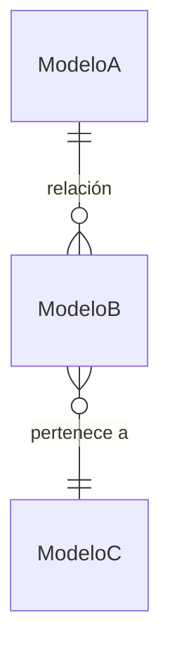

# [Nombre del Módulo]

> **Feature**: `src/features/[feature-name]/`
> **Modelos Prisma**: [lista de modelos]

---

## Descripción

<!-- 2-3 párrafos: qué hace, para qué sirve, contexto de negocio, a quién beneficia. -->

## Modelos de Datos



| Modelo | Propósito | PK | Relaciones clave |
|--------|-----------|----|------------------|
| `ModeloA` | Descripción | `id` | → ModeloB, → ModeloC |

## Funcionalidades

### [Funcionalidad 1]

**Descripción**: <!-- qué hace y cuándo se usa -->

**Input**: <!-- datos de entrada, filtros, parámetros -->

**Reglas de negocio**:
- <!-- regla 1 -->
- <!-- regla 2 -->

**Output**: <!-- qué retorna -->

### [Funcionalidad 2]

<!-- ... -->

## Server Actions (API)

Todas las Server Actions se definen en `src/features/[feature]/actions*.ts`.

| Action | Propósito | Input destacado | Output |
|--------|-----------|-----------------|--------|
| `getXxxAction` | Listar/consultar | `{ filtros... }` | `{ items: Xxx[] }` |
| `createXxxAction` | Crear | `{ datos... }` | `{ item: Xxx }` |
| `updateXxxAction` | Actualizar | `{ id, datos... }` | `{ item: Xxx }` |
| `deleteXxxAction` | Eliminar | `id: string` | `{ success: boolean }` |

## Reglas de Negocio

<!-- Validaciones importantes, constraints, flujos condicionales, edge cases que no son obvios del código -->

## UI y Navegación

| Ruta | Componente principal | Propósito |
|------|---------------------|-----------|
| `/busy/[ruta]` | `Componente` | Descripción |

## Integraciones

<!-- Qué módulos consume o provee este feature -->

| Módulo | Relación |
|--------|----------|
| `modulo-a` | Consume datos de... |
| `modulo-b` | Provee datos a... |

## Permisos y Roles

| Acción | Rol requerido |
|--------|---------------|
| Ver | `admin`, `[rol]` |
| Crear/Editar | `admin`, `[rol]` |
| Eliminar | `admin` |

## Tests

- **Archivos**: `src/features/[feature]/__tests__/`
- **Coverage**: <!-- áreas cubiertas y no cubiertas -->

```bash
pnpm test -- src/features/[feature]/
```

## Notas Técnicas

<!-- Decisiones de diseño, deuda técnica, gotchas, configuraciones especiales, advertencias -->
