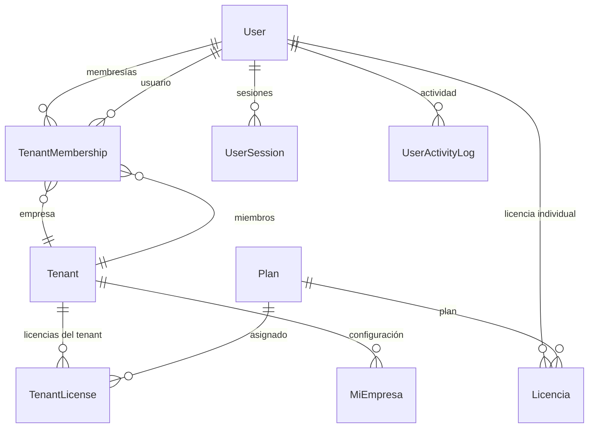

# Administración (Admin)

> **Feature**: `src/features/admin/`
> **Modelos Prisma**: `User`, `Tenant`, `TenantMembership`, `Empleado`, `Licencia`, `Plan`
> **Rutas**: `/admin` (plataforma), `/busy/admin` (tenant)

---

## Descripción

Módulo de administración del sistema con dos niveles:

1. **Platform Admin** (`/admin`): Gestión global de usuarios, tenants, licencias, planes y miembros del sistema. Acceso exclusivo para rol `admin`.
2. **Tenant Admin** (`/busy/admin/usuarios`): Gestión de usuarios dentro de una empresa. Acceso para `manager` y `admin`.

Permite crear, editar, bloquear y monitorear usuarios del sistema, gestionar membresías a empresas, y administrar licencias y planes de suscripción.

## Modelos de Datos



## Funcionalidades

### Gestión de Usuarios (Platform)

**Descripción**: CRUD completo de usuarios del sistema. Solo para rol `admin`.

**Operaciones**:
- `getUsersAction` — Listar todos los usuarios del sistema
- `createUserAction` — Crear usuario con opción de membresía a tenant y creación automática de empleado
- `updateUserAction` — Actualizar datos, rol, estado activo, expiración
- `deleteUserAction` — Eliminar usuario permanentemente
- `lockUserAction` / `unlockUserAction` — Bloquear/desbloquear usuario

### Gestión de Usuarios por Tenant

**Descripción**: Administración de usuarios dentro de una empresa específica. Accesible para `manager` y `admin`.

**Operaciones**:
- `getGlobalUsersAction` — Listar usuarios del tenant actual (o por tenantId para platform admin)
- `addTenantMembershipAction` — Agregar usuario existente a un tenant con rol específico
- `updateTenantUserAction` — Cambiar rol o estado dentro del tenant
- `membershipActionAction` — Acciones sobre membresías (cambio de rol)

### Monitoreo

**Descripción**: Panel de monitoreo de actividad de usuarios.

- `getUserMetricsAction` — Métricas de usuarios (activos, bloqueados, por vencer)
- `getActivityLogsAction` — Logs de actividad del sistema
- `getUserSessionsAction` — Sesiones activas por usuario

### Gestión de Licencias y Planes

**Descripción**: Administración de licencias y planes de suscripción. Ver docs de [Planes y Licencias](planes/README.md).

## Server Actions

| Action | Propósito | Input | Output |
|--------|-----------|-------|--------|
| `getUsersAction` | Listar todos los usuarios | `void` | `User[]` |
| `createUserAction` | Crear usuario | `{ name, email, password, role, tenantRole?, daysToExpire? }` | `User` |
| `updateUserAction` | Actualizar usuario | `{ userId, name?, email?, role?, isActive? }` | `User` |
| `deleteUserAction` | Eliminar usuario | `userId: string` | `{ success, userId }` |
| `lockUserAction` | Bloquear usuario 24h | `{ userId, reason? }` | `{ user, message }` |
| `unlockUserAction` | Desbloquear usuario | `{ userId }` | `{ user, message }` |
| `getGlobalUsersAction` | Listar usuarios del tenant | `{ tenantId?, limit? }` | `User[]` |
| `addTenantMembershipAction` | Agregar membresía a tenant | `{ userId, tenantId, tenantRole }` | `TenantMembership` |
| `updateTenantUserAction` | Actualizar usuario en tenant | `{ userId, tenantRole?, isActive? }` | `User` |
| `membershipActionAction` | Acción sobre membresía | `{ id, tenantRole }` | `TenantMembership` |
| `getUserMetricsAction` | Métricas de usuarios | `void` | `{ total, active, locked, expiring }` |
| `getActivityLogsAction` | Logs de actividad | `{ tenantId?, limit? }` | `ActivityLog[]` |
| `getUserSessionsAction` | Sesiones activas | `{ tenantId? }` | `Session[]` |

## Reglas de Negocio

1. **Solo admin** puede crear/editar/eliminar usuarios globalmente (platform-level).
2. **Manager** puede gestionar usuarios dentro de su tenant (no puede promover a admin).
3. Al crear usuario con `tenantRole: "dependiente"`, se crea automáticamente un registro `Empleado` asociado.
4. Crear usuario envía email de verificación (best-effort, no bloqueante).
5. Bloquear usuario lo inhabilita por 24 horas (no login, no acciones).
6. Desbloquear resetea `lockedUntil` y `loginAttempts`.
7. Eliminar usuario es una operación irreversible (DELETE físico).

## UI y Navegación

| Ruta | Componente | Propósito |
|------|-----------|-----------|
| `/admin` | AdminPage | Panel de administración global |
| `/admin/usuarios` | AdminUsersPage | Listado y gestión de usuarios globales |
| `/admin/tenants` | AdminTenantsPage | Gestión de tenants/empresas |
| `/admin/planes` | AdminPlanesPage | Gestión de planes de suscripción |
| `/admin/licencias` | AdminLicenciasPage | Gestión de licencias |
| `/busy/admin/usuarios` | TenantUsersPage | Usuarios de la empresa actual |
| `/busy/admin/migraciones` | MigrationsPage | Migraciones de datos |

### Componentes Principales

| Componente | Propósito |
|-----------|-----------|
| `admin-users-table.tsx` | Tabla de usuarios globales con acciones |
| `tenant-users-table.tsx` | Tabla de usuarios por tenant |
| `create-user-dialog.tsx` | Diálogo de creación de usuario |
| `edit-user-dialog.tsx` | Diálogo de edición de usuario |
| `membership-action-dialog.tsx` | Gestión de membresías |
| `user-monitoring-panel.tsx` | Panel de monitoreo de actividad |
| `blocked-users-tab.tsx` | Lista de usuarios bloqueados |
| `expiring-users-tab.tsx` | Usuarios próximos a vencer |
| `activity-logs-tab.tsx` | Logs de actividad |

## Integraciones

| Módulo | Relación |
|--------|----------|
| `auth` | Login/logout, verificación de acceso |
| `planes` | CRUD de planes de suscripción |
| `licencias` | Gestión de licencias |
| `empleados` | Creación automática al asignar rol dependiente |
| `mi-empresa` | Configuración del negocio |

## Permisos y Roles

| Acción | Rol requerido |
|--------|---------------|
| Ver listado global de usuarios | `admin` |
| Crear/Editar/Eliminar usuarios | `admin` |
| Ver usuarios del tenant | `admin`, `manager` |
| Gestionar membresías del tenant | `admin`, `manager` |
| Gestionar planes | `admin` |
| Gestionar licencias | `admin` |
| Ver monitoreo | `admin` |

## Tests

- **Archivos**: `src/features/admin/__tests__/`

```bash
pnpm test -- src/features/admin/
```

## Notas Técnicas

- Las acciones de admin NO usan `requireTenant()` porque operan a nivel plataforma.
- `getGlobalUsersAction` discrimina entre `admin` (ver todos los tenants) y `manager` (solo su tenant).
- La creación de empleado al asignar rol `dependiente` es automática y no configurable.
- `createUserAction` usa `upsert` para `TenantMembership` — si ya existe, actualiza el rol.
