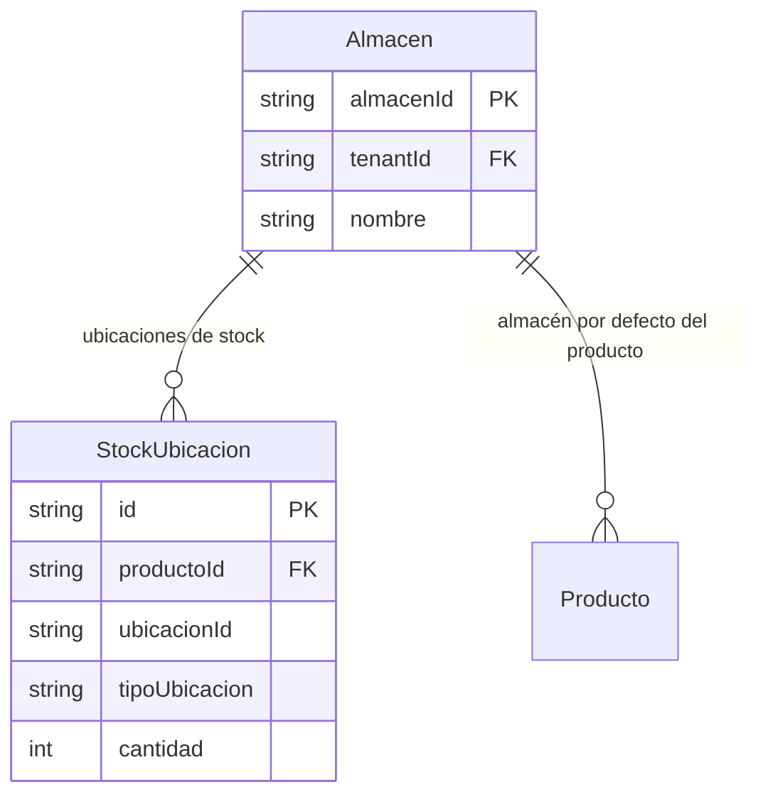

# Almacenes

> **Feature**: `src/features/almacenes/`
> **Modelos Prisma**: `Almacen`, `StockUbicacion`
> **Ruta**: `/busy/almacenes`

---

## Descripción

Módulo de gestión de almacenes físicos. Cada almacén representa un espacio donde se guardan productos. Los almacenes son la base para el control de inventario: los productos tienen un almacén por defecto, el stock se rastrea por ubicación dentro de cada almacén, y las transferencias mueven stock entre almacenes.

## Modelos de Datos



| Modelo | Propósito | PK | Relaciones clave |
|--------|-----------|----|------------------|
| `Almacen` | Almacén físico del negocio | `almacenId` | → Producto, → StockUbicacion |
| `StockUbicacion` | Stock de un producto en una ubicación específica | `id` | → Producto, → Almacen/PuntoDeVenta |

## Funcionalidades

### CRUD de Almacenes

**Descripción**: Operaciones básicas de creación, lectura, actualización y eliminación de almacenes.

### Stock por Ubicación

**Descripción**: Cada almacén puede tener múltiples ubicaciones físicas. El stock se rastrea a nivel de `StockUbicacion`, permitiendo saber exactamente dónde está cada producto dentro del almacén.

**Modos de consulta** (via `getStockPorUbicacionAction`):
- Solo productos con stock > 0 en esa ubicación
- Todos los productos del almacén (incluyendo stock=0)

## Server Actions

| Action | Propósito | Input | Output |
|--------|-----------|-------|--------|
| `getAlmacenesAction` | Listar almacenes del tenant | `void` | `Almacen[]` |
| `getAlmacenByIdAction` | Obtener almacén por ID | `almacenId: string` | `Almacen` |
| `createAlmacenAction` | Crear almacén | `{ nombre }` | `Almacen` |
| `updateAlmacenAction` | Actualizar almacén | `{ almacenId, nombre }` | `Almacen` |
| `deleteAlmacenAction` | Eliminar almacén | `almacenId: string` | `{ success }` |

## Reglas de Negocio

1. **Nombre**: Obligatorio. No hay validación de unicidad explícita (el nombre puede repetirse entre tenants por el aislamiento multi-tenant).
2. **Aislamiento**: Los almacenes están scoped por `tenantId`.
3. **Protección**: No se puede eliminar un almacén con productos asociados (verificación via Prisma constraints).
4. **Stock**: El stock total de un producto suma todas sus `StockUbicacion` en todos los almacenes.

## UI y Navegación

| Ruta | Componente | Propósito |
|------|-----------|-----------|
| `/busy/almacenes` | AlmacenesPage | Listado y gestión de almacenes |

## Integraciones

| Módulo | Relación |
|--------|----------|
| `productos` | Todo producto tiene un almacén por defecto |
| `transferencias` | Origen y destino de transferencias son almacenes |
| `stock-ubicacion` | Stock detallado por ubicación dentro del almacén |
| `mermas` | Mermas afectan stock en un almacén específico |

## Permisos y Roles

| Acción | Rol requerido |
|--------|---------------|
| Ver almacenes | `admin`, `manager`, `economico`, `dependiente` |
| Crear/Editar/Eliminar | `admin`, `manager` |

## Tests

- **Archivos**: `src/features/almacenes/__tests__/`

```bash
pnpm test -- src/features/almacenes/
```

## Notas Técnicas

- `Almacen` es un modelo simple: solo tiene `almacenId`, `nombre`, y timestamps. No tiene campos como dirección o descripción (el modelo `PuntoDeVenta` es más completo para sucursales).
- `StockUbicacion` es un modelo polimórfico: `tipoUbicacion` distingue entre "almacen" y "puntoVenta", y `ubicacionId` referencia al ID correspondiente.
- La función `getStockPorUbicacionAction` está definida en el feature de `productos` pero opera sobre `StockUbicacion`.
