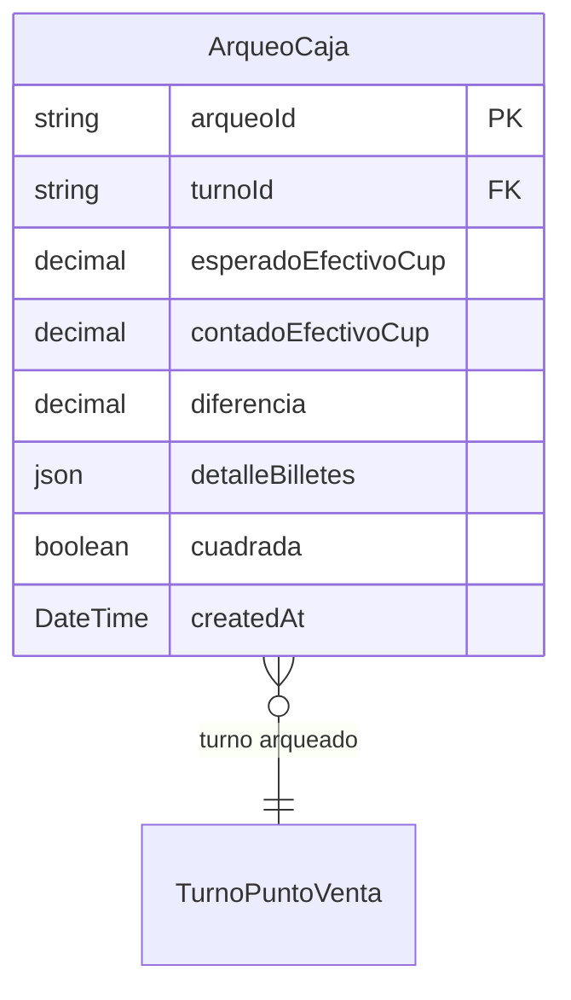

# Arqueo de Caja

> **Feature**: `src/features/arqueo-caja/`
> **Modelos Prisma**: `ArqueoCaja`, `TurnoPuntoVenta`, `Venta`
> **Ruta**: `/busy/puntosDeVenta`

---

## Descripción

Módulo de arqueo de caja para puntos de venta. Al finalizar un turno POS, se realiza el arqueo para verificar que el efectivo físico (desglosado por denominación de billetes y monedas) coincida con el total de ventas registradas.

## Modelos de Datos

| Modelo | Propósito | PK |
|--------|-----------|----|
| `ArqueoCaja` | Registro de arqueo de caja de un turno | `arqueoId` |

## Funcionalidades

### Realizar Arqueo (`realizarArqueoAction`)

**Descripción**: Realiza el arqueo de caja para un turno. Calcula los montos esperados vs contados y registra la diferencia.

**Input**: turnoId, conteo de billetes (1000, 500, 200, 100, 50, 20, 10, 5, 1 CUP), monedas, y otros métodos de pago.

**Reglas**:
- Calcula automáticamente el total esperado desde las ventas del turno
- Calcula el total contado desde el desglose de billetes
- Si la diferencia supera el umbral configurable (`UMBRAL_DIFERENCIA_DEFAULT = $500 CUP`), la caja no cuadra
- Si no cuadra, se requiere observación obligatoria

### Esperados de Arqueo (`getEsperadosArqueoAction`)

**Descripción**: Calcula los montos esperados para un turno: total de ventas por método de pago, fondo inicial, y saldo esperado en caja.

## Server Actions

| Action | Propósito |
|--------|-----------|
| `getEsperadosArqueoAction` | Calcular montos esperados del turno |
| `realizarArqueoAction` | Realizar arqueo con conteo físico |
| `getArqueosAction` | Listar arqueos realizados |

## Reglas de Negocio

1. Un turno solo puede arquearse una vez.
2. Si la diferencia > umbral, la caja se marca como no cuadrada.
3. Si no cuadra, se debe registrar observación obligatoria.
4. Los valores de billetes están en centavos (x100).
5. El arqueo incluye todos los métodos de pago (efectivo, tarjeta, transferencia, crédito).

## Integraciones

| Módulo | Relación |
|--------|----------|
| `turnos-pos` | El arqueo se realiza sobre un turno |
| `ventas` | Las ventas del turno determinan el esperado |
| `cuadre-diario` | Los arqueos alimentan el cuadre diario |

## Permisos

| Acción | Rol |
|--------|-----|
| Ver arqueos | `admin`, `manager`, `economico` |
| Realizar arqueo | `admin`, `manager`, `dependiente` |
