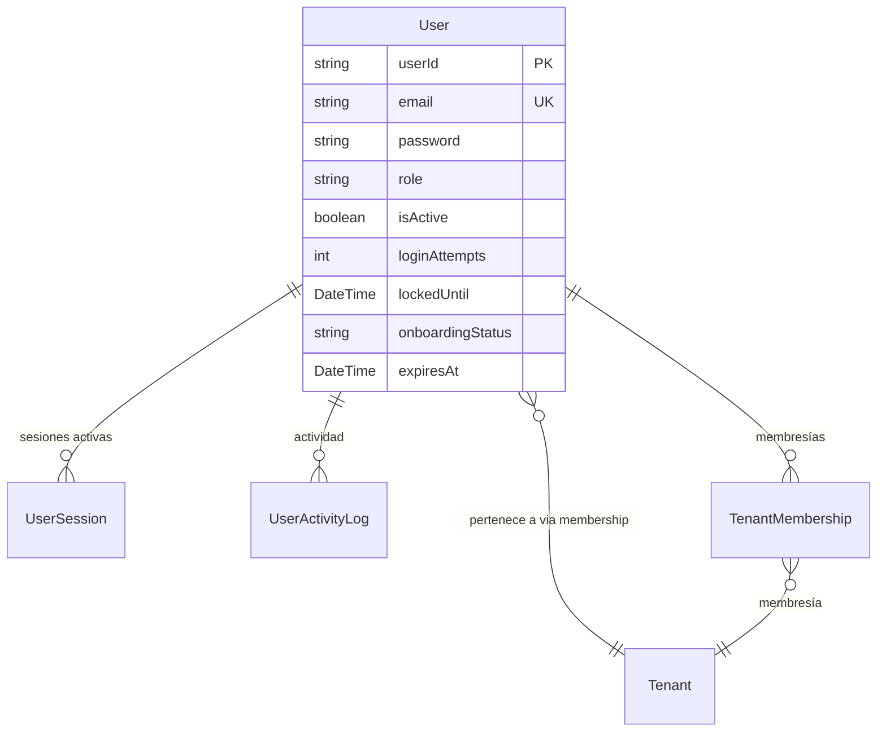

# Autenticación (Auth)

> **Feature**: `src/features/auth/`
> **Modelos Prisma**: `User`, `UserSession`, `UserActivityLog`, `Tenant`, `TenantMembership`

---

## Descripción

Módulo de autenticación y gestión de sesiones. Provee login seguro con JWT almacenado en cookies httpOnly, registro de usuarios con flujo de onboarding multi-paso, y resolución de contexto multi-tenant.

Es el punto de entrada al sistema: sin autenticación no se puede acceder a ninguna funcionalidad protegida.

## Modelos de Datos



| Modelo | Propósito | PK | Relaciones |
|--------|-----------|----|------------|
| `User` | Cuenta de usuario del sistema | `userId` | → TenantMembership, → UserSession |
| `UserSession` | Sesión JWT activa | `sessionId` | → User |
| `UserActivityLog` | Log de acciones del usuario | `logId` | → User |
| `TenantMembership` | Asociación User→Tenant con rol | `membershipId` | → User, → Tenant |

## Funcionalidades

### Login (`loginAction`)

**Descripción**: Autentica al usuario con email y contraseña. Pública (no requiere autenticación previa).

**Reglas de negocio**:
- Máximo 5 intentos fallidos antes de bloquear la cuenta por 15 minutos
- A los 3 intentos fallidos se notifica a los administradores
- Usuarios inactivos o con licencia vencida no pueden iniciar sesión (excepto admin)
- Durante el flujo de onboarding no se validan límites de licencia
- Al autenticar, resuelve el contexto de tenant (membresía activa)
- Genera JWT + Refresh Token y los setea como cookies httpOnly (30 días)
- El cliente NUNCA almacena el token en JavaScript — solo cookies

**Output**: `{ success, data: { user } }` o `{ success: false, error: { message, code } }`

**Códigos de error**:
| Código | Significado |
|--------|-------------|
| `INVALID_CREDENTIALS` | Email o contraseña incorrectos |
| `USER_INACTIVE` | Usuario desactivado por admin |
| `LICENSE_EXPIRED` | Licencia vencida |
| `ACCOUNT_LOCKED` | Cuenta bloqueada por intentos fallidos |
| `NO_TENANT` | Sin empresa activa asociada |

### Logout (`logoutAction`)

**Descripción**: Cierra la sesión del usuario. Desactiva todas las `UserSession` activas, elimina las cookies y registra la acción.

### Obtener Sesión Actual (`meAction`)

**Descripción**: Devuelve los datos del usuario autenticado actual, incluyendo contexto de tenant y datos de membresía.

### Refresh de Sesión (`refreshSessionAction`)

**Descripción**: Renueva el token JWT usando el refresh token. Mantiene la sesión activa sin necesidad de re-login.

### Registro y Onboarding

**Descripción**: Flujo de creación de nuevo usuario con multi-pasos. Estados de onboarding definidos en `ONBOARDING_MID_FLOW`:

- `pending_email_verification` — pendiente de verificar email
- `selecting_user_type` — seleccionando tipo de usuario
- `selecting_tenant` — seleccionando empresa existente o creando nueva
- `awaiting_manager_approval` — esperando aprobación del manager
- `awaiting_global_approval` — esperando aprobación global

## Server Actions

| Action | Propósito | Acceso | Input | Output |
|--------|-----------|--------|-------|--------|
| `loginAction` | Login de usuario | Público | `{ email, password }` | `{ user }` |
| `logoutAction` | Logout | Autenticado | `void` | `{ success }` |
| `meAction` | Datos del usuario actual | Autenticado | `void` | `{ user, memberships }` |
| `refreshSessionAction` | Renovar token | Autenticado | `void` | `{ success }` |
| `registerAction` | Crear cuenta nueva | Público | `{ name, email, password }` | `{ user, tenant }` |

## Reglas de Negocio

1. **Rate limiting**: `checkRateLimit` se aplica en login para prevenir fuerza bruta.
2. **Bloqueo automático**: 5 intentos fallidos → bloqueo 15 minutos.
3. **Notificaciones**: 3+ intentos fallidos disparan notificación a admins.
4. **Usuarios inactivos**: No pueden loguearse. Se muestran mensajes de error específicos según la causa.
5. **Onboarding bypass**: Durante onboarding no se validan licencias ni estado activo.
6. **JWT en cookies**: Strict httpOnly + secure + sameSite=lax. Nunca accesible desde JavaScript.
7. **Multi-tenant**: Al login se resuelve el tenant activo via `resolveTenantContext()`.

## UI y Navegación

| Ruta | Componente | Propósito |
|------|-----------|-----------|
| `/login` | LoginPage | Formulario de inicio de sesión |
| `/register` | RegisterPage | Registro de nuevo usuario |
| `/onboarding` | OnboardingPage | Flujo de onboarding multi-paso |
| `/verify-email` | VerifyEmailPage | Verificación de email |
| `/auth-callback` | AuthCallback | Callback de OAuth (Clerk) |

## Integraciones

| Módulo | Relación |
|--------|----------|
| `admin` | Gestión de usuarios (CRUD, roles) |
| `mi-empresa` | Acceso a datos del tenant autenticado |
| `profile` | Perfil del usuario autenticado |
| `notificaciones` | Alertas de intentos fallidos de login |

## Permisos y Roles

| Acción | Rol requerido |
|--------|---------------|
| Login | Público |
| Logout | Cualquier autenticado |
| Ver perfil (`meAction`) | Cualquier autenticado |
| Admin actions | `admin` |

## Tests

- **Archivos**: `src/features/auth/__tests__/`
- **Coverage**: Flujos de login, validación de credenciales, bloqueo, refresh de token

```bash
pnpm test -- src/features/auth/
```

## Notas Técnicas

- `loginAction` NO usa `withAction` porque es pública. Usa try-catch manual con response shape consistente.
- Las cookies se setean desde el servidor. `meAction` y `refreshSessionAction` sí usan `withAction`.
- La sesión expira a los 30 días (configurable via JWT expiry).
- Clerk es una alternativa de autenticación (no principal).
- `User.password` se almacena hasheado con bcrypt (12 rounds).
- `isMidOnboarding()` determina si el usuario está en flujo de onboarding para tratar permisos especiales.
