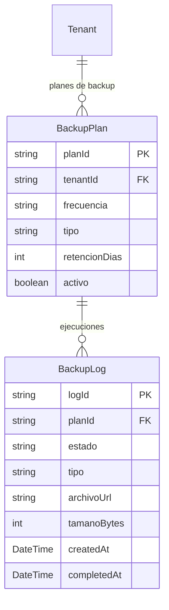

# Backups

> **Feature**: `src/features/backups/`
> **Modelos Prisma**: `BackupLog`, `BackupPlan`, `Tenant`
> **Ruta**: `/admin/backups`

---

## Descripción

Sistema de respaldos automáticos de base de datos. Soporta backups completos e incrementales con frecuencia configurable (semanal, diario, horario). La ejecución de backups es asíncrona: la acción retorna inmediatamente con un `backupLogId` y el progreso se consulta via polling.

## Modelos de Datos

## Funcionalidades

### Ejecución de Backup

**Descripción**: Dispara un backup (completo, por tenant, o de configuración). Corre en background — el cliente debe pollear `getBackupStatusAction`.

### Restauración

**Descripción**: Restaura un backup existente. Operación destructiva: reemplaza los datos actuales.

### Planes de Backup

**Descripción**: Define la frecuencia (DIARIO, SEMANAL, HORARIO), tipo (COMPLETO, INCREMENTAL), y retención.

### Importación

**Descripción**: Importa datos desde un archivo SQL externo.

## Server Actions

| Action | Propósito | Acceso |
|--------|-----------|--------|
| `createBackupAction` | Ejecutar backup | `admin` |
| `getBackupStatusAction` | Consultar progreso | `admin` |
| `restoreBackupAction` | Restaurar backup | `admin` |
| `importBackupAction` | Importar SQL | `admin` |
| `deleteBackupAction` | Eliminar backup | `admin` |
| CRUD planes | Gestión de planes | `admin` |

## Reglas de Negocio

1. Solo `admin` puede ejecutar/restaurar backups.
2. Los backups corren asincrónicamente (no bloquean el request).
3. `BackupEngine` y `RestoreEngine` manejan la lógica de ejecución.
4. El almacenamiento se maneja via `createStorage()` (Railway Volume o S3-compatible).

## Integraciones

| Módulo | Relación |
|--------|----------|
| `admin` | Acceso restringido a admin |

## Permisos

| Acción | Rol |
|--------|-----|
| Todas las operaciones | `admin` |
