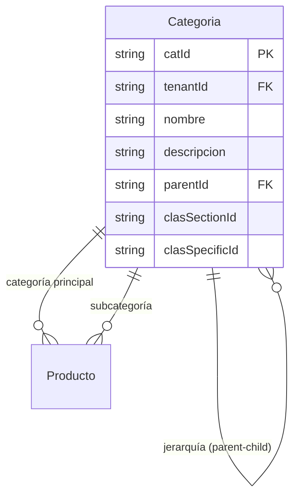
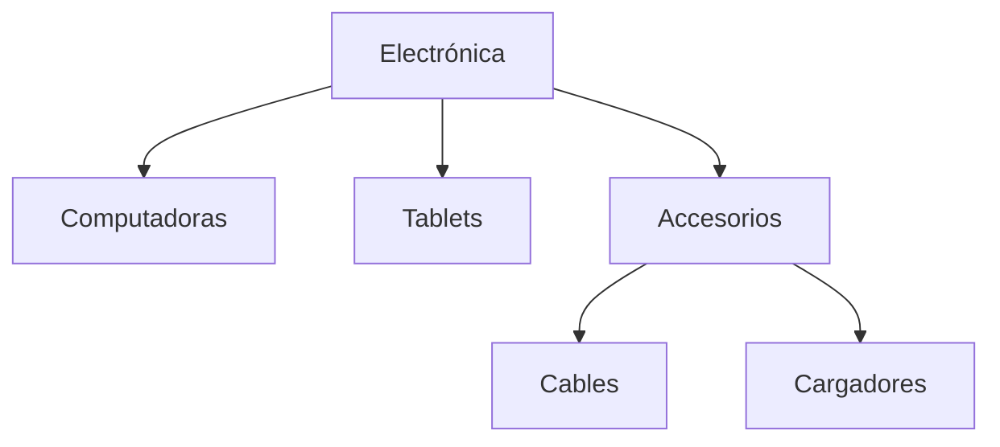

# Categorías

> **Feature**: `src/features/categorias/`
> **Modelos Prisma**: `Categoria`
> **Ruta**: `/busy/categorias`

---

## Descripción

Módulo de taxonomía de productos. Las categorías organizan el catálogo en una estructura jerárquica de dos niveles: **categoría padre → subcategoría**. Además, las categorías pueden tener configuraciones de prefijo EAN-13 y referencias al clasificador CLAS.

## Modelos de Datos



| Modelo | Propósito | PK | Relaciones clave |
|--------|-----------|----|------------------|
| `Categoria` | Nodo de taxonomía jerárquica | `catId` | → Categoria (self: parent), → Producto (categoría, subcategoría) |

## Funcionalidades

### CRUD de Categorías

**Descripción**: Operaciones básicas de creación, lectura, actualización y eliminación de categorías.

**Reglas de negocio**:
- Solo 2 niveles de profundidad: categoría padre → subcategoría
- No se puede eliminar una categoría con productos asociados
- El nombre es obligatorio, la descripción es opcional
- El `parentId` define la jerarquía: `null` = categoría raíz

### Jerarquía

**Descripción**: Consulta la estructura jerárquica completa. `getCategoriaHierarchyAction` devuelve un árbol anidado con conteo de productos por nodo.



### Validación de Eliminación

**Descripción**: `getCategoriaDeletionErrorsAction` verifica las consecuencias de eliminar una categoría antes de hacerlo, retornando errores específicos si hay productos o subcategorías asociadas.

## Server Actions

| Action | Propósito | Input | Output |
|--------|-----------|-------|--------|
| `getCategoriasAction` | Listar categorías planas | `void` | `Categoria[]` |
| `getCategoriaByIdAction` | Obtener categoría por ID | `catId: string` | `Categoria` |
| `getCategoriaHierarchyAction` | Árbol jerárquico completo | `void` | `CategoriaHierarchy[]` |
| `createCategoriaAction` | Crear categoría | `{ nombre, descripcion?, parentId? }` | `Categoria` |
| `updateCategoriaAction` | Actualizar categoría | `{ catId, nombre?, descripcion?, parentId? }` | `Categoria` |
| `deleteCategoriaAction` | Eliminar categoría | `catId: string` | `{ success }` |
| `getCategoriaDeletionErrorsAction` | Validar eliminación | `catId: string` | `{ hasErrors, errors }` |

## Reglas de Negocio

1. **Profundidad máxima**: 2 niveles (padre → hijo). No se permiten bisnietos.
2. **Protección de eliminación**: No se puede eliminar una categoría que tenga productos. Primero hay que reasignar o eliminar los productos.
3. **Validación de ciclos**: Al actualizar `parentId`, se verifica que no se cree un ciclo de auto-referencia (una categoría no puede ser su propio ancestro).
4. **Categorías y EAN-13**: Las categorías pueden almacenar prefijos y secciones para generación de códigos EAN-13 (campos `clasSectionId`, `clasSpecificId`).
5. **Multi-tenant**: Cada tenant tiene su propio árbol de categorías, aislado via `tenantId`.

## UI y Navegación

| Ruta | Componente | Propósito |
|------|-----------|-----------|
| `/busy/categorias` | CategoriasPage | Listado con vista jerárquica |

## Integraciones

| Módulo | Relación |
|--------|----------|
| `productos` | Todo producto pertenece a una categoría (y opcionalmente una subcategoría) |
| `mi-empresa` | Al activar EAN-13, se resetean las categorías |
| `unidades` | Independiente, pero usado junto con categorías en el catálogo |

## Permisos y Roles

| Acción | Rol requerido |
|--------|---------------|
| Ver categorías | `admin`, `manager`, `economico`, `dependiente` |
| Crear/Editar/Eliminar | `admin`, `manager` |

## Tests

- **Archivos**: `src/features/categorias/__tests__/`

```bash
pnpm test -- src/features/categorias/
```

## Notas Técnicas

- La jerarquía se construye en memoria con `buildHierarchy()` — no hay consultas recursivas en la BD.
- La estructura es plana en la BD (auto-referencia via `parentId`); el árbol se arma en la Server Action.
- Existe un validador dedicado (`CategoriaValidator`, `CategoriaDeletionValidator`) en `src/lib/categoria-validation.ts` y `src/lib/categoria-errors.ts`.
- Los campos `clasSectionId` y `clasSpecificId` son para integración con el clasificador CLAS, usado en sistemas fiscales cubanos.
