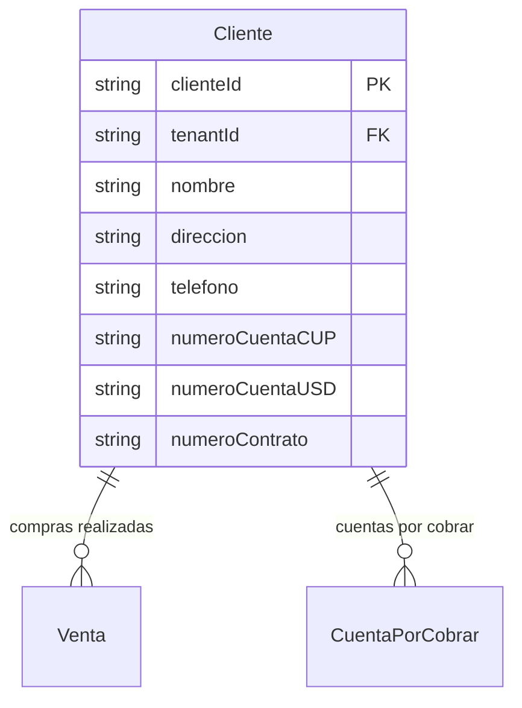

# Clientes

> **Feature**: `src/features/clientes/`
> **Modelos Prisma**: `Cliente`, `Venta`, `CuentaPorCobrar`
> **Ruta**: `/busy/cliente`

---

## Descripción

Módulo de gestión de la cartera de clientes. Cada cliente puede tener compras, facturas y cuentas por cobrar asociadas. Es un módulo habilitado por feature flag (`clientes`).

## Modelos de Datos



| Modelo | Propósito | PK | Relaciones clave |
|--------|-----------|----|------------------|
| `Cliente` | Persona o entidad que realiza compras | `clienteId` | → Venta, → CuentaPorCobrar |

## Funcionalidades

### CRUD de Clientes

**Descripción**: Operaciones básicas de creación, lectura, actualización y eliminación de clientes.

**Campos**: nombre, dirección, teléfono, cuentas bancarias (CUP/USD), número de contrato.

## Server Actions

| Action | Propósito | Input | Output |
|--------|-----------|-------|--------|
| `getClientesAction` | Listar clientes del tenant | `void` | `Cliente[]` |
| `getClienteByIdAction` | Obtener cliente por ID | `clienteId: string` | `Cliente` |
| `createClienteAction` | Crear cliente | `{ nombre, direccion?, telefono?, numeroCuentaCUP?, numeroCuentaUSD?, numeroContrato? }` | `Cliente` |
| `updateClienteAction` | Actualizar cliente | `{ clienteId, nombre?, ... }` | `Cliente` |
| `deleteClienteAction` | Eliminar cliente | `clienteId: string` | `{ success }` |

## Reglas de Negocio

1. **Feature flag**: El módulo requiere el feature `clientes` habilitado en el plan (`requireFeature`).
2. **Nombre**: Obligatorio. Todos los demás campos son opcionales.
3. **Número de contrato**: Opcional. Identificador del contrato del cliente.
4. **Cuentas bancarias**: Cada cliente puede tener cuenta en CUP y USD.
5. **Aislamiento**: Scoped por `tenantId`.

## UI y Navegación

| Ruta | Componente | Propósito |
|------|-----------|-----------|
| `/busy/cliente` | ClientesPage | Listado y gestión de clientes |

## Integraciones

| Módulo | Relación |
|--------|----------|
| `ventas` | Una venta puede tener un cliente asociado |
| `facturas` | Cuentas por cobrar originadas de ventas a clientes |
| `contabilidad` | Reportes de cuentas por cobrar por cliente |

## Permisos y Roles

| Acción | Rol requerido |
|--------|---------------|
| Ver clientes | `admin`, `manager`, `economico`, `dependiente` |
| Crear/Editar/Eliminar | `admin`, `manager` |

## Tests

- **Archivos**: `src/features/clientes/__tests__/`

```bash
pnpm test -- src/features/clientes/
```

## Notas Técnicas

- El módulo verifica el feature flag `clientes` via `requireFeature()` antes de cualquier operación.
- `Cliente` es un modelo relativamente simple. Los datos extensos del cliente (historial de compras, crédito) se consultan desde los módulos de ventas y facturas.
- El campo `numeroContrato` es informativo — no está vinculado al módulo de contratos.
