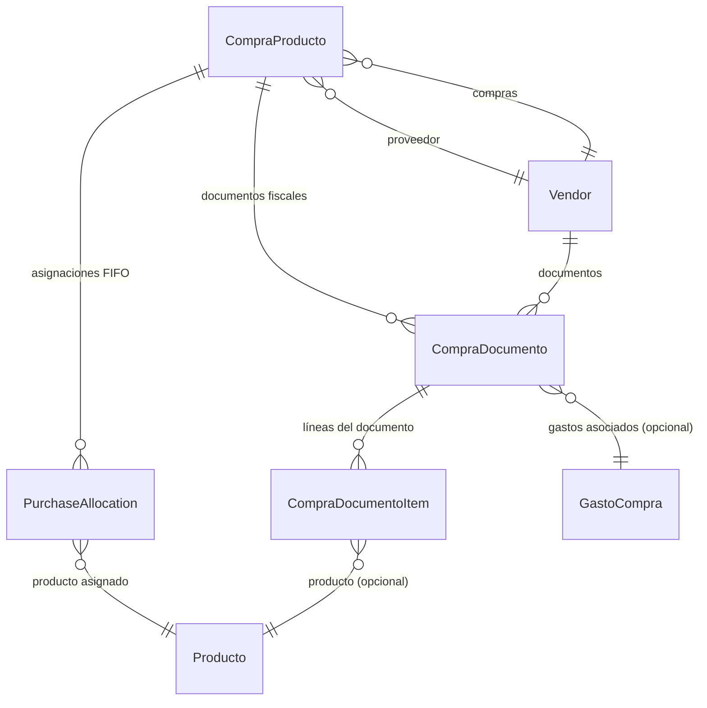

# Compras de Productos

> **Feature**: `src/features/compras-productos/`
> **Modelos Prisma**: `CompraProducto`, `CompraDocumento`, `CompraDocumentoItem`, `PurchaseAllocation`, `GastoCompra`, `Vendor`
> **Ruta**: `/busy/compras`

---

## Descripción

Módulo de compras de productos a proveedores. Gestiona todo el ciclo de aprovisionamiento: registro de compras, documentos fiscales asociados, gastos de importación, asignación por lote (FIFO), y actualización automática de stock y costos.

## Modelos de Datos



| Modelo | Propósito | PK |
|--------|-----------|----|
| `CompraProducto` | Registro de compra de productos a proveedor | `compraId` |
| `CompraDocumento` | Documento fiscal de una compra (factura, recibo) | `docId` |
| `CompraDocumentoItem` | Línea de detalle de un documento de compra | `itemId` |
| `PurchaseAllocation` | Asignación FIFO de productos por lote de compra | `id` |
| `GastoCompra` | Gastos asociados a una compra (transporte, aduana, etc.) | `gastoId` |

## Funcionalidades

### Registro de Compra

**Descripción**: Registra una compra con su proveedor, productos, cantidades, costos y documento fiscal.

**Reglas de negocio**:
- Proveedor obligatorio
- Puede incluir uno o más productos
- Calcula costo actualizado del producto
- Actualiza `StockUbicacion` con la nueva cantidad
- Registra cambio de costo si el precio varió
- Soporta aplicación de anticipos como forma de pago

### Documentos de Compra

**Descripción**: Cada compra puede tener uno o más documentos fiscales (factura del proveedor, recibo, etc.). Los documentos tienen items con producto, cantidad y precio.

### Asignación FIFO

**Descripción**: `PurchaseAllocation` rastrea qué lote de compra corresponde a cada unidad de stock. Se usa para FIFO en ventas y para calcular rentabilidad por lote.

### Filtros y Búsqueda

**Descripción**: Listado paginado con filtros por:
- Tipo de operación
- Estado
- Forma de pago
- Proveedor
- Rango de fechas
- Rango de montos
- Búsqueda textual (factura #, producto, proveedor)

## Server Actions

| Action | Propósito | Input destacado |
|--------|-----------|-----------------|
| `getComprasProductosAction` | Listar compras (paginado) | `{ page, limit, proveedorId?, fechaDesde?, ... }` |
| `getCompraProductoByIdAction` | Obtener compra por ID | `compraId: string` |
| `createCompraProductoAction` | Crear compra | `{ proveedorId, items, documentos?, gastoCompra?, ... }` |
| `updateCompraProductoAction` | Actualizar compra | `{ compraId, ... }` |
| `deleteCompraProductoAction` | Eliminar compra | `compraId: string` |

## Reglas de Negocio

1. **Período contable**: Las compras requieren período abierto (validado por `withPeriodValidation`).
2. **Stock**: Al crear compra se actualiza el stock y `StockUbicacion`.
3. **Costo**: Si el precio de costo cambia, se registra en `ProductoCostHistory`.
4. **Anticipos**: Se pueden aplicar anticipos a proveedores como parte del pago.
5. **FIFO**: `PurchaseAllocation` se crea para cada lote comprado.
6. **Soft delete**: Las compras eliminadas tienen `deletedAt` seteado.

## UI y Navegación

| Ruta | Componente | Propósito |
|------|-----------|-----------|
| `/busy/compras` | ComprasPage | Listado con filtros y búsqueda |

## Integraciones

| Módulo | Relación |
|--------|----------|
| `productos` | Actualización de stock, costos, historial |
| `vendors` | Proveedor de la compra |
| `contabilidad` | Registro contable de gastos de compra |
| `almacenes` | Ubicación destino del stock comprado |
| `gastosDE` | Gastos asociados (transporte, aduana) |
| `anticipos` | Aplicación de anticipos como pago |

## Permisos y Roles

| Acción | Rol requerido |
|--------|---------------|
| Ver compras | `admin`, `manager`, `economico` |
| Crear/Editar/Eliminar | `admin`, `manager` |

## Tests

- **Archivos**: `src/features/compras-productos/__tests__/`

```bash
pnpm test -- src/features/compras-productos/
```

## Notas Técnicas

- El modelo principal de consulta es `CompraDocumento` (no `CompraProducto`), que incluye la relación con proveedor, items, y gastos asociados.
- `createCompraProductoAction` envuelta con `withPeriodValidation`.
- `calcularPrecioCostoCompra()` en `src/lib/inventory-cost-utils.ts` determina el nuevo costo promedio del producto.
- `upsertStockUbicacion()` actualiza el stock en la ubicación destino.
- `getStockTotalProducto()` consulta el stock total disponible para verificar consistencia post-compra.
