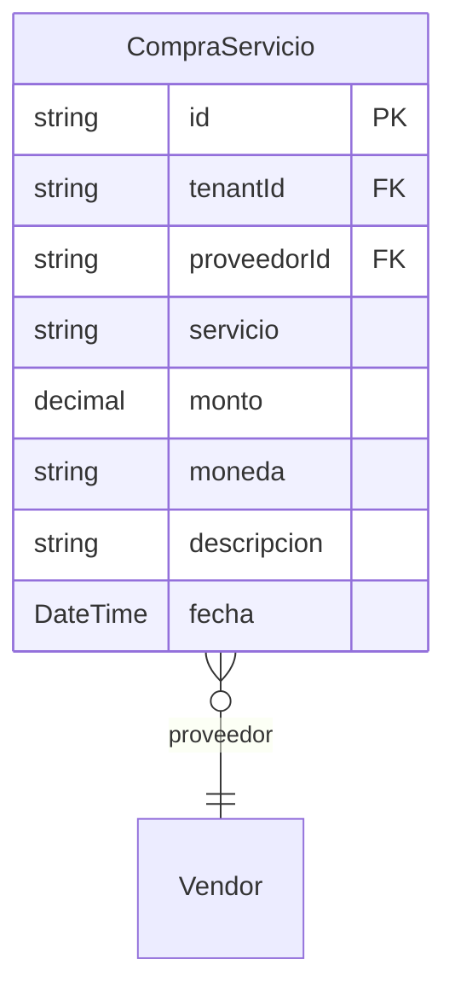

# Compras de Servicios

> **Feature**: `src/features/compras-servicios/`
> **Modelos Prisma**: `CompraServicio`, `Vendor`, `GastoCompra` (opcional)
> **Ruta**: `/busy/compras-servicios`

---

## Descripción

Módulo de registro de compras de servicios a proveedores. Complementa el módulo de compras de productos, permitiendo registrar servicios contratados (fletes, mantenimiento, consultoría, etc.) que no pasan por inventario.

## Modelos de Datos



| Modelo | Propósito | PK |
|--------|-----------|----|
| `CompraServicio` | Compra de un servicio a un proveedor | `id` |

## Funcionalidades

### CRUD de Compras de Servicios

**Descripción**: Operaciones básicas de registro, consulta, actualización y eliminación de compras de servicios.

**Campos**: proveedor, servicio (descripción), monto, moneda, descripción adicional, fecha.

## Server Actions

| Action | Propósito | Input | Output |
|--------|-----------|-------|--------|
| `getComprasServiciosAction` | Listar compras de servicios | `void` | `CompraServicio[]` |
| `getCompraServicioByIdAction` | Obtener compra por ID | `id: string` | `CompraServicio` |
| `createCompraServicioAction` | Crear compra de servicio | `{ proveedorId, servicio, monto, moneda?, descripcion?, fecha? }` | `CompraServicio` |
| `updateCompraServicioAction` | Actualizar compra | `{ id, ... }` | `CompraServicio` |
| `deleteCompraServicioAction` | Eliminar compra | `id: string` | `{ success }` |

## Reglas de Negocio

1. **Proveedor**: Obligatorio. Debe existir en el tenant.
2. **Servicio**: Descripción textual del servicio contratado.
3. **Monto**: Valor numérico obligatorio.
4. **Moneda**: Por defecto "CUP". Puede ser USD, EUR, etc.
5. **Fecha**: Por defecto la fecha actual.
6. **No afecta inventario**: A diferencia de compras de productos, no actualiza stock ni costos.
7. **Aislamiento**: Scoped por `tenantId`.

## UI y Navegación

| Ruta | Componente | Propósito |
|------|-----------|-----------|
| `/busy/compras-servicios` | ComprasServiciosPage | Listado y registro de compras de servicios |

## Integraciones

| Módulo | Relación |
|--------|----------|
| `vendors` | Proveedor del servicio |
| `compras-productos` | Complemento para compras que mezclan productos y servicios |
| `contabilidad` | Registro contable de gastos por servicios |
| `gastosDE` | Posible clasificación como gasto D/E |

## Permisos y Roles

| Acción | Rol requerido |
|--------|---------------|
| Ver compras de servicios | `admin`, `manager`, `economico` |
| Crear/Editar/Eliminar | `admin`, `manager` |

## Tests

- **Archivos**: `src/features/compras-servicios/__tests__/`

```bash
pnpm test -- src/features/compras-servicios/
```

## Notas Técnicas

- Es un modelo simple comparado con `compras-productos`: no tiene items, documentos, asignación FIFO ni gastos asociados.
- No hay `withPeriodValidation` — las compras de servicios no afectan períodos contables directamente.
- El campo `servicio` es textual (no referencia al catálogo de servicios), lo que permite registrar servicios no estandarizados.
