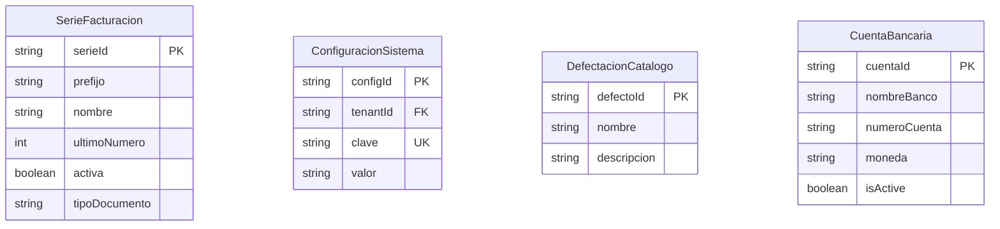

# Configuración

> **Feature**: `src/features/configuracion/`
> **Modelos Prisma**: `SerieFacturacion`, `CuentaBancaria`, `ConfiguracionSistema`, `DefectacionCatalogo`
> **Ruta**: `/busy/admin/configuracion`

---

## Descripción

Módulo de configuración general del sistema. Agrupa ajustes que no pertenecen a un módulo específico pero son necesarios para la operación del negocio: series de facturación, configuración de defectaciones, y consultas globales (cuentas bancarias activas, siguiente número de serie).

## Modelos de Datos

| Modelo | Propósito |
|--------|-----------|
| `SerieFacturacion` | Series fiscales con prefijo, numeración y tipo de documento |
| `ConfiguracionSistema` | Pares clave-valor para configuración genérica del sistema |
| `DefectacionCatalogo` | Catálogo de defectos para control de calidad y reparaciones |
| `CuentaBancaria` | Cuentas bancarias de la empresa (consultada globalmente) |

## Funcionalidades

### Series de Facturación

**Descripción**: Configuración de series fiscales para la emisión de facturas, notas de crédito y notas de débito. Cada serie define un prefijo (ej: "FAC-", "NC-"), un tipo de documento, y un contador numérico.

**Componente**: `SeriesConfigPage`

### Defectaciones

**Descripción**: Catálogo de defectos predefinidos usados en el taller de reparaciones y control de calidad. Permite definir tipos de fallas o problemas estándar.

**Componente**: `DefectacionesEditorPanel`

### Consultas Globales

- `getCuentasBancariasAction` — Lista todas las cuentas bancarias activas (usado por múltiples módulos).
- `getNextSerieNumberAction` — Calcula el próximo número disponible para una serie dado su prefijo.

## Server Actions

| Action | Propósito | Input | Output |
|--------|-----------|-------|--------|
| `getCuentasBancariasAction` | Listar cuentas bancarias activas | `void` | `CuentaBancaria[]` |
| `getNextSerieNumberAction` | Calcular próximo número de serie | `prefijo: string` | `{ nextNumber, prefijo, preview }` |

## Reglas de Negocio

1. Las series de facturación tienen un contador (`ultimoNumero`) que se incrementa con cada factura emitida.
2. Una serie puede estar activa o inactiva. Solo las series activas pueden emitir documentos.
3. Cada tipo de documento (factura, NC, ND) puede tener múltiples series.
4. `getNextSerieNumberAction` calcula el preview del próximo número (NO incrementa el contador — eso ocurre al emitir).

## UI y Navegación

| Ruta | Componente | Propósito |
|------|-----------|-----------|
| `/busy/admin/configuracion` | ConfigPage | Página principal de configuración |
| — | `SeriesConfigPage` | Gestión de series de facturación |
| — | `DefectacionesEditorPanel` | Editor de catálogo de defectaciones |

## Integraciones

| Módulo | Relación |
|--------|----------|
| `facturas` | Usa `SerieFacturacion` para emitir documentos fiscales |
| `series-facturacion` | Módulo dedicado a series (CRUD avanzado) |
| `reparaciones` | Usa `DefectacionCatalogo` para clasificar fallas |
| `contabilidad` | Consulta cuentas bancarias activas |

## Permisos y Roles

| Acción | Rol requerido |
|--------|---------------|
| Ver configuraciones | `admin`, `manager` |
| Editar series | `admin`, `manager` |
| Editar defectaciones | `admin`, `manager` |

## Tests

- **Archivos**: `src/features/configuracion/__tests__/` (si existe)

## Notas Técnicas

- `getCuentasBancariasAction` es usada por múltiples features como helper global.
- `getNextSerieNumberAction` es una operación de solo lectura — NO modifica el contador.
- El módulo `configuracion` es un feature "paraguas" que agrupa configuraciones menores. Features de configuración más complejas (series, cuentas bancarias) tienen su propio módulo dedicado.
- `ConfiguracionSistema` (modelo) está disponible para configuración genérica clave-valor pero no tiene UI dedicada aún.
