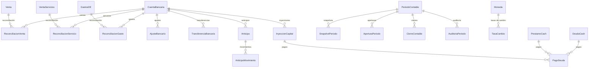

# Contabilidad

> **Feature**: `src/features/contabilidad/`
> **Ruta**: `/busy/finanzas`

---

## Descripción

El módulo de contabilidad es el más grande y complejo del sistema. Agrupa la gestión financiera completa: cuentas bancarias, cuentas por cobrar y pagar, anticipos, deudas, préstamos, períodos contables, reconciliación bancaria, tipos de pago, moneda y tasas de cambio, cierres contables e inyecciones de capital.

Está organizado en múltiples archivos de Server Actions y componentes, divididos por subdominio.

---

## Estructura del Módulo

```
src/features/contabilidad/
├── actions.ts                        # Resumen financiero, transferencias bancarias
├── actions-ajustes-bancarios.ts      # Ajustes bancarios
├── actions-anticipos.ts              # Anticipos a proveedores/clientes
├── actions-capital.ts                # Inyecciones de capital
├── actions-cierres.ts                # Cierres contables
├── actions-cuentas.ts               # Cuentas por cobrar y pagar
├── actions-cuentas-bancarias.ts      # CRUD cuentas bancarias
├── actions-deudas-cash.ts            # Deudas de caja
├── actions-exchange.ts               # Monedas y tasas de cambio
├── actions-periodos.ts               # Períodos contables
├── actions-prestamos-cash.ts         # Préstamos otorgados
├── actions-reconciliacion.ts         # Reconciliación bancaria
├── actions-tipos-pago.ts            # Tipos de pago
├── cuadre-queries.ts                # Queries de cuadre y reportes
├── components/                       # 40+ componentes React
│   ├── CuentasBancariasTab/
│   ├── CuentasPorCobrarTab/
│   ├── CuentasPorPagarTab/
│   ├── AnticiposTab/
│   ├── ReconciliacionTab/
│   ├── PeriodosTab/
│   └── ...
└── api/                              # API handlers legacy
```

---

## Submódulos

| Submódulo | Archivo | Propósito |
|-----------|---------|-----------|
| [Períodos Contables](periodos-contables.md) | `actions-periodos.ts` | Apertura, cierre, snapshots, aprobación |
| [Reconciliación Bancaria](reconciliacion.md) | `actions-reconciliacion.ts` | Conciliación de ventas, servicios, gastos |
| [Ajustes, Anticipos y Deudas](ajustes-bancarios.md) | Varios | Ajustes, anticipos, deudas cash, préstamos |
| Cuentas Bancarias | `actions-cuentas-bancarias.ts` | CRUD de cuentas bancarias |
| Cuentas por Cobrar/Pagar | `actions-cuentas.ts` | Gestión de CxC y CxP |
| Moneda y Exchange | `actions-exchange.ts` | Monedas, tasas de cambio, conversión |
| Tipos de Pago | `actions-tipos-pago.ts` | Catálogo de métodos de pago |
| Cierres Contables | `actions-cierres.ts` | Registro de cierres de período |
| Capital | `actions-capital.ts` | Inyecciones de capital y pagos |

---

## Modelos de Datos



---

## Funcionalidades Principales

### Cuentas Bancarias

CRUD completo de cuentas bancarias del negocio. Cada cuenta tiene: nombre del banco, número de cuenta, moneda, tipo (ahorro/corriente), estado activo/inactivo.

### Cuentas por Cobrar (CxC)

Gestión de cuentas por cobrar a clientes. Originadas de ventas a crédito o facturas. Con estados: `PENDIENTE`, `PARCIAL`, `PAGADA`, `VENCIDA` y métricas de antigüedad.

### Cuentas por Pagar (CxP)

Control de cuentas por pagar a proveedores. Con tipos: comercial (compra de productos) y no comercial (servicios, gastos).

### Tipos de Pago

Catálogo de métodos de pago del sistema: efectivo, transferencia, cheque, tarjeta, etc.

### Moneda y Tasas de Cambio

Gestión de monedas (CUP, USD, EUR) y tasas de cambio históricas. Permite conversión entre monedas en cualquier fecha.

### Resumen Financiero

`getResumenFinancieroAction` — Resumen de ingresos, gastos, saldos por período con filtros por cuenta y moneda.

### Transferencias Bancarias

Registro de transferencias entre cuentas bancarias propias, con soporte para diferentes monedas y tasas de cambio.

---

## Server Actions (principales)

| Action | Archivo | Propósito |
|--------|---------|-----------|
| `getCuentasBancariasAction` | `actions-cuentas-bancarias.ts` | Listar cuentas activas |
| `getCuentasPorCobrarAction` | `actions-cuentas.ts` | Listar CxC con métricas |
| `getCuentasPorPagarAction` | `actions-cuentas.ts` | Listar CxP |
| `getMonedasAction` | `actions-exchange.ts` | Monedas disponibles |
| `getTasasActualesAction` | `actions-exchange.ts` | Tasas de cambio actuales |
| `convertMoneyAction` | `actions-exchange.ts` | Conversión entre monedas |
| `getResumenFinancieroAction` | `actions.ts` | Resumen financiero del período |
| `getTransferenciasBancariasAction` | `actions.ts` | Transferencias entre cuentas |
| `getTiposPagoAction` | `actions-tipos-pago.ts` | Métodos de pago disponibles |
| `getInyeccionesCapitalAction` | `actions-capital.ts` | Inyecciones de capital |
| `getCierresAction` | `actions-cierres.ts` | Cierres contables registrados |

---

## Reglas de Negocio (transversales)

1. **Feature flag**: Todas las operaciones requieren `contabilidad` habilitado en el plan.
2. **Período contable**: Las operaciones que modifican saldos requieren período abierto (`withPeriodValidation`).
3. **Multi-moneda**: Soporta CUP, USD, EUR con conversión automática.
4. **Aislamiento**: Todos los modelos scoped por `tenantId`.
5. **Auditoría**: Operaciones críticas registradas via `AuditLogService.log()`.

---

## UI y Navegación

| Ruta | Componentes principales |
|------|----------------------|
| `/busy/finanzas` | Múltiples tabs: Cuentas Bancarias, CxC, CxP, Anticipos, Reconciliación, Períodos |

---

## Integraciones

| Módulo | Relación |
|--------|----------|
| `ventas` | Alimentan CxC y reconciliación |
| `facturas` | Origen de CxC |
| `compras-productos` | Origen de CxP y gastos |
| `gastosDE` | Gastos reconciliables |
| `empleados` | Nómina como gasto operativo |
| `productos` | Costos y rentabilidad |

---

## Permisos y Roles

| Acción | Rol requerido |
|--------|---------------|
| Ver contabilidad | `admin`, `manager`, `economico` |
| Crear/Editar cuentas | `admin`, `manager` |
| Reconciliar | `admin`, `manager`, `economico` |
| Cierre contable | `admin`, `manager` |

---

## Tests

```bash
pnpm test -- src/features/contabilidad/
```
