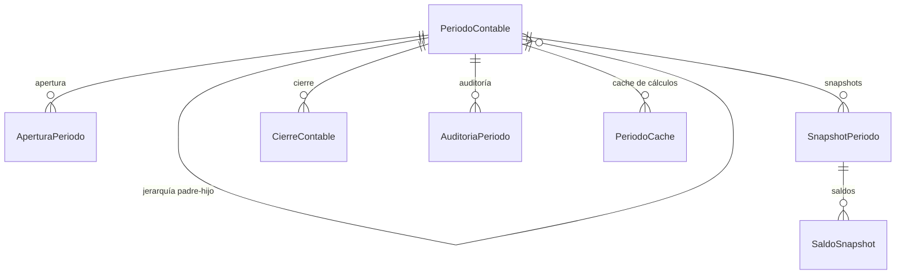

# Períodos Contables

> **Submódulo de**: [Contabilidad](README.md)
> **Server Actions**: `src/features/contabilidad/actions-periodos.ts`
> **Servicios**: `src/lib/services/periodo-contable-service.ts`
> **Modelos**: `PeriodoContable`, `AperturaPeriodo`, `SnapshotPeriodo`, `SaldoSnapshot`, `PeriodoCache`, `AuditoriaPeriodo`

> ⚠️ **Documentación completa disponible en**: `docs/modules/contabilidad/periodos-contables.md`
> Este documento es un resumen. Para la especificación detallada, leer el doc completo.

---

## Descripción

Sistema de gestión de períodos contables con enfoque mixto (caja + devengo). Permite abrir, cerrar, aprobar y reabrir períodos a nivel diario, mensual y anual, con trazabilidad completa de cada operación financiera.

## Ciclo de Vida del Período

```
BORRADOR → ABIERTO → EN_CIERRE → CERRADO → APROBADO
               ↑                               │
               └────── REABIERTO ←─────────────┘
```

Solo los estados `ABIERTO` y `REABIERTO` aceptan nuevas operaciones.

## Jerarquía

```
ANUAL (2026)
├── MENSUAL (2026-01)
│   ├── DIARIO (2026-01-01)
│   ├── DIARIO (2026-01-02)
│   └── ...
├── MENSUAL (2026-02)
└── ...
```

## Modelos de Datos



## Funcionalidades Clave

| Acción | Propósito |
|--------|-----------|
| Apertura | Abre un período con arrastre de saldos del período anterior |
| Cierre | Cierra un período (consolida diarios en mensual, mensuales en anual) |
| Reapertura | Reabre un período ya cerrado (con auditoría obligatoria) |
| Aprobación | Aprobación final del cierre por usuario autorizado |
| Snapshots | Captura de saldos en un punto del tiempo para reportes históricos |

## Reglas de Negocio

1. **Jerarquía estricta**: Un mensual no puede cerrarse si tiene diarios abiertos.
2. **Sin retroceso**: No se pueden modificar períodos cerrados sin reapertura autorizada.
3. **Auditoría**: Cada cambio de estado se registra con usuario, timestamp y motivo.
4. **Cache**: Los cálculos de período se cachean en `PeriodoCache` e invalidan al modificar operaciones.
5. **Evento contable**: Subledger normalizado con líneas de doble partida (débito/crédito), origen (venta, gasto, etc.) y criterio (CAJA o DEVENGO).

## Enums

| Enum | Valores |
|------|---------|
| `TipoPeriodo` | `DIARIO`, `MENSUAL`, `ANUAL`, `PERSONALIZADO` |
| `EstadoPeriodo` | `BORRADOR`, `ABIERTO`, `EN_CIERRE`, `CERRADO`, `APROBADO`, `BLOQUEADO` |
| `CategoriaPeriodo` | `FISCAL`, `CONTABLE`, `OPERATIVO` |
| `EventoAuditoria` | `APERTURA`, `CIERRE`, `REAPERTURA`, `AJUSTE`, `APROBACION` |
| `ModoContable` | `AUTOMATICO`, `MANUAL` |
