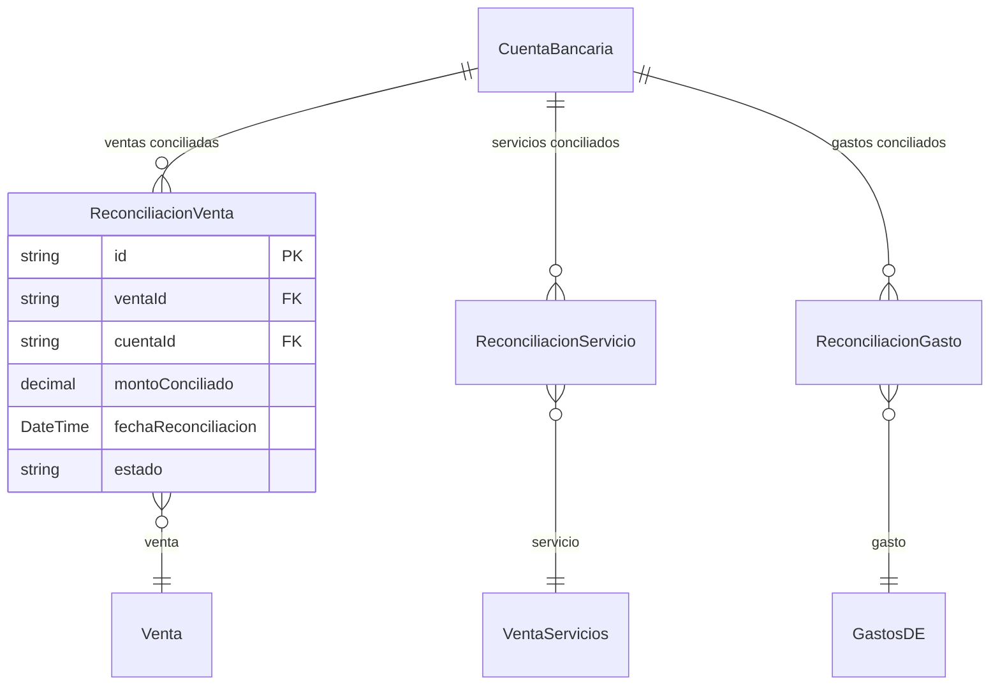

# Reconciliación Bancaria

> **Submódulo de**: [Contabilidad](README.md)
> **Server Actions**: `src/features/contabilidad/actions-reconciliacion.ts`

---

## Descripción

Proceso de verificación entre los movimientos registrados en el sistema (ventas, servicios, gastos) y los movimientos reales de la cuenta bancaria. Permite conciliar cada transacción individualmente, garantizando que los registros contables coincidan con el estado real de las cuentas.

## Modelos de Datos

| Modelo | Propósito |
|--------|-----------|
| `ReconciliacionVenta` | Conciliación de una venta contra cuenta bancaria |
| `ReconciliacionServicio` | Conciliación de un servicio contra cuenta bancaria |
| `ReconciliacionGasto` | Conciliación de un gasto contra cuenta bancaria |

## Funcionalidades

### Reconciliación de Ventas

**Descripción**: Lista ventas pendientes de reconciliar, permite conciliarlas contra una cuenta bancaria especificando monto, fecha y tipo de pago.

- `getVentasPendientesAction` — Ventas sin reconciliar
- `getHistorialReconciliacionVentasAction` — Historial de conciliaciones realizadas
- `reconciliarVentaAction` — Concilia una venta contra una cuenta

### Reconciliación de Servicios

**Descripción**: Similar a ventas pero para servicios (`VentaServicios`).

### Reconciliación de Gastos

**Descripción**: Concilia gastos de distribución y explotación (`GastosDE`) contra cuentas bancarias.

### Stats de Reconciliación

**Descripción**: `getReconciliacionStatsAction` — Métricas de reconciliación: total pendiente, total reconciliado, brecha.

## Server Actions

| Action | Propósito |
|--------|-----------|
| `getReconciliacionStatsAction` | Estadísticas de reconciliación |
| `getVentasPendientesAction` | Ventas pendientes de conciliar |
| `getHistorialReconciliacionVentasAction` | Historial de ventas conciliadas |
| `reconciliarVentaAction` | Conciliar una venta |
| `getServiciosPendientesAction` | Servicios pendientes de conciliar |
| `getHistorialReconciliacionServiciosAction` | Historial de servicios conciliados |
| `reconciliarServicioAction` | Conciliar un servicio |
| `getGastosPendientesAction` | Gastos pendientes de conciliar |
| `getHistorialReconciliacionGastosAction` | Historial de gastos conciliados |
| `reconciliarGastoAction` | Conciliar un gasto |

## Reglas de Negocio

1. Una transacción solo puede reconciliarse una vez contra una cuenta específica.
2. El monto reconciliado no puede exceder el total de la transacción.
3. La reconciliación requiere que el período contable esté abierto.
4. Cada reconciliación se asocia a un tipo de pago registrado en el sistema.

## UI y Navegación

| Ruta | Componentes |
|------|------------|
| `/busy/finanzas` (tab Reconciliación) | PendientesTable, HistorialTable, ReconciliarDialog |
