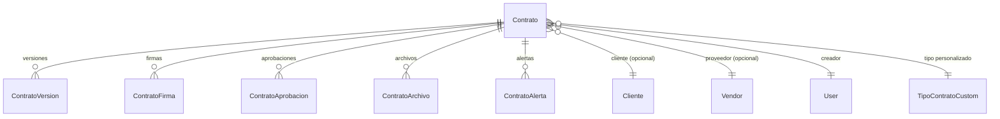

# Contratos

> **Feature**: `src/features/contratos/`
> **Modelos Prisma**: `Contrato`, `ContratoVersion`, `ContratoFirma`, `ContratoAprobacion`, `ContratoArchivo`, `ContratoAlerta`, `TipoContratoCustom`
> **Ruta**: `/busy/contratos`

---

## Descripción

Módulo de gestión de contratos con clientes y proveedores. Soporta ciclo de vida completo: creación, versionado, firmas digitales, aprobaciones, archivos adjuntos, alertas de vencimiento y numeración automática.

## Modelos de Datos

| Modelo | Propósito |
|--------|-----------|
| `Contrato` | Contrato con cliente o proveedor |
| `ContratoVersion` | Versiones del contrato (historial) |
| `ContratoFirma` | Firmas digitales |
| `ContratoAprobacion` | Aprobaciones requeridas |
| `ContratoArchivo` | Archivos adjuntos (PDFs, escaneos) |
| `ContratoAlerta` | Alertas de vencimiento programadas |
| `TipoContratoCustom` | Tipos de contrato personalizados |

## Funcionalidades

### CRUD de Contratos

**Descripción**: Creación, consulta, actualización y eliminación de contratos. Incluye cliente o proveedor, fechas, monto, moneda, y estado.

**Estados**: `BORRADOR`, `ACTIVO`, `VENCIDO`, `RENOVADO`, `CANCELADO`.

### Numeración Automática

**Descripción**: Cada contrato recibe un número consecutivo formateado según tipo, año y secuencia (`TIPO-2026-001`). Implementado en `numeroContratoGenerator.ts`.

### Versionado

**Descripción**: Cada modificación crea una nueva `ContratoVersion` con el contenido completo, preservando el historial.

### Firmas Digitales

**Descripción**: Registro de firmas de las partes involucradas. Cada firma tiene fecha y tipo (firmante).

### Aprobaciones

**Descripción**: Flujo de aprobación con múltiples aprobadores. Cada aprobación registra quién, cuándo y el resultado.

### Alertas

**Descripción**: Alertas automáticas programadas para fechas clave: vencimiento, renovación, pagos.

## Server Actions

| Action | Propósito |
|--------|-----------|
| `getContratosAction` | Listar contratos (con include completo) |
| `getContratoByIdAction` | Obtener contrato con detalle |
| `createContratoAction` | Crear contrato (genera número automático) |
| `updateContratoAction` | Actualizar datos |
| `deleteContratoAction` | Eliminar contrato |
| Acciones bulk | Cambio de estado masivo, eliminación masiva |

## Reglas de Negocio

1. **Feature flag**: Requiere `contratos` habilitado.
2. **Numeración**: Automática, formato `{prefijo}-{año}-{secuencial}`.
3. **Versionado**: Cada modificación sustancial crea una nueva versión.
4. **Alertas**: Se generan automáticamente al crear el contrato basado en `fechaVencimiento`.

## Integraciones

| Módulo | Relación |
|--------|----------|
| `clientes` | Contrato con cliente |
| `vendors` | Contrato con proveedor |
| `notificaciones` | Alertas de vencimiento |

## Permisos

| Acción | Rol |
|--------|-----|
| Ver | `admin`, `manager` |
| Crear/Editar | `admin`, `manager` |
| Aprobar/Firmar | `admin`, `manager` |
