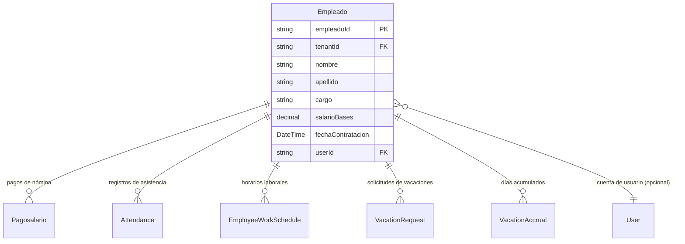

# Empleados

> **Feature**: `src/features/empleados/`
> **Modelos Prisma**: `Empleado`, `Attendance`, `EmployeeWorkSchedule`, `VacationRequest`, `VacationAccrual`, `User`
> **Ruta**: `/busy/empleados`

---

## Descripción

Módulo de gestión de recursos humanos. Administra los datos laborales de los empleados: contratación, salario base, cargo, asistencia, horarios laborales y vacaciones. Los empleados pueden tener o no una cuenta de usuario asociada.

## Modelos de Datos



| Modelo | Propósito | PK |
|--------|-----------|----|
| `Empleado` | Datos laborales del empleado | `empleadoId` |
| `Attendance` | Registro diario de asistencia | `attendanceId` |
| `EmployeeWorkSchedule` | Horario laboral del empleado | `scheduleId` |
| `VacationRequest` | Solicitud de vacaciones | `requestId` |
| `VacationAccrual` | Acumulación de días de vacaciones | `accrualId` |

## Funcionalidades

### CRUD de Empleados

**Descripción**: Registro y gestión de datos laborales de empleados.

**Campos**: nombre, apellido, cargo, salario base, fecha de contratación, usuario asociado (opcional).

### Asistencia (`Attendance`)

**Descripción**: Registro diario de entrada/salida de los empleados. `getAsistenciaAction` lista registros con filtros por fecha y empleado.

**Componentes**: `asistencia-form.tsx`, `enhanced-asistencia-form.tsx`, `attendance-history-view.tsx`

### Horarios Laborales (`EmployeeWorkSchedule`)

**Descripción**: Define los horarios y días laborales de cada empleado. Gestionado via `work-schedule-manager.tsx`.

### Vacaciones

**Descripción**: Sistema de solicitud y aprobación de vacaciones con acumulación automática de días.

- `VacationAccrual` — seguimiento de días acumulados
- `VacationRequest` — solicitudes con estado (pendiente, aprobada, rechazada)
- Cálculo automático de días disponibles según normativa

### Cálculo de Nómina

**Descripción**: `calculatePayrollFormulas()` calcula salarios, comisiones y deducciones según fórmulas configurables. Ver [Pago de Salario](pago-salario/README.md).

## Server Actions

| Action | Propósito | Input |
|--------|-----------|-------|
| `getEmpleadosAction` | Listar empleados del tenant | `void` |
| `getEmpleadoByIdAction` | Obtener empleado con últimas ventas | `id: string` |
| `createEmpleadoAction` | Crear empleado | `{ nombre, apellido, cargo, salarioBases, fechaContratacion, ... }` |
| `updateEmpleadoAction` | Actualizar empleado | `{ empleadoId, ... }` |
| `deleteEmpleadoAction` | Eliminar empleado | `empleadoId: string` |

## Reglas de Negocio

1. **Feature flag**: Requiere `empleados` habilitado en el plan.
2. **Cargo y nombre**: Obligatorios.
3. **Cuenta de usuario**: Un empleado puede tener un `User` asociado para acceso al sistema (rol `dependiente`).
4. **Salario base**: Campo `salarioBases` (nótase el plural) es el salario base mensual.
5. **Aislamiento**: Scoped por `tenantId`.
6. **Protección**: No se puede eliminar un empleado con pagos de salario asociados.

## UI y Navegación

| Ruta | Componente | Propósito |
|------|-----------|-----------|
| `/busy/empleados` | `EmpleadosPage` | Listado y gestión de empleados |
| — | `empleados-form.tsx` | Formulario de creación/edición |
| — | `enhanced-empleados-form.tsx` | Formulario mejorado |
| — | `nomina-view.tsx` | Visualización de nómina por empleado |
| — | `empleados-nomina-content.tsx` | Contenido de nómina |
| — | `asistencia-form.tsx` | Registro de asistencia |
| — | `vacaciones-form.tsx` | Solicitud de vacaciones |
| — | `work-schedule-manager.tsx` | Gestión de horarios |

## Integraciones

| Módulo | Relación |
|--------|----------|
| `pago-salario` | Cálculo y registro de pagos de nómina |
| `admin` | Creación automática de empleado al asignar rol `dependiente` |
| `turnos-pos` | Independiente, pero relacionado (empleados tienen turnos) |
| `auth` | Asociación empleado ↔ user |

## Permisos y Roles

| Acción | Rol requerido |
|--------|---------------|
| Ver empleados | `admin`, `manager`, `economico` |
| Crear/Editar/Eliminar | `admin`, `manager` |
| Gestionar asistencia | `admin`, `manager` |

## Tests

- **Archivos**: `src/features/empleados/__tests__/`

```bash
pnpm test -- src/features/empleados/
```

## Notas Técnicas

- `Empleado` usa `salarioBases` (no `salarioBase`) como nombre de campo — consistente con el esquema original.
- `getEmpleadoByIdAction` incluye las últimas 10 ventas del empleado para vista rápida de rendimiento.
- Las fórmulas de nómina están en `src/lib/payroll-formulas.ts` y soportan comisiones dinámicas.
- `createEmpleadoAction` exige `requireManagerRole` (solo manager puede crear empleados).
