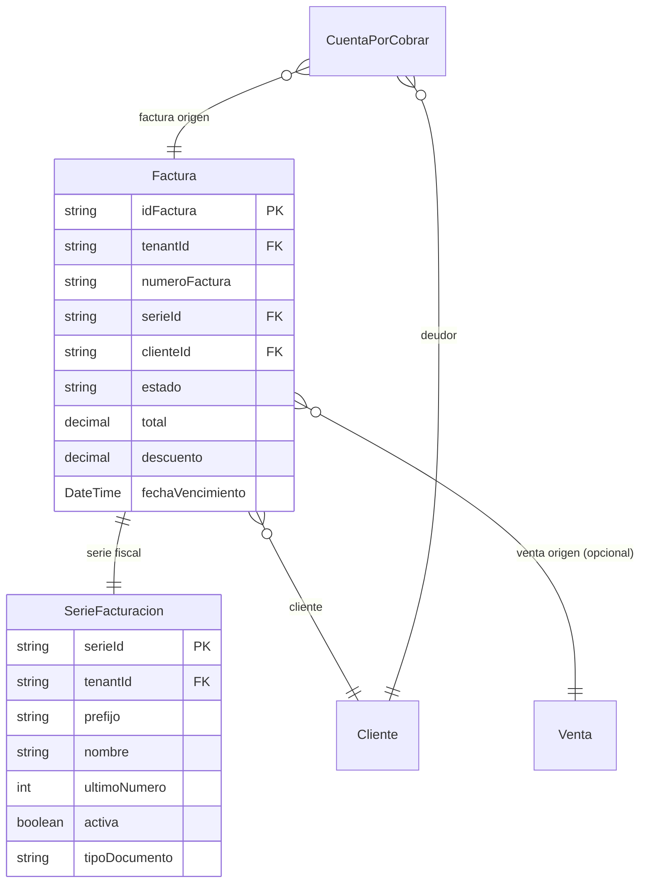

# Facturación

> **Feature**: `src/features/facturas/` + `src/features/series-facturacion/`
> **Modelos Prisma**: `Factura`, `SerieFacturacion`, `CuentaPorCobrar`, `Venta`
> **Ruta**: `/busy/facturacion`

---

## Descripción

Módulo de facturación electrónica. Gestiona la emisión de facturas, notas de crédito y notas de débito. Las facturas se generan automáticamente al registrar ventas (con cliente), o pueden crearse manualmente. Cada factura pertenece a una **Serie de Facturación** que define su prefijo y numeración.

## Modelos de Datos



| Modelo | Propósito | PK |
|--------|-----------|----|
| `Factura` | Documento fiscal emitido | `idFactura` |
| `SerieFacturacion` | Serie fiscal con prefijo y numeración | `serieId` |
| `CuentaPorCobrar` | Cuenta por cobrar generada por factura | `cxcId` |

## Funcionalidades

### Emisión de Facturas

**Descripción**: Las facturas se emiten automáticamente al crear una venta con cliente, o manualmente desde el módulo de facturación. Usan una **Serie de Facturación** activa para asignar el número de factura.

**Reglas**:
- Requiere feature flag `facturacion`
- Asigna número correlativo según la serie
- Soporta descuentos, impuestos y cargo de transporte
- Calcula subtotal, impuestos y total
- Soporta múltiples monedas con tasa de cambio

### Gestión de Estado

**Descripción**: Cada factura tiene un estado (`PENDIENTE`, `PAGADA`, `VENCIDA`, `CANCELADA`) que se actualiza manualmente o automáticamente al registrar pagos.

### Cuentas por Cobrar

**Descripción**: Al emitir una factura a crédito, se genera automáticamente una `CuentaPorCobrar` asociada. Las cuentas por cobrar tienen su propio estado y seguimiento.

### Series de Facturación

**Descripción**: Configuración de series fiscales. Cada serie define:
- Prefijo (ej: "FAC-", "NC-", "ND-")
- Tipo de documento (factura, nota de crédito, nota de débito)
- Contador numérico (`ultimoNumero`)
- Estado activa/inactiva

## Server Actions

### Facturas

| Action | Propósito | Input destacado |
|--------|-----------|-----------------|
| `getFacturasAction` | Listar facturas (paginado) | `{ page, limit, estado?, clienteId?, serieId?, fechaInicio?, fechaFin?, search? }` |
| `getFacturaByIdAction` | Obtener factura por ID | `id: string` |
| `updateFacturaAction` | Actualizar estado/datos | `{ idFactura, estado?, ... }` |
| `deleteFacturaAction` | Eliminar factura | `idFactura: string` |

### Series de Facturación

| Action | Propósito |
|--------|-----------|
| `getSeriesFacturacionAction` | Listar series del tenant |
| `createSerieFacturacionAction` | Crear serie |
| `updateSerieFacturacionAction` | Actualizar serie |
| `deleteSerieFacturacionAction` | Eliminar serie |

## Reglas de Negocio

1. **Feature flag**: `facturacion` debe estar habilitado en el plan.
2. **Numeración**: Cada factura recibe el próximo número disponible de su serie (auto-incremental).
3. **Serie activa**: Solo se pueden emitir facturas en series activas.
4. **Estados**: `PENDIENTE → PAGADA | VENCIDA | CANCELADA`. No se puede retroceder de PAGADA a PENDIENTE.
5. **Facturas vencidas**: Si `fechaVencimiento` pasó y la factura sigue `PENDIENTE`, pasa a `VENCIDA`.
6. **Protección**: No se puede eliminar una factura con cuentas por cobrar asociadas (sin antes cancelarlas).

## UI y Navegación

| Ruta | Componente | Propósito |
|------|-----------|-----------|
| `/busy/facturacion` | `FacturasContent` | Listado con filtros y acciones |
| — | `EstadoFacturaBadge` | Badge de estado visual |
| — | `ActualizarEstadoFactura` | Diálogo de cambio de estado |

## Integraciones

| Módulo | Relación |
|--------|----------|
| `ventas` | Las ventas con cliente generan facturas automáticas |
| `clientes` | El cliente es obligatorio en la factura |
| `contabilidad` | Las facturas alimentan cuentas por cobrar y reportes |
| `configuracion` | `getNextSerieNumberAction` para preview de numeración |
| `series-facturacion` | CRUD de series |

## Permisos y Roles

| Acción | Rol requerido |
|--------|---------------|
| Ver facturas | `admin`, `manager`, `economico` |
| Emitir/Editar | `admin`, `manager` |
| Anular/Cancelar | `admin`, `manager` |
| Gestionar series | `admin`, `manager` |

## Tests

- **Archivos**: `src/features/facturas/__tests__/`, `src/features/series-facturacion/__tests__/`

```bash
pnpm test -- src/features/facturas/
```

## Notas Técnicas

- Las facturas se serializan con `Number()` para todos los campos decimales (subtotal, total, descuento, impuestos, etc.).
- `getFacturasAction` incluye las relaciones `serie`, `cliente`, y `venta` con `puntoDeVenta` anidado.
- Los montos se almacenan como `Decimal` en Prisma y se convierten a `Number` en las respuestas para evitar problemas de serialización.
- Las series de facturación se gestionan tanto desde `configuracion` como desde `series-facturacion` (módulo dedicado).
