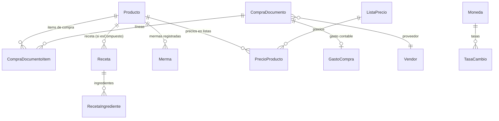

# Ficha de Costo

> **Feature**: `src/features/ficha-costo/`
> **Modelos Prisma**: `Producto`, `Receta`, `RecetaIngrediente`, `CompraDocumento`, `CompraDocumentoItem`, `GastoCompra`, `Merma`, `TasaCambio`, `PrecioProducto`, `ListaPrecio`
> **Ruta**: `/busy/products/[id]/ficha-costo`

---

## Descripción

El módulo Ficha de Costo consolida en una sola vista todos los datos dispersos del sistema que afectan el costo y la rentabilidad de un producto: compras registradas, gastos asociados, recetas (para productos compuestos), mermas, listas de precios y tasas de cambio.

La ficha se calcula **on-demand** a partir de los datos existentes — no se persiste en una nueva tabla — y expone cuatro dimensiones:

1. **Costo real calculado** (CPP para productos simples; materiales + MO + indirectos para compuestos).
2. **Margen bruto** contra el precio de venta, con estado accionable (saludable, bajo, pérdida).
3. **Variación vs costo estándar** (proxy: el `precioCosto` cargado en el producto).
4. **Merma esperada vs real** (últimos 30 días, con porcentaje de impacto sobre stock).

El objetivo es responder con la mayor veracidad posible: "¿cuánto me cuesta este producto, cuánto me deja, y por qué?"

## Modelos de Datos



| Modelo | Propósito en la ficha | PK |
|--------|-------------------------|-----|
| `Producto` | Producto del que se calcula la ficha | `id` |
| `CompraDocumentoItem` | Líneas de compra de los últimos 12 meses (input del CPP) | `compraDocumentoItemId` |
| `CompraDocumento` | Cabecera con proveedor, factura, fecha, gastoCompraId | `compraDocumentoId` |
| `GastoCompra` | Gasto contable asociado a la factura (se prorratea en el CPP) | `gastoCompraId` |
| `Receta` | Receta del producto (solo si `esCompuesto`) | `recetaId` |
| `RecetaIngrediente` | Ingredientes con cantidad y desperdicio esperado | `id` |
| `Merma` | Mermas de los últimos 30 días (para merma esperada vs real) | `mermaId` |
| `ListaPrecio` / `PrecioProducto` | Listas de precios vigentes del producto | `id` |
| `TasaCambio` | Tasas de cambio para normalización multi-moneda | `tasaId` |

> **Decisión de diseño**: la ficha **no introduce un nuevo modelo Prisma**. El cálculo on-demand es lo suficientemente barato (12 meses de compras en una sola query) y los datos fuente ya son la verdad. Si en el futuro se requiere snapshot histórico para auditoría, agregar `model FichaCostoSnapshot` sin romper el cálculo on-demand.

## Funcionalidades

### Ficha resumen (CPP + margen + variación + merma)

**Descripción**: Vista principal con cuatro KPIs:

- **Costo calculado**: CPP (productos simples) o costo de materiales de la receta (compuestos).
- **Margen**: absoluto y porcentual vs `precioVenta`. Estado: `SALUDABLE` (≥10%), `BAJO` (0-10%), `PERDIDA` (<0%), `SIN_PRECIO` (precio=0).
- **Variación vs estándar**: `(costoReal - precioCosto) / precioCosto * 100`. Estado: `OK` (|Δ|≤5%), `MAYOR` (>+5%), `MENOR` (<-5%), `SIN_DATOS`.
- **Merma (30d)**: cantidad total, porcentaje sobre stock, desperdicio esperado promedio de la receta.

**Input**: `productoId`.

**Reglas de negocio**:
- El cálculo usa los últimos 12 meses de compras.
- El CPP se calcula solo con líneas activas (no soft-deleted).
- El gasto se prorratea por cantidad entre las líneas de cada documento.
- Los productos sin compras muestran estado vacío con advertencia.
- Los productos sin receta (compuestos sin receta) muestran error con link a crear receta.

**Output**: `FichaCostoData` con producto, costoCalculado, margen, variacion, merma, advertencias y fecha de cálculo.

### Historial de compras

**Descripción**: Tabla paginada con líneas de compra del producto, con filtros por rango de fechas. 20 items por página.

**Input**: `productoId`, `page`, `limit`, `fechaDesde`, `fechaHasta`, `proveedorId`.

**Reglas de negocio**:
- Ordenado por `fechaCompra` descendente.
- Filtros combinados con AND.
- Multi-tenant: solo ve líneas del tenant del usuario.

**Output**: `HistorialCostosData` con `items` (fecha, factura, proveedor, cantidad, precios) y `pagination`.

### Composición (productos compuestos)

**Descripción**: Desglose del costo de un producto compuesto con tres componentes:

- **Materiales**: suma de `cantidad × (1 + desperdicio/100) × CPP_ingrediente` por cada ingrediente.
- **Mano de obra**: input manual del usuario (no persistido en MVP).
- **Costos indirectos**: input manual del usuario (no persistido en MVP).

**Input**: `productoId`, `manoObra` (opcional), `indirectos` (opcional).

**Reglas de negocio**:
- MO e indirectos se validan como números ≥ 0.
- Ingredientes sin compras en 12 meses se reportan como `sinCosto` y se excluyen del total.
- La UI recalcula al cambiar los inputs (sin persistencia).

**Output**: `ComposicionCostoData` con `materiales`, `manoObra`, `indirectos`, `total`, `detalle[]` y `porcentajes`.

### Normalización multi-moneda

**Descripción**: Si la moneda del documento de compra difiere de la moneda base del tenant, se normaliza usando `TasaCambio`.

**Input**: lookup de tasas vía `precargarTasas(monedasOrigen, monedaDestino)`.

**Reglas de negocio**:
- Si origen = destino, no hay conversión (valor directo).
- Si no hay tasa exacta para la fecha, se usa la más reciente anterior (nota `TASA_APROXIMADA`).
- Si no hay tasa, retorna null (la action cae al precio original y registra advertencia).
- Hoy todas las compras se asumen CUP (el schema no expone `moneda` en `CompraDocumento`); el wiring queda listo para cuando se agregue el campo.

### Exportación a PDF

**Descripción**: Genera un PDF del contenido actual de la ficha usando `html2canvas` + `jspdf`.

**Reglas de negocio**:
- Carga dinámica de las dependencias para no inflar el bundle.
- El PDF incluye todas las tabs visibles.
- Paginación simple por altura.
- Nombre de archivo: `ficha-costo-{codigoProducto}-{YYYY-MM-DD}.pdf`.

### Alertas por margen bajo

**Descripción**: Cuando el margen calculado está en estado `BAJO` o `PERDIDA`, se agrega una advertencia al listado de la ficha.

**Reglas de negocio**:
- `BAJO` (0-10%): "Margen bajo: X% — considerar subir precio de venta o reducir costo".
- `PERDIDA` (<0%): "Margen negativo (X%): se vende a pérdida — revisar urgente".
- La alerta es informativa en MVP; la integración con el sistema de notificaciones push queda para fase futura.

### Listas de precios

**Descripción**: Vista read-only de las listas de precios en las que está incluido el producto con su precio vigente.

**Reglas de negocio**:
- Solo lectura desde la ficha; la edición se hace en el módulo `listas-precios`.
- Muestra todas las listas del tenant con su precio.

## Server Actions

Todas las acciones se definen en `src/features/ficha-costo/actions.ts`.

| Action | Propósito | Input | Output |
|--------|-----------|-------|--------|
| `getFichaCostoAction` | Devuelve la ficha consolidada (resumen completo) | `productoId: string` | `FichaCostoData` |
| `getHistorialCostosAction` | Líneas de compra paginadas con filtros | `{ productoId, page?, limit?, fechaDesde?, fechaHasta?, proveedorId? }` | `HistorialCostosData` |
| `getComposicionCostoAction` | Desglose de costo para producto compuesto | `{ productoId, manoObra?, indirectos? }` | `ComposicionCostoData` |
| `getListasPreciosProductoAction` | Precios del producto en cada lista | `{ productoId }` | `PrecioEnListaResult[]` |

Todas las acciones:
- Usan el wrapper `withAction` (auth, errores tipados).
- Aplican `requireFeature(user, 'productos', '...')` para verificar el plan.
- Filtran por `tenantId` (multi-tenant estricto).
- Retornan `ActionResponse<T>` con `{ success: true, data: T }` o `{ success: false, error }`.

## Reglas de Negocio

1. **Cálculo on-demand**: la ficha no se persiste; cada consulta recalcula desde datos actuales.
2. **Ventana de 12 meses**: el CPP se calcula con compras de los últimos 12 meses. Compras más viejas no afectan el cálculo.
3. **Multi-tenant**: todos los cálculos respetan `tenantId`. Productos de otros tenants retornan 404.
4. **Producto simple vs compuesto**: la rama de cálculo se decide por `producto.esCompuesto`. La UI muestra la tab "Composición" solo para compuestos.
5. **Productos sin compras**: el CPP da 0 y se reporta como advertencia. El margen se computa contra `precioVenta` igual.
6. **Precisión**: las funciones de cálculo (`cost-calculator.ts`) son puras y testeables sin servidor. No hay rounding en cálculos intermedios; se redondea a 2 decimales al render.
7. **MO e indirectos no persisten**: son inputs del usuario en cada sesión. No se guardan entre recargas.
8. **Variación vs estándar**: usa el `precioCosto` actual del producto como proxy de costo estándar. Si no hay dato, marca `SIN_DATOS`.
9. **Merma esperada**: se calcula como el promedio simple de `RecetaIngrediente.desperdicio` de la receta asociada.
10. **Multi-moneda**: el wiring está hecho pero el schema actual no expone `moneda` en `CompraDocumento`; se asume CUP por línea. Cuando se agregue el campo, la normalización se activará automáticamente.

## UI y Navegación

| Ruta | Componente principal | Propósito |
|------|----------------------|-----------|
| `/busy/products/[id]/ficha-costo` | `FichaCostoView` | Ficha de costo del producto |
| `/busy/products/[id]` (edición) | `ProductoFormPageClient` | Botón "Ver ficha de costo" agregado en la barra de acciones |

### Componentes principales

| Componente | Propósito |
|------------|-----------|
| `ficha-costo-view.tsx` | Container con tabs (Resumen, Composición, Historial, Listas) |
| `resumen-costo.tsx` | Tarjetas con CPP, margen, variación, merma y advertencias |
| `indicador-margen.tsx` | Badge accesible con texto + icono (cumple NFR-003 accesibilidad) |
| `composicion-costo.tsx` | Inputs de MO/indirectos y desglose por ingrediente |
| `historial-costos.tsx` | Tabla paginada con filtros de fecha |
| `listas-precios.tsx` | Lista read-only de listas y precios vigentes |
| `ficha-costo-pdf.tsx` | Generador de PDF con html2canvas + jspdf |

### Página server

`src/app/busy/products/[id]/ficha-costo/page.tsx`:
- Server Component.
- Llama `getFichaCostoAction(id)`.
- Si `success: false` y `code === 'NOT_FOUND'`, llama `notFound()` (404).
- Si otro error, lanza excepción.
- Renderiza `<FichaCostoView data={result.data} />`.

## Integraciones

| Módulo | Relación |
|--------|----------|
| `productos` | Lee `Producto`, `PrecioProducto`; provee botón en la edición |
| `compras-productos` | Lee `CompraDocumentoItem` y `CompraDocumento` (12 meses) |
| `produccion` | Lee `Receta` y `RecetaIngrediente` para compuestos |
| `contabilidad` | Lee `TasaCambio` para normalización multi-moneda |
| `mermas` | Lee `Merma` agregada de los últimos 30 días |
| `listas-precios` | Lee `ListaPrecio` y `PrecioProducto` (read-only) |
| `compras-productos` | El módulo ya actualiza `Producto.precioCosto` automáticamente con CPP ponderado (ver `actions.ts:140`) |

## Permisos y Roles

| Acción | Feature key | Roles efectivos |
|--------|-------------|-----------------|
| Ver ficha de costo | `productos` | Todos (admin bypass, resto vía plan) |
| Ver historial | `productos` | Todos |
| Ver composición | `productos` | Todos |
| Ver listas de precios | `productos` | Todos |

> La acción admin global (`role === 'admin'`) bypassa la verificación de `requireFeature`.

## Tests

- **Archivos**: `src/features/ficha-costo/__tests__/`
  - `cost-calculator.test.ts` — 21 tests: CPP, costo materiales, margen, normalización, variación.
  - `exchange-lookup.test.ts` — 3 tests: lookup de tasas, fallback, mismo origen-destino.
  - `actions.test.ts` — 5 tests: 404, sin compras, con compras, margen bajo, pérdida.
  - `historial.test.ts` — 4 tests: 404, paginación, filtros, lista vacía.
  - `composicion.test.ts` — 4 tests: 404, suma MO+indirectos, validación, ingredientes sin CPP.
  - `listas-precios.test.ts` — 3 tests: 404, con precios, sin listas.
  - `ficha-costo-view.test.tsx` — 9 tests: render, tabs, margen accesible, advertencias, error.

```bash
pnpm test -- src/features/ficha-costo/
```

**Coverage**: 49 tests, 100% de las funciones puras (cost-calculator y exchange-lookup), 100% de las Server Actions, render completo de la vista con sus 4 tabs.

## Notas Técnicas

- **Capa pura de cálculo**: `src/features/ficha-costo/lib/cost-calculator.ts` no tiene imports de servidor ni de Prisma. Esto permite testear toda la lógica de cálculo sin mockear nada.
- **Dependency injection para moneda**: `normalizarMoneda` recibe un `TasaCambioLookup` callback en lugar de llamar a Prisma directamente. Esto mantiene la pureza y permite testear todos los escenarios (misma moneda, conversión exacta, tasa aproximada, sin tasa).
- **Migración cero**: el módulo no requiere cambios en `prisma/schema.prisma`. Toda la información necesaria ya existe en el modelo de datos.
- **Refactor histórico**: la versión inicial tenía `calcularCostoSimple` (vieja) y `calcularCostoSimpleInterno` (nueva) duplicando lógica. La versión actual consolida ambas en una sola implementación llamada `calcularCostoSimpleInterno`, y `calcularCostoSimple` (público) es un wrapper que solo agrega advertencias.
- **Multi-moneda pendiente**: el wiring está hecho pero el schema actual no expone `moneda` en `CompraDocumento`. La normalización se activará cuando ese campo se agregue. Mientras tanto, todas las compras se asumen CUP y el sistema reporta `SIN_TASA` o `TASA_APROXIMADA` cuando corresponda.
- **PDF con html2canvas + jspdf**: la captura del DOM es client-side y carga dinámica. No requiere servicio externo.
- **PDF no testeado**: por la naturaleza de `html2canvas` y `jspdf` (manipulación de DOM real), el test del botón PDF verifica solo su presencia, no el contenido del archivo generado.
- **Símbolo de moneda**: actualmente todas las fichas devuelven `moneda: 'CUP'` hardcodeado. Pendiente leer la moneda base del `Tenant` o `MiEmpresa` cuando se exponga.
