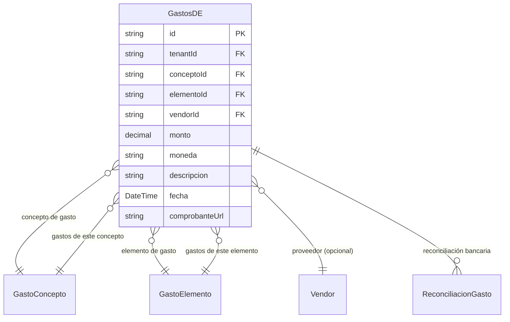

# Gastos de Distribución y Explotación (Gastos D/E)

> **Feature**: `src/features/gastosDE/`
> **Modelos Prisma**: `GastosDE`, `GastoConcepto`, `GastoElemento`, `Vendor`
> **Ruta**: `/busy/gastos`

---

## Descripción

Módulo de gestión de gastos operativos de la empresa. Los gastos se clasifican por **Concepto** (tipo de gasto: transporte, electricidad, alquiler) y **Elemento** (subclasificación: materiales, mano de obra, servicios públicos).

Son reconciliables contra cuentas bancarias y alimentan los reportes financieros.

## Modelos de Datos



| Modelo | Propósito | PK |
|--------|-----------|----|
| `GastosDE` | Registro de gasto operativo | `id` |
| `GastoConcepto` | Clasificación de tipo de gasto | `conceptoId` |
| `GastoElemento` | Subclasificación del gasto | `elementoId` |

## Funcionalidades

### CRUD de Gastos

**Descripción**: Registro de gastos con concepto, elemento, monto, moneda, proveedor y comprobante.

### Catálogo de Conceptos

**Descripción**: Gestión de conceptos de gasto (ej: "Transporte", "Servicios Públicos", "Alquiler").

### Catálogo de Elementos

**Descripción**: Gestión de elementos de gasto (ej: "Materiales Directos", "Mano de Obra Indirecta").

## Server Actions

| Action | Propósito |
|--------|-----------|
| `getGastosDEAction` | Listar gastos |
| `createGastosDEAction` | Crear gasto |
| `updateGastosDEAction` | Actualizar gasto |
| `deleteGastosDEAction` | Eliminar gasto |
| `getGastoConceptosAction` | Listar conceptos |
| `createGastoConceptoAction` | Crear concepto |
| `updateGastoConceptoAction` | Actualizar concepto |
| `deleteGastoConceptoAction` | Eliminar concepto |
| `getGastoElementosAction` | Listar elementos |
| `createGastoElementoAction` | Crear elemento |
| `updateGastoElementoAction` | Actualizar elemento |
| `deleteGastoElementoAction` | Eliminar elemento |

## UI y Navegación

| Ruta | Componente | Propósito |
|------|-----------|-----------|
| `/busy/gastos` | `GastosDEContent` | Listado y registro de gastos |
| — | `GastoConceptosContent` | Gestión de conceptos |
| — | `GastoElementosContent` | Gestión de elementos |
| — | `GastoDEForm` | Formulario de gasto |
| — | `VendorCombobox` | Selector de proveedores |

## Integraciones

| Módulo | Relación |
|--------|----------|
| `contabilidad` | Reconciliación de gastos contra cuentas bancarias |
| `vendors` | Proveedor asociado al gasto |
| `reportes-financieros` | Los gastos alimentan reportes de rentabilidad |

## Permisos y Roles

| Acción | Rol |
|--------|-----|
| Ver gastos | `admin`, `manager`, `economico` |
| Crear/Editar/Eliminar | `admin`, `manager` |

## Tests

```bash
pnpm test -- src/features/gastosDE/
```
