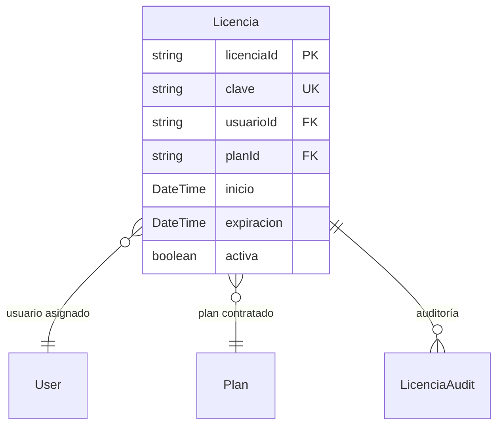

# Licencias (Individuales)

> **Feature**: `src/features/licencias/`
> **Modelos Prisma**: `Licencia`, `LicenciaAudit`, `User`, `Plan`
> **Ruta**: `/busy/admin/licencias`

---

## Descripción

Módulo de licencias individuales (legacy). Asigna planes de suscripción a usuarios específicos. Está siendo reemplazado progresivamente por `TenantLicense` (licencias por empresa). Ver [Planes y Licencias](planes/README.md) para el modelo actual.

## Modelos de Datos

## Funcionalidades

### CRUD de Licencias

**Descripción**: Creación (con generación automática de clave), activación/desactivación, extensión y eliminación.

### Generación de Clave

**Descripción**: `generarClave()` genera claves en formato `XXXXX-XXXXX-XXXXX-XXXXX` (4 grupos de 5 caracteres, sin vocales ni dígitos ambiguos).

## Server Actions

| Action | Propósito |
|--------|-----------|
| `getLicenciasAction` | Listar licencias (admin) |
| `createLicenciaAction` | Crear licencia con clave + plan |
| `updateLicenciaAction` | Extender/desactivar |
| `deleteLicenciaAction` | Eliminar |

## Reglas de Negocio

1. Solo admin puede gestionar licencias.
2. Al crear licencia, se actualiza `User.expiresAt`.
3. La clave se genera automáticamente si no se provee una.
4. Modelo legacy — las nuevas implementaciones usan `TenantLicense`.
