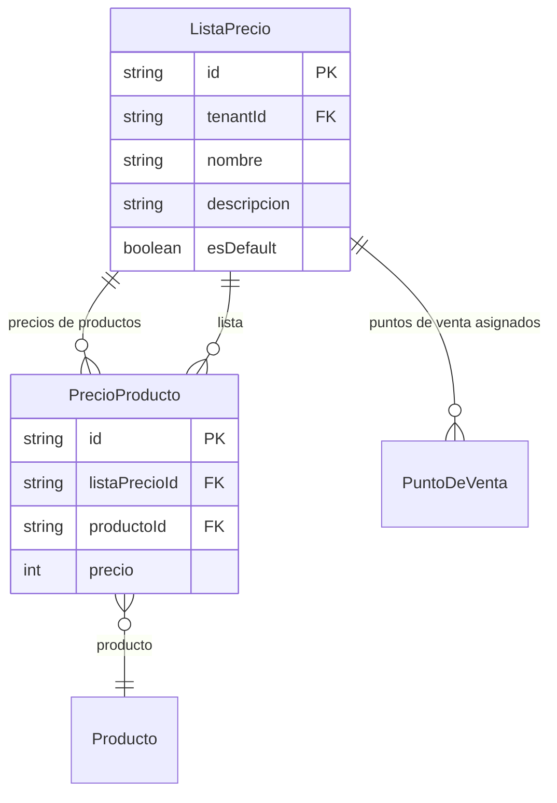

# Listas de Precios

> **Feature**: `src/features/listas-precios/`
> **Modelos Prisma**: `ListaPrecio`, `PrecioProducto`, `PuntoDeVenta`
> **Ruta**: `/busy/listas-precios`

---

## Descripción

Módulo de gestión de listas de precios. Permite definir precios diferenciados para productos según la lista aplicable. Cada lista puede tener precios distintos para los mismos productos, y los puntos de venta pueden asignarse a una lista específica.

Es un módulo habilitado por feature flag (`listas-precios`).

## Modelos de Datos



| Modelo | Propósito | PK |
|--------|-----------|----|
| `ListaPrecio` | Lista de precios con nombre y descripción | `id` |
| `PrecioProducto` | Precio de un producto en una lista específica | `id` |

## Funcionalidades

### CRUD de Listas de Precios

**Descripción**: Operaciones básicas de creación, lectura, actualización y eliminación de listas de precios.

**Campos**: nombre, descripción, esDefault.

### Lista por Defecto

**Descripción**: Una lista puede marcarse como `esDefault`. Si se marca una nueva lista como default, la anterior pierde ese estado automáticamente. Solo una lista puede ser default por tenant.

### Gestión de Precios por Producto

**Descripción**: Los precios de cada producto en cada lista se gestionan desde el formulario del producto (feature `productos`). Cada `Producto` expone sus `precios` como array de `{ listaPrecioId, precio }`.

## Server Actions

| Action | Propósito | Input | Output |
|--------|-----------|-------|--------|
| `getListasPreciosAction` | Listar listas (con _count de PVs y precios) | `void` | `ListaPrecio[]` |
| `getListaPrecioByIdAction` | Obtener lista por ID (incluye PVs asignados) | `id: string` | `ListaPrecio` |
| `createListaPrecioAction` | Crear lista de precios | `{ nombre, descripcion?, esDefault? }` | `ListaPrecio` |
| `updateListaPrecioAction` | Actualizar lista | `{ id, nombre?, descripcion?, esDefault? }` | `ListaPrecio` |
| `deleteListaPrecioAction` | Eliminar lista | `id: string` | `{ success }` |

## Reglas de Negocio

1. **Feature flag**: Requiere el feature `listas-precios` habilitado en el plan.
2. **Default único**: Solo una lista puede ser `esDefault` por tenant. Al marcar una como default, las demás pierden ese estado.
3. **Nombre**: Obligatorio. Descripción opcional.
4. **Aislamiento**: Scoped por `tenantId`.
5. **Protección**: No se puede eliminar una lista con puntos de venta o precios asignados (constraint de BD).

## UI y Navegación

| Ruta | Componente | Propósito |
|------|-----------|-----------|
| `/busy/listas-precios` | `ListasPreciosPageClient` | Listado y gestión de listas |

Los precios por producto se gestionan desde:
| Ruta | Componente | Propósito |
|------|-----------|-----------|
| `/busy/productos/[id]` | `ProductoForm` + `ProductosPriceLists` | Precios del producto en cada lista |

## Integraciones

| Módulo | Relación |
|--------|----------|
| `productos` | Asignación de precios por producto en cada lista |
| `puntos-venta` | Cada PV puede tener una lista de precios asignada |
| `ventas` | Las ventas usan precios según la lista del PV |

## Permisos y Roles

| Acción | Rol requerido |
|--------|---------------|
| Ver listas | `admin`, `manager`, `economico` |
| Crear/Editar/Eliminar | `admin`, `manager` |

## Tests

- **Archivos**: `src/features/listas-precios/__tests__/`

```bash
pnpm test -- src/features/listas-precios/
```

## Notas Técnicas

- `PrecioProducto` almacena `precio` como `int` (en centavos/moneda base, no decimal) para evitar problemas de redondeo.
- Al crear una lista con `esDefault: true`, primero se desmarcan todas las existentes con `updateMany`.
- La asignación de precios a productos se hace desde el feature `productos`, no desde `listas-precios`.
- `getListasPreciosAction` incluye `_count` de relaciones (PVs asignados y precios configurados) para mostrar en la UI.
