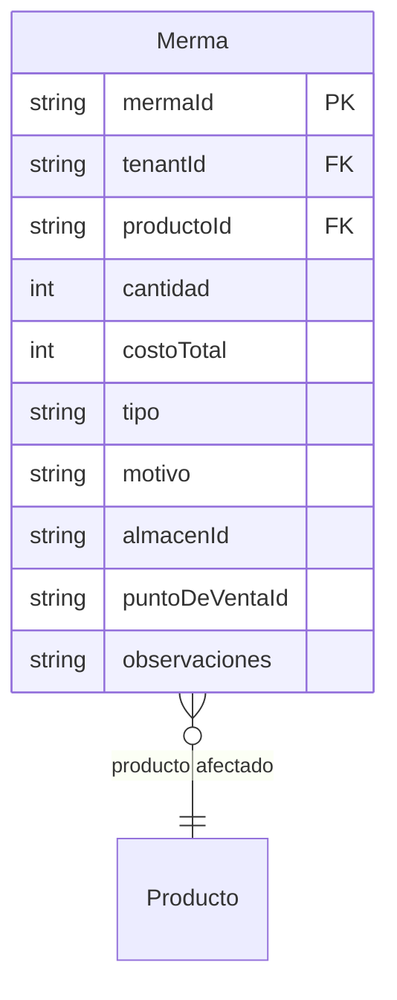

# Mermas

> **Feature**: `src/features/mermas/`
> **Modelos Prisma**: `Merma`, `Producto`
> **Ruta**: `/busy/mermas`

---

## Descripción

Módulo de control de pérdidas y ajustes de inventario. Registra mermas por vencimiento, rotura, robo, error de inventario o ajuste contable. Al registrar una merma, se descuenta automáticamente el stock del producto en la ubicación especificada.

## Modelos de Datos

| Modelo | Propósito | PK |
|--------|-----------|----|
| `Merma` | Registro de pérdida o ajuste de inventario | `mermaId` |

## Funcionalidades

### CRUD de Mermas

**Descripción**: Registro, consulta, actualización y eliminación de mermas.

**Campos**: producto, cantidad, costo total, tipo, motivo, almacén/POS, observaciones.

### Descuento Automático de Stock

**Descripción**: Al crear una merma, se descuenta el stock del producto via `upsertStockUbicacion()` y se actualiza `Producto.stock`.

### Notificaciones

**Descripción**: Al registrar una merma, se envía una notificación a los administradores del sistema via `notificarMerma()`.

## Server Actions

| Action | Propósito |
|--------|-----------|
| `getMermasAction` | Listar mermas del tenant |
| `getMermaByIdAction` | Obtener merma por ID |
| `createMermaAction` | Crear merma (descuenta stock + notifica) |
| `updateMermaAction` | Actualizar merma |
| `deleteMermaAction` | Eliminar merma |

## Reglas de Negocio

1. Al crear una merma, se verifica stock suficiente en la ubicación.
2. `costoTotal` se calcula como `cantidad × precioCosto` del producto al momento del registro.
3. Las mermas no se pueden revertir automáticamente (no hay "deshacer").
4. Las notificaciones se envían a todos los admins del tenant.

## Integraciones

| Módulo | Relación |
|--------|----------|
| `productos` | Descuento de stock |
| `almacenes` | Ubicación de la merma |
| `notificaciones` | Alerta de merma registrada |

## Permisos

| Acción | Rol |
|--------|-----|
| Ver | `admin`, `manager`, `economico` |
| Crear/Editar/Eliminar | `admin`, `manager` |
