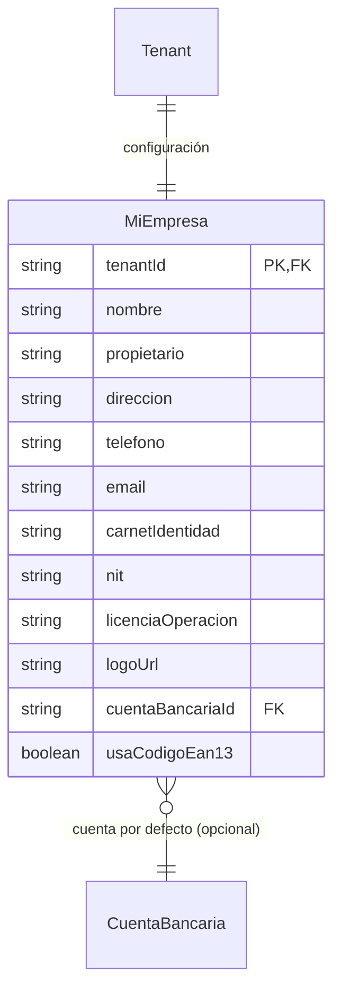

# Mi Empresa

> **Feature**: `src/features/mi-empresa/`
> **Modelos Prisma**: `MiEmpresa`, `CuentaBancaria`
> **Ruta**: `/busy/admin/mi-empresa`

---

## Descripción

Módulo de configuración del perfil de la empresa (tenant). Permite gestionar los datos legales y comerciales del negocio: nombre, dirección, NIT, logo, y opciones avanzadas como la generación de códigos de barras EAN-13.

Cada tenant tiene exactamente un registro `MiEmpresa` que se crea automáticamente durante el onboarding.

## Modelos de Datos



| Modelo | Propósito | PK |
|--------|-----------|----|
| `MiEmpresa` | Datos de configuración del negocio | `tenantId` (1:1 con Tenant) |

## Funcionalidades

### Obtener Datos de la Empresa (`getMiEmpresaAction`)

**Descripción**: Devuelve la configuración actual del negocio, incluyendo datos de la cuenta bancaria por defecto.

### Actualizar Datos de la Empresa (`updateMiEmpresaAction`)

**Descripción**: Actualiza los datos del negocio. Si el registro no existe, lo crea (upsert).

**Reglas de negocio**:
- Valida todos los campos con Zod (formato de teléfono, email, etc.)
- Si se activa `usaCodigoEan13`, requiere confirmación explícita (`confirmReset: true`) porque **borra todos los productos y categorías existentes** para regenerar códigos EAN-13
- Si se desactiva `usaCodigoEan13`, limpia todos los códigos EAN-13 existentes sin borrar productos

## Server Actions

| Action | Propósito | Input destacado | Output |
|--------|-----------|-----------------|--------|
| `getMiEmpresaAction` | Obtener datos del negocio | `void` | `MiEmpresa` o `null` |
| `updateMiEmpresaAction` | Actualizar/crear datos | `{ nombre, direccion, telefono, email, nit, logoUrl, usaCodigoEan13, confirmReset? }` | `{ data: MiEmpresa, message }` |

## Reglas de Negocio

1. **Activar EAN-13** requiere confirmación (`confirmReset: true`) porque destruye datos existentes (productos y categorías se resetean).
2. **Desactivar EAN-13** es seguro: solo limpia los códigos EAN-13 de los productos, no los elimina.
3. El campo `nombre` es obligatorio. Todos los demás son opcionales.
4. El teléfono debe coincidir con el regex `/^[0-9\-\+\s\(\)]+$/`.
5. El email debe tener formato válido.
6. El `logoUrl` debe ser una URL válida.

## UI y Navegación

| Ruta | Componente | Propósito |
|------|-----------|-----------|
| `/busy/admin/mi-empresa` | MiEmpresaForm | Formulario de configuración del negocio |

## Integraciones

| Módulo | Relación |
|--------|----------|
| `auth` | Requiere autenticación con tenant activo (`requireTenant`) |
| `cuentas-bancarias` | Referencia a cuenta bancaria por defecto |
| `categorias` | Se resetean al activar EAN-13 |
| `productos` | Se resetean o limpian códigos EAN-13 según toggle |

## Permisos y Roles

| Acción | Rol requerido |
|--------|---------------|
| Ver datos | `admin`, `manager`, `economico` |
| Editar datos | `admin`, `manager` |

## Tests

- **Archivos**: `src/features/mi-empresa/__tests__/` (si existe)

```bash
pnpm test -- src/features/mi-empresa/
```

## Notas Técnicas

- `MiEmpresa` usa `tenantId` como PK, relación 1:1 con `Tenant`. No tiene un ID independiente.
- Al activar EAN-13, se llama a `resetProductsForEan13(tenantId)` que borra productos y categorías para regenerar desde cero con códigos EAN-13.
- Al desactivar EAN-13, se llama a `clearEan13Codes(tenantId)` que solo limpia los campos de código de barras.
- `updateMiEmpresaAction` usa `prisma.miEmpresa.upsert()` para manejar tanto creación como actualización.
- La función usa `Record<string, unknown>` para el update data en lugar del tipo directo de Prisma para flexibilidad.
