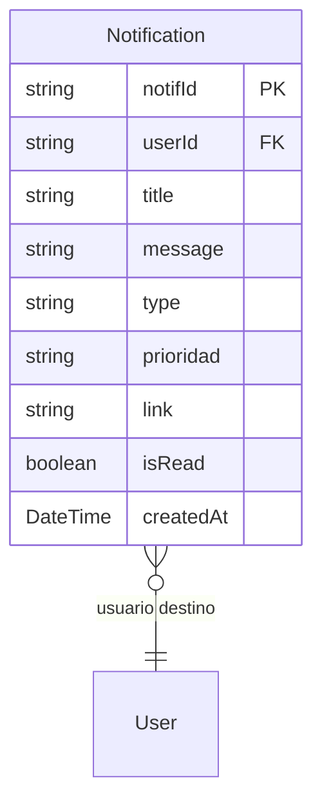

# Notificaciones

> **Feature**: `src/features/notificaciones/`
> **Modelos Prisma**: `Notification`
> **Ruta**: `/busy/notificaciones`

---

## Descripción

Centro de notificaciones del sistema. Las notificaciones se generan automáticamente desde múltiples módulos: stock bajo, intentos fallidos de login, transferencias, mermas, licencias próxima a vencer, etc.

## Modelos de Datos

## Funcionalidades

### Listado de Notificaciones

**Descripción**: `getNotificacionesAction` retorna las notificaciones del usuario autenticado con resumen de prioridades (alta, media, baja) y conteo de no leídas.

### Marcar como Leída

**Descripción**: `marcarNotificacionLeidaAction` actualiza `isRead = true`.

### Verificación de Stock Bajo

**Descripción**: `verificarStockBajo()` se ejecuta periódicamente y genera notificaciones cuando productos tienen `stock <= stockMinimo`.

## Server Actions

| Action | Propósito |
|--------|-----------|
| `getNotificacionesAction` | Listar notificaciones del usuario |
| `marcarNotificacionLeidaAction` | Marcar como leída |
| `createNotificacionAction` | Crear notificación (uso interno) |
| `deleteNotificacionAction` | Eliminar notificación |

## Integraciones

| Módulo | Genera notificaciones por |
|--------|--------------------------|
| `auth` | Intentos fallidos de login, bloqueo de cuenta |
| `productos` | Stock bajo (vía `verificarStockBajo()`) |
| `transferencias` | Nueva transferencia solicitada |
| `mermas` | Merma registrada |
| `contratos` | Alertas de vencimiento |
| `planes/licencias` | Licencia próxima a vencer |

## Permisos

| Acción | Rol |
|--------|-----|
| Ver notificaciones | Cualquier autenticado (propias) |
