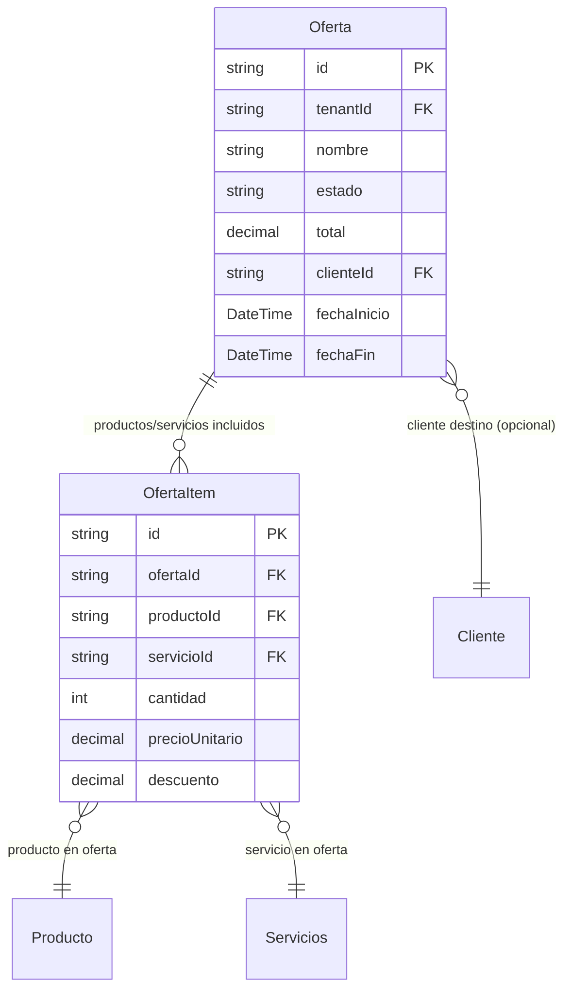

# Ofertas y Promociones

> **Feature**: `src/features/ofertas/`
> **Modelos Prisma**: `Oferta`, `OfertaItem`, `Producto`, `Servicios`, `Cliente`, `Venta`
> **Ruta**: `/busy/ofertas`

---

## Descripción

Módulo de gestión de ofertas y promociones comerciales. Permite crear ofertas que agrupan productos y/o servicios con condiciones especiales de precio, descuento o financiamiento. Las ofertas pueden tener un cliente asociado (ofertas personalizadas) o ser generales.

Una vez creada una oferta, puede ser **facturada** para generar una venta real a partir de sus items.

## Modelos de Datos



| Modelo | Propósito | PK |
|--------|-----------|----|
| `Oferta` | Oferta o promoción comercial | `id` |
| `OfertaItem` | Línea de producto o servicio en la oferta | `id` |

## Funcionalidades

### CRUD de Ofertas

**Descripción**: Creación, consulta, actualización y eliminación de ofertas. Cada oferta incluye items que pueden ser productos o servicios.

**Campos**: nombre, estado (`ACTIVA`, `INACTIVA`, `VENCIDA`), cliente opcional, fechas de vigencia, total.

### Facturación de Oferta (`facturarOfertaAction`)

**Descripción**: Convierte una oferta en una venta real. Crea las `Venta` y `Factura` correspondientes, descuenta stock (productos) y registra en contabilidad.

**Reglas**:
- La oferta debe estar en estado `ACTIVA`
- Requiere punto de venta y turno activo
- Puede aplicar anticipos como forma de pago
- Genera factura automáticamente (si corresponde)

## Server Actions

| Action | Propósito | Input | Output |
|--------|-----------|-------|--------|
| `getOfertasAction` | Listar ofertas del tenant | `void` | `Oferta[]` (incluye items, cliente, productos) |
| `getOfertaByIdAction` | Obtener oferta por ID | `id: string` | `Oferta` |
| `createOfertaAction` | Crear oferta | `{ nombre, items, clienteId?, ... }` | `Oferta` |
| `updateOfertaAction` | Actualizar oferta | `{ id, nombre?, estado?, ... }` | `Oferta` |
| `deleteOfertaAction` | Eliminar oferta | `id: string` | `{ success }` |
| `facturarOfertaAction` | Facturar oferta (→ venta) | `{ ofertaId, puntoDeVentaId, metodoPago, ... }` | `{ venta, factura }` |

## Reglas de Negocio

1. **Feature flag**: Requiere `ofertas` habilitado en el plan.
2. **Estados**: `ACTIVA`, `INACTIVA`, `VENCIDA`. Solo las ofertas activas pueden facturarse.
3. **Items**: Cada item puede ser `productoId` o `servicioId` (no ambos).
4. **Facturación**: Al facturar una oferta, se descuenta stock de los productos.
5. **Vigencia**: `fechaInicio` y `fechaFin` opcionales. Sin fechas = vigencia indefinida.
6. **Cliente**: Opcional. Si se especifica, la oferta es personalizada para ese cliente.

## UI y Navegación

| Ruta | Componente | Propósito |
|------|-----------|-----------|
| `/busy/ofertas` | OfertasPage | Listado y gestión de ofertas |

## Integraciones

| Módulo | Relación |
|--------|----------|
| `productos` | Items de producto en la oferta |
| `servicios` | Items de servicio en la oferta |
| `ventas` | Facturación de oferta genera venta |
| `facturas` | Facturación de oferta genera factura |
| `clientes` | Oferta personalizada por cliente |

## Permisos y Roles

| Acción | Rol requerido |
|--------|---------------|
| Ver ofertas | `admin`, `manager`, `economico` |
| Crear/Editar/Eliminar | `admin`, `manager` |
| Facturar oferta | `admin`, `manager`, `dependiente` |

## Tests

- **Archivos**: `src/features/ofertas/__tests__/`

```bash
pnpm test -- src/features/ofertas/
```

## Notas Técnicas

- `facturarOfertaAction` usa el workflow `facturarOfertaWorkflow` en `services/facturar-oferta-workflow.ts`.
- Las ofertas se serializan con `JSON.parse(JSON.stringify())` para eliminar tipos Prisma (Decimal, Date).
- `facturarOfertaAction` usa `getOrCreateTurnoActivo()` para asociar la venta al turno POS actual.
- La oferta puede tener anticipos aplicados como forma de pago (`applyAnticipoAllocations`).
