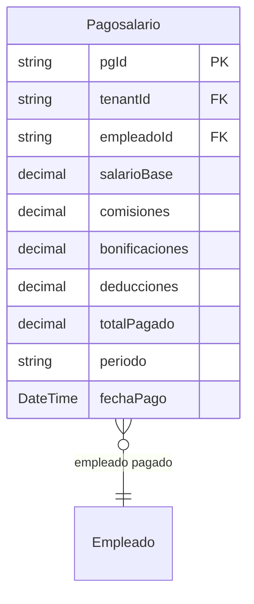

# Pago de Salario (Nómina)

> **Feature**: `src/features/pago-salario/`
> **Modelos Prisma**: `Pagosalario`, `Empleado`
> **Ruta**: `/busy/nomina`

---

## Descripción

Módulo de nómina y pagos de salario. Gestiona el registro de pagos a empleados, incluyendo salario base, comisiones dinámicas y deducciones. Se integra con el sistema de vacaciones para calcular montos ajustados.

## Modelos de Datos



| Modelo | Propósito | PK |
|--------|-----------|----|
| `Pagosalario` | Registro de pago de nómina a un empleado | `pgId` |

## Funcionalidades

### CRUD de Pagos de Salario

**Descripción**: Registro, consulta, actualización y eliminación de pagos de nómina.

**Campos**: empleado, salario base, comisiones, bonificaciones, deducciones, total pagado, período, fecha de pago.

### Cálculo de Nómina

**Descripción**: El sistema se integra con `calculatePayrollFormulas()` en `src/lib/payroll-formulas.ts` para calcular comisiones y deducciones automáticamente según las ventas del empleado y la configuración del negocio.

## Server Actions

| Action | Propósito | Input | Output |
|--------|-----------|-------|--------|
| `getPagoSalariosAction` | Listar pagos de nómina | `void` | `Pagosalario[]` (incluye empleado) |
| `getPagoSalarioByIdAction` | Obtener pago por ID | `id: string` | `Pagosalario` |
| `createPagoSalarioAction` | Crear pago de nómina | `{ empleadoId, salarioBase, comisiones?, deducciones?, periodo?, ... }` | `Pagosalario` |
| `updatePagoSalarioAction` | Actualizar pago | `{ pgId, ... }` | `Pagosalario` |
| `deletePagoSalarioAction` | Eliminar pago | `pgId: string` | `{ success }` |

## Reglas de Negocio

1. **Feature flag**: Requiere `nomina` habilitado en el plan.
2. **Solo managers**: `createPagoSalarioAction` requiere `requireManagerRole`.
3. **Período**: Campo textual para identificar el período (ej: "Enero 2026", "Q1 2026").
4. **Total pagado**: Se calcula como `salarioBase + comisiones + bonificaciones - deducciones`.
5. **Comisiones**: Se pueden calcular automáticamente desde las ventas del empleado.
6. **Aislamiento**: Scoped por `tenantId`.

## UI y Navegación

| Ruta | Componente | Propósito |
|------|-----------|-----------|
| `/busy/nomina` | NominaPage | Listado y gestión de pagos de nómina |

## Integraciones

| Módulo | Relación |
|--------|----------|
| `empleados` | Referencia al empleado pagado |
| `ventas` | Las comisiones se calculan desde ventas del empleado |
| `contabilidad` | Registro contable de gastos de nómina |

## Permisos y Roles

| Acción | Rol requerido |
|--------|---------------|
| Ver nómina | `admin`, `manager`, `economico` |
| Crear/Editar/Eliminar | `admin`, `manager` |

## Tests

- **Archivos**: `src/features/pago-salario/__tests__/`

```bash
pnpm test -- src/features/pago-salario/
```

## Notas Técnicas

- El modelo Prisma se llama `Pagosalario` (una sola palabra, sin separador).
- `createPagoSalarioAction` requiere `requireManagerRole` (solo gerentes pueden registrar pagos).
- Las fórmulas de comisiones están en `src/lib/payroll-formulas.ts` y son configurables por tenant.
