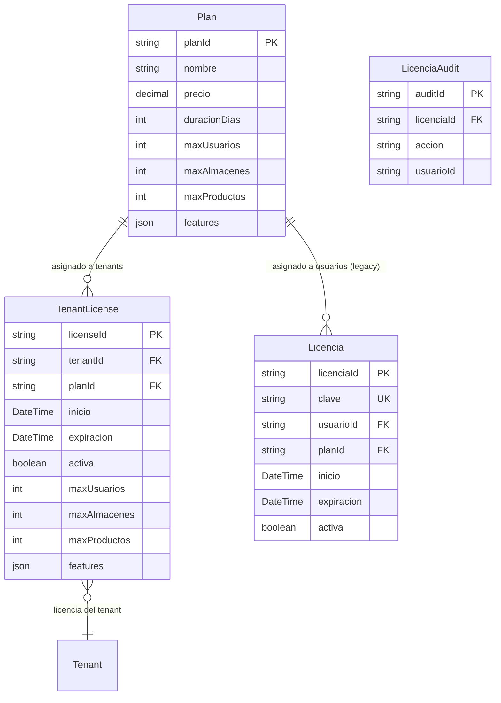

# Planes y Licencias

> **Features**: `src/features/planes/` + `src/features/licencias/` + `src/features/admin/` (parte)
> **Modelos Prisma**: `Plan`, `Licencia`, `TenantLicense`, `LicenciaAudit`
> **Rutas**: `/admin/planes`, `/admin/licencias`, `/busy/admin/licencias`

---

## Descripción

Módulo de suscripción y licenciamiento del sistema. Gestiona los **planes** (definiciones de precios, límites y features) y las **licencias** (asignaciones de planes a usuarios o tenants).

El sistema soporta dos modelos de licencia:
1. **TenantLicense** (actual): Licencia asociada a una empresa (tenant). Es el modelo principal.
2. **Licencia** (legacy): Licencia individual asociada a un usuario. En desuso progresivo.

Los planes definen qué features están disponibles para cada empresa mediante un sistema de **feature flags** almacenados como JSON.

## Modelos de Datos



| Modelo | Propósito | PK |
|--------|-----------|----|
| `Plan` | Definición de plan de suscripción (precios, límites, features) | `planId` |
| `TenantLicense` | Licencia activa de un tenant para un plan | `licenseId` |
| `Licencia` | Licencia individual legacy (usuario→plan) | `licenciaId` |
| `LicenciaAudit` | Auditoría de cambios en licencias | `auditId` |

## Feature Registry

El sistema tiene un catálogo central de todos los módulos/features en `feature-registry.ts`. Es la fuente de verdad para determinar qué funcionalidades incluye cada plan.

### Categorías de Features

| Categoría | Clave | Ejemplos |
|-----------|-------|----------|
| Inventario | `inventario` | productos, categorías, unidades, listas de precios |
| Operaciones | `operaciones` | almacenes, puntos de venta, transferencias, mermas |
| Ventas | `ventas` | ventas POS, facturación, turnos, arqueo, ofertas |
| Compras | `compras` | proveedores, compras de productos/servicios |
| Financiero | `financiero` | contabilidad, multi-moneda, reportes, cuentas |
| Producción | `produccion` | órdenes de producción, reparaciones |
| RRHH | `rrhh` | empleados, nómina |
| Configuración | `config` | mi-empresa, contratos, notificaciones, dashboard |
| Infraestructura | `infra` | backups, API, integraciones |

### Feature Flags

Cada plan tiene un campo `features` (JSON) donde cada clave es un feature key y el valor es booleano:

```json
{
  "productos": true,
  "ventas-pos": true,
  "contabilidad": false,
  "clientes": true,
  "backups-diario": false
}
```

La verificación en runtime se hace via `requireFeature(featureKey)` en `tenant-scope.ts`.

## Funcionalidades

### Gestión de Planes

**Descripción**: CRUD de planes de suscripción. Solo accesible para rol `admin` (plataforma).

**Operaciones**:
- `getPlansAction` — Listar todos los planes ordenados por precio
- `getPlansPublicActionV2` — Listar planes para la landing page pública (formateados para display)
- CRUD via admin actions (`createPlanAction`, `updatePlanAction`, etc.)

### Gestión de Licencias

**Descripción**: Asignación de planes a usuarios (legacy) o tenants. Las licencias determinan los límites operativos del tenant.

**Operaciones**:
- `getLicenciasAction` — Listar licencias (admin)
- `createLicenciaAction` — Crear licencia con generación automática de clave
- `updateLicenciaAction` — Extender o desactivar licencia
- `deleteLicenciaAction` — Eliminar licencia

### Feature Enforcement

**Descripción**: Verificación en runtime de que el tenant tiene acceso al feature solicitado. Implementado via `requireFeature()` que consulta `TenantLicense.features`.

## Server Actions

### Planes

| Action | Propósito | Acceso |
|--------|-----------|--------|
| `getPlansAction` | Listar planes con features parseados | Admin |
| `getPlansPublicActionV2` | Listar planes para landing pública | Público |
| `createPlanAction` | Crear plan | Admin |
| `updatePlanAction` | Actualizar plan | Admin |
| `deletePlanAction` | Eliminar plan | Admin |

### Licencias

| Action | Propósito | Input |
|--------|-----------|-------|
| `getLicenciasAction` | Listar licencias | `void` |
| `createLicenciaAction` | Crear licencia | `{ usuarioId, planId, duracionDias?, clave? }` |
| `updateLicenciaAction` | Actualizar licencia | `{ licenciaId, expiracion?, activa? }` |
| `deleteLicenciaAction` | Eliminar licencia | `licenciaId: string` |

## Reglas de Negocio

1. **Generación de clave**: Las licencias generan una clave automática en formato `XXXXX-XXXXX-XXXXX-XXXXX` (4 grupos de 5 caracteres alfanuméricos, excluyendo vocales y dígitos ambiguos).
2. **Expiración**: Si no se especifica duración, usa la duración del plan seleccionado.
3. **Límites**: Al crear licencia, se actualiza `User.expiresAt` con la fecha de expiración.
4. **Feature enforcement**: Cada Server Action sensible verifica via `requireFeature()` que el plan del tenant incluya el feature necesario.
5. **Plan público**: `getPlansPublicActionV2` deriva automáticamente los bullets de features desde el `FEATURE_REGISTRY`.

## UI y Navegación

| Ruta | Componente | Propósito |
|------|-----------|-----------|
| `/admin/planes` | AdminPlanesPage | CRUD de planes (admin plataforma) |
| `/admin/licencias` | AdminLicenciasPage | Gestión de licencias (admin plataforma) |
| `/busy/admin/licencias` | LicenciasPage | Licencias del tenant actual |
| Landing page | PlanesSection | Display público de planes |

## Integraciones

| Módulo | Relación |
|--------|----------|
| `admin` | CRUD de planes y licencias via admin actions |
| `auth` | Verificación de licencia al login (`User.expiresAt`) |
| `landing` | Muestra planes públicos en la landing page |
| `mi-empresa` | Límites del plan afectan configuraciones del negocio |
| Todos los features | `requireFeature()` verifica acceso en cada Server Action |

## Permisos y Roles

| Acción | Rol requerido |
|--------|---------------|
| Ver planes (admin) | `admin` |
| CRUD planes | `admin` |
| Ver licencias (global) | `admin` |
| Crear/Editar licencias | `admin` |
| Ver planes (público) | Público (sin auth) |

## Tests

- **Archivos**: `src/features/planes/__tests__/`, `src/features/licencias/__tests__/`

```bash
pnpm test -- src/features/planes/
pnpm test -- src/features/licencias/
```

## Notas Técnicas

- `Plan.features` es un campo JSON en Prisma. Se parsea como `Record<string, boolean>` en runtime.
- `TenantLicense` extiende los límites del plan con sus propios campos (`maxUsuarios`, `maxAlmacenes`, `maxProductos`) para permitir personalización por licencia.
- La generación de clave excluye vocales y dígitos ambiguos (`0`, `1`) para evitar confusiones al escribir la clave manualmente.
- `getPlansPublicActionV2` usa `FEATURE_REGISTRY` para derivar descripciones amigables y agrupaciones por categoría para la UI pública.
- El feature `multitenantmembership` permite que un usuario pertenezca a múltiples tenants simultáneamente.
