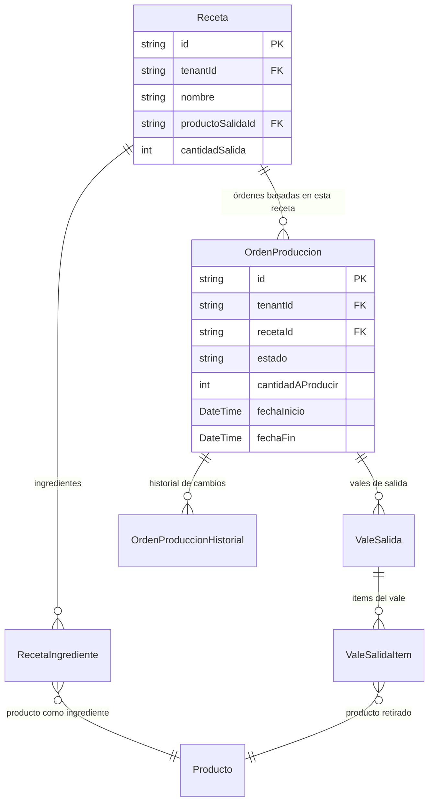

# Producción

> **Feature**: `src/features/produccion/`
> **Modelos Prisma**: `Receta`, `RecetaIngrediente`, `OrdenProduccion`, `OrdenProduccionHistorial`, `ValeSalida`, `ValeSalidaItem`, `Producto`
> **Ruta**: `/busy/produccion`

---

## Descripción

Módulo de producción. Gestiona la fabricación de productos compuestos a partir de **Recetas** que definen ingredientes y cantidades. Las **Órdenes de Producción** autorizan y controlan el proceso productivo, y los **Vales de Salida** documentan la extracción de materiales del almacén.

## Modelos de Datos

## Funcionalidades

### Recetas de Producción

**Descripción**: Define la fórmula de producción: qué producto se produce y qué ingredientes se necesitan.

**Campos**: nombre, producto de salida, cantidad de salida, ingredientes (producto + cantidad).

### Órdenes de Producción

**Descripción**: Autoriza la producción de una cantidad específica de un producto siguiendo una receta.

**Estados**: `PENDIENTE` → `EN_PROCESO` → `COMPLETADO` / `CANCELADO`

### Vales de Salida

**Descripción**: Documenta la extracción de materiales del almacén para una orden de producción. Descuenta el stock de los ingredientes.

### Historial

**Descripción**: `OrdenProduccionHistorial` registra todos los cambios de estado de cada orden.

## Server Actions

| Action | Propósito |
|--------|-----------|
| `getRecetasProduccionAction` | Listar recetas |
| `createRecetaProduccionAction` | Crear receta con ingredientes |
| `setIngredientesRecetaProduccionAction` | Actualizar ingredientes de receta |
| `getOrdenesProduccionAction` | Listar órdenes |
| `createOrdenProduccionAction` | Crear orden de producción |
| `aprobarOrdenProduccionAction` | Aprobar orden |
| `completarOrdenProduccionAction` | Completar (descuenta ingredientes, agrega producto) |
| `cancelarOrdenProduccionAction` | Cancelar orden |

## Reglas de Negocio

1. Una receta define la cantidad de salida (`cantidadSalida`) y los ingredientes necesarios.
2. Al completar una orden:
   - Se descuenta stock de los ingredientes
   - Se agrega stock del producto de salida
3. No se puede completar una orden sin stock suficiente de ingredientes.
4. Las órdenes canceladas no modifican el stock.

## Integraciones

| Módulo | Relación |
|--------|----------|
| `productos` | Ingredientes y producto de salida |
| `almacenes` | Stock de ingredientes y salida |
| `mermas` | Posibles pérdidas en producción |

## Permisos

| Acción | Rol |
|--------|-----|
| Ver recetas/órdenes | `admin`, `manager` |
| Crear/Editar/Eliminar | `admin`, `manager` |
