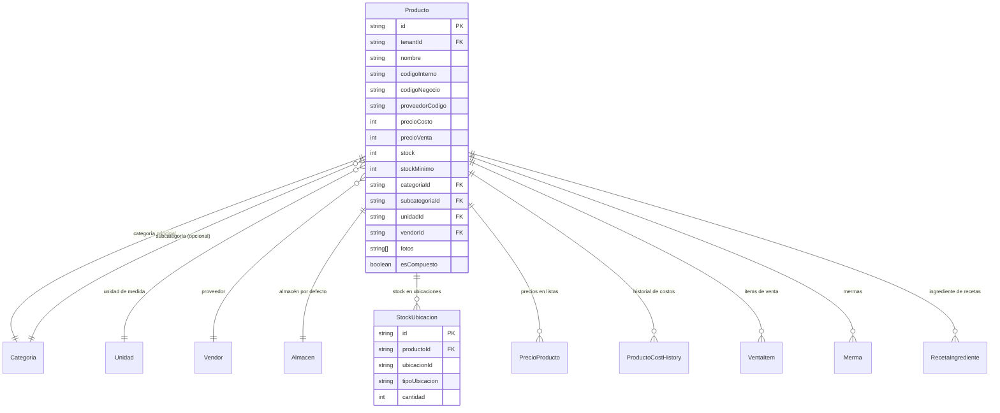

# Productos

> **Feature**: `src/features/productos/`
> **Modelos Prisma**: `Producto`, `StockUbicacion`, `ProductoCostHistory`, `PrecioProducto`
> **Ruta**: `/busy/productos`

---

## Descripción

Módulo central del sistema de inventario. Gestiona el catálogo de productos, su stock, costos, precios, códigos de barras, y el historial de cambios. Es el feature más grande del sistema y el núcleo alrededor del cual giran ventas, compras, transferencias, producción y contabilidad.

Cada producto pertenece a un tenant, tiene una categoría, una unidad de medida, un proveedor opcional, y puede tener precios diferenciados por lista de precios.

## Modelos de Datos



| Modelo | Propósito | PK |
|--------|-----------|----|
| `Producto` | Catálogo central del inventario | `id` |
| `StockUbicacion` | Stock desglosado por ubicación física | `id` |
| `PrecioProducto` | Precio de un producto en una lista específica | `id` |
| `ProductoCostHistory` | Historial de cambios de precio de costo | `id` |

## Funcionalidades

### CRUD de Productos

**Descripción**: Operaciones completas de creación, lectura, actualización y eliminación de productos.

**Campos principales**: nombre, descripción, precio de costo, precio de venta, stock, stock mínimo, código interno (11 dígitos), código de negocio (EAN-13), código de proveedor, categoría, subcategoría, unidad, proveedor, almacén, fotos.

### Stock por Ubicación (`getStockPorUbicacionAction`)

**Descripción**: Consulta el stock de productos filtrado por ubicación (almacén o punto de venta).

**Modos**:
- `includeZero: false` — solo productos con stock > 0 en la ubicación
- `includeZero: true` — todos los productos de la ubicación (stock=0 donde no haya registro)

### Restock de Producto (`restockProductoAction`)

**Descripción**: Procesa la entrada de stock de un producto. Crea un registro `GastoCompra`, actualiza el stock, registra cambio de costo si aplica. Soporta pago completo o parcial y conversión de monedas.

**Reglas**:
- Valida el período contable abierto antes de procesar
- Actualiza `StockUbicacion` para la ubicación destino
- Registra historial de costo si `precioCosto` cambió
- Permite vincular a una `CompraProducto` existente
- Soporta instancias de producto (productos compuestos)

### Historial de Restock (`getRestockHistoryAction`)

**Descripción**: Historial paginado de restocks de un producto con resumen estadístico (total restocks, cantidad agregada, costo total, cambios de precio).

### Actualización Masiva de Stock Mínimo (`bulkUpdateStockMinimoAction`)

**Descripción**: Permite actualizar el `stockMinimo` de múltiples productos a la vez desde una lista.

## Server Actions

| Action | Archivo | Propósito |
|--------|---------|-----------|
| `getProductosAction` | `actions-crud.ts` | Listar productos del tenant (con filtros: categoría, vendor, stock bajo) |
| `getProductoByIdAction` | `actions-crud.ts` | Obtener producto por ID |
| `createProductoAction` | `actions-crud.ts` | Crear producto con precios opcionales |
| `updateProductoAction` | `actions-crud.ts` | Actualizar producto |
| `deleteProductoAction` | `actions-crud.ts` | Eliminar producto |
| `getStockPorUbicacionAction` | `actions-stock.ts` | Stock filtrado por ubicación |
| `bulkUpdateStockMinimoAction` | `actions-crud.ts` | Actualización masiva de stock mínimo |
| `restockProductoAction` | `actions-restock.ts` | Entrada de stock (restock) |
| `getRestockHistoryAction` | `actions-restock.ts` | Historial paginado de restocks |

## Reglas de Negocio

1. **Código interno**: Debe tener exactamente 11 dígitos. Es único por tenant.
2. **Código de negocio (EAN-13)**: Generado automáticamente según configuración de la empresa y categoría.
3. **Stock mínimo**: Si `stock <= stockMinimo`, se generan alertas de reposición.
4. **Precios**: `precioVenta >= precioCosto` (validado en creación/actualización).
5. **Categoría**: Obligatoria. Subcategoría opcional.
6. **Almacén**: Obligatorio. Cada producto tiene un almacén por defecto.
7. **Foto**: URLs de imágenes (array de strings).
8. **Productos compuestos** (`esCompuesto`): Productos que se fabrican a partir de una receta.
9. **Solo manager puede** realizar restocks (`requireManagerRole`).
10. **Período contable**: Restocks requieren período contable abierto (`withPeriodValidation`).

## UI y Navegación

| Ruta | Componente | Propósito |
|------|-----------|-----------|
| `/busy/productos` | `ProductosContent` | Listado con tabla, filtros y búsqueda |
| `/busy/productos/nuevo` | `ProductoForm` | Creación de producto |
| `/busy/productos/[id]` | `ProductoForm` | Edición de producto |
| `/busy/productos/restock/[id]` | RestockDialog | Entrada de stock |
| `/busy/productos/stock-masivo` | `BulkStockMinimoManager` | Actualización masiva de stock mínimo |

### Componentes Principales

| Componente | Propósito |
|-----------|-----------|
| `productos-content.tsx` | Listado con tabla, filtros, paginación |
| `productos-form.tsx` | Formulario de creación/edición |
| `product-filters.tsx` | Filtros por categoría, vendor, stock bajo |
| `product-photo-upload.tsx` | Upload de fotos del producto |
| `cost-history-dialog.tsx` | Historial de cambios de costo |
| `productos-price-lists.tsx` | Gestión de precios por lista |
| `bulk-stock-minimo-manager.tsx` | Editor masivo de stock mínimo |

## Integraciones

| Módulo | Relación |
|--------|----------|
| `categorias` | Categoría y subcategoría del producto |
| `unidades` | Unidad de medida |
| `vendors` | Proveedor del producto |
| `almacenes` | Almacén por defecto |
| `listas-precios` | Precios diferenciados por lista |
| `ventas` | Items de venta referencia productos |
| `compras-productos` | Compras registran productos |
| `mermas` | Mermas afectan stock de productos |
| `produccion` | Recetas e ingredientes basados en productos |
| `contabilidad` | Restocks registran gastos contables |

## Permisos y Roles

| Acción | Rol requerido |
|--------|---------------|
| Ver productos | `admin`, `manager`, `economico`, `dependiente` |
| Crear/Editar | `admin`, `manager` |
| Eliminar | `admin`, `manager` |
| Restock | `admin`, `manager` |
| Stock masivo | `admin`, `manager` |

## Tests

- **Archivos**: `src/features/productos/__tests__/`

```bash
pnpm test -- src/features/productos/
```

## Notas Técnicas

- El feature tiene **tres archivos de actions** separados por responsabilidad: `actions-crud.ts`, `actions-restock.ts`, `actions-stock.ts`.
- `restockProductoAction` está envuelta con `withPeriodValidation()` que verifica que el período contable esté abierto antes de procesar.
- Los códigos EAN-13 se generan con utilerías en `src/lib/ean13-utils.ts` y `src/lib/product-business-code.ts`, usando prefijos de categoría y secuencia de proveedor.
- `Producto.fotos` es un array de strings (URLs). Se usa `default([])` en el schema.
- El campo `codigoNegocio` almacena el código EAN-13 completo de 13 dígitos.
- `StockUbicacion` permite rastrear stock a nivel de ubicación física dentro de un almacén.
