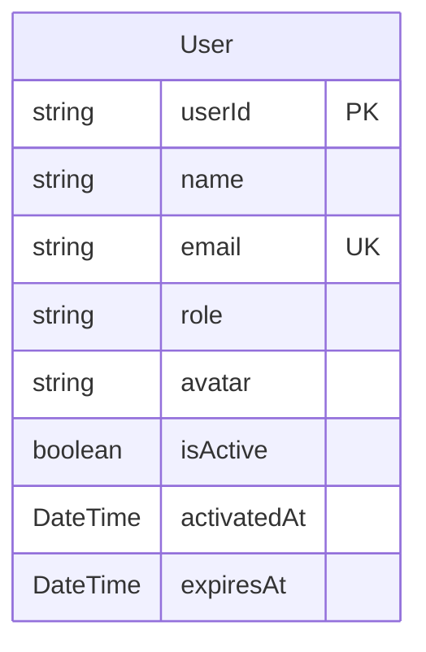

# Perfil de Usuario (Profile)

> **Feature**: `src/features/profile/`
> **Modelos Prisma**: `User`
> **Ruta**: `/busy/perfil`

---

## Descripción

Módulo de perfil del usuario autenticado. Permite consultar y actualizar los datos personales de la cuenta: nombre, email, avatar, contraseña.

## Modelos de Datos



| Modelo | Propósito | PK |
|--------|-----------|----|
| `User` | Cuenta de usuario del sistema (usada como perfil) | `userId` |

## Funcionalidades

### Consultar Perfil (`getProfileAction`)

**Descripción**: Devuelve los datos del usuario autenticado. No requiere input — usa el `user` inyectado por `withAction`.

### Actualizar Perfil (`updateProfileAction`)

**Descripción**: Actualiza los datos del perfil del usuario autenticado.

**Campos editables**: name, email, avatar, contraseña.

## Server Actions

| Action | Propósito | Input | Output |
|--------|-----------|-------|--------|
| `getProfileAction` | Obtener perfil del usuario actual | `void` | `Profile` |
| `updateProfileAction` | Actualizar perfil | `{ name?, email?, avatar?, password? }` | `Profile` |

## Reglas de Negocio

1. **Solo el propio usuario**: Cada usuario solo puede ver/editar su propio perfil.
2. **Validación**: `updateProfileAction` usa `profileUpdateSchema` con Zod para validar inputs.
3. **Email**: Si se cambia el email, debe ser único en el sistema.
4. **Contraseña**: Si se actualiza, se hashea con bcrypt antes de guardar.

## UI y Navegación

| Ruta | Componente | Propósito |
|------|-----------|-----------|
| `/busy/perfil` | ProfilePage | Vista y edición del perfil |

## Integraciones

| Módulo | Relación |
|--------|----------|
| `auth` | Autenticación y datos de sesión |
| `admin` | Gestión de usuarios (admin puede editar cualquier perfil) |

## Permisos y Roles

| Acción | Rol requerido |
|--------|---------------|
| Ver/Editar perfil propio | Cualquier autenticado |

## Tests

- **Archivos**: `src/features/profile/__tests__/`

```bash
pnpm test -- src/features/profile/
```

## Notas Técnicas

- Es el feature más simple del sistema: solo 2 acciones, un schema, y select básico.
- `getProfileAction` usa el `user.userId` del contexto de autenticación, no recibe parámetros.
- `updateProfileAction` construye el update data dinámicamente para solo incluir campos presentes.
