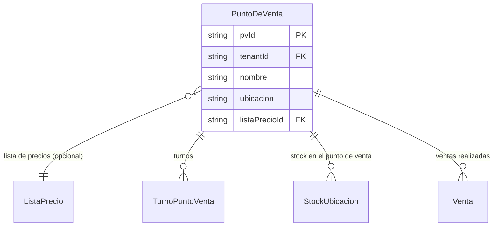

# Puntos de Venta

> **Feature**: `src/features/puntos-venta/`
> **Modelos Prisma**: `PuntoDeVenta`, `TurnoPuntoVenta`, `ListaPrecio`
> **Ruta**: `/busy/puntosDeVenta`

---

## Descripción

Módulo de gestión de puntos de venta (sucursales). Cada punto de venta es una ubicación física donde se realizan ventas. A diferencia de los almacenes (que solo almacenan), los puntos de venta tienen operaciones asociadas: turnos de empleados, arqueo de caja, y pueden tener una lista de precios asignada.

Cada punto de venta puede tener una `ListaPrecio` asociada para precios diferenciados por sucursal.

## Modelos de Datos



| Modelo | Propósito | PK |
|--------|-----------|----|
| `PuntoDeVenta` | Sucursal o punto de venta físico | `pvId` |
| `TurnoPuntoVenta` | Turno de empleado en un POS | `turnoId` |
| `ListaPrecio` | Lista de precios asignada al PV | `id` |

## Funcionalidades

### CRUD de Puntos de Venta

**Descripción**: Operaciones básicas de creación, lectura, actualización y eliminación de puntos de venta.

**Campos**: nombre, ubicación, lista de precios asignada.

## Server Actions

| Action | Propósito | Input | Output |
|--------|-----------|-------|--------|
| `getPuntosDeVentaAction` | Listar PV del tenant | `void` | `PuntoDeVenta[]` (incluye listaPrecio) |
| `getPuntoDeVentaByIdAction` | Obtener PV por ID | `id: string` | `PuntoDeVenta` |
| `createPuntoDeVentaAction` | Crear PV | `{ nombre, ubicacion?, listaPrecioId? }` | `PuntoDeVenta` |
| `updatePuntoDeVentaAction` | Actualizar PV | `{ pvId, nombre?, ubicacion?, listaPrecioId? }` | `PuntoDeVenta` |
| `deletePuntoDeVentaAction` | Eliminar PV | `id: string` | `{ success, id }` |

## Reglas de Negocio

1. **Nombre**: Obligatorio. Único dentro del tenant (validación implícita por scoping).
2. **Ubicación**: Opcional. Descripción textual de la dirección o ubicación.
3. **Lista de precios**: Opcional. Si se asigna, las ventas en este PV usan precios de esa lista.
4. **Aislamiento**: Scoped por `tenantId`.
5. **Protección**: No se puede eliminar un PV con ventas o turnos asociados (constraint de BD).

## UI y Navegación

| Ruta | Componente | Propósito |
|------|-----------|-----------|
| `/busy/puntosDeVenta` | PuntosVentaPage | Listado y gestión de puntos de venta |

## Integraciones

| Módulo | Relación |
|--------|----------|
| `ventas` | Las ventas se registran contra un punto de venta |
| `turnos-pos` | Los turnos de empleados pertenecen a un PV |
| `arqueo-caja` | Arqueo de caja por turno en cada PV |
| `listas-precios` | Cada PV puede tener una lista de precios asignada |
| `stock-ubicacion` | Stock disponible en cada PV (StockUbicacion) |
| `cuadre-diario` | Cuadre consolidado de todos los PV |

## Permisos y Roles

| Acción | Rol requerido |
|--------|---------------|
| Ver PV | `admin`, `manager`, `economico`, `dependiente` |
| Crear/Editar/Eliminar | `admin`, `manager` |

## Tests

- **Archivos**: `src/features/puntos-venta/__tests__/`

```bash
pnpm test -- src/features/puntos-venta/
```

## Notas Técnicas

- El modelo `PuntoDeVenta` incluye la relación con `ListaPrecio`. Al listar, se incluye con `include: { listaPrecio: true }`.
- `PuntoDeVenta` es distinto de `Almacen`: un PV puede vender pero no necesariamente almacenar grandes cantidades. El stock en PV se maneja via `StockUbicacion` con `tipoUbicacion: "puntoVenta"`.
- Las features de turnos, arqueo y cuadre diario dependen de que existan puntos de venta configurados.
