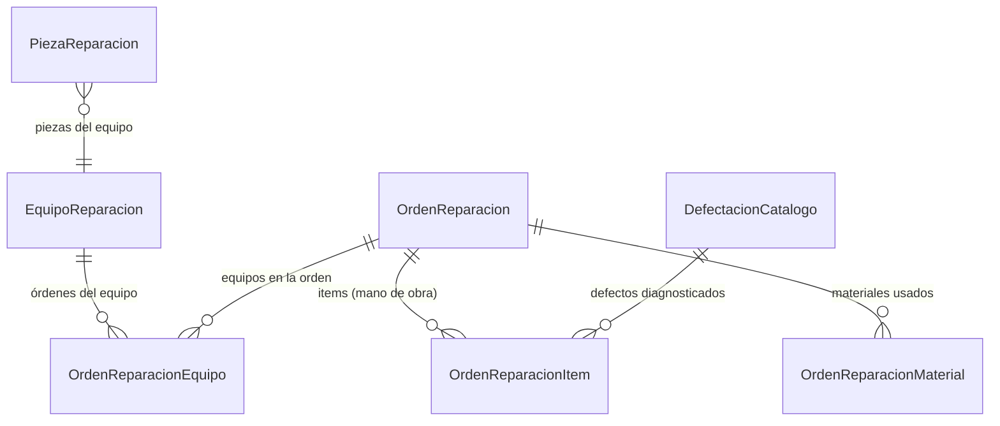

# Taller de Reparaciones

> **Feature**: `src/features/reparaciones/`
> **Modelos Prisma**: `EquipoReparacion`, `PiezaReparacion`, `OrdenReparacion`, `OrdenReparacionEquipo`, `OrdenReparacionItem`, `OrdenReparacionMaterial`, `CatalogoReparacionConfig`, `DefectacionCatalogo`
> **Ruta**: `/busy/reparaciones`

---

## Descripción

Módulo de taller de reparaciones. Gestiona equipos de clientes, piezas, órdenes de reparación con seguimiento de estado, materiales utilizados y mano de obra.

## Modelos de Datos

| Modelo | Propósito |
|--------|-----------|
| `EquipoReparacion` | Equipo/cliente registrado en el taller |
| `PiezaReparacion` | Piezas/reemplazos del equipo |
| `OrdenReparacion` | Orden de trabajo de reparación |
| `OrdenReparacionEquipo` | Equipos incluidos en una orden |
| `OrdenReparacionItem` | Mano de obra/diagnóstico |
| `OrdenReparacionMaterial` | Materiales/repuestos usados |
| `CatalogoReparacionConfig` | Configuración del taller |
| `DefectacionCatalogo` | Catálogo de defectos predefinidos |

## Funcionalidades

### Equipos

Registro de equipos de clientes con marca, modelo, número de serie, y piezas asociadas.

### Órdenes de Reparación

Ciclo de vida completo: `PENDIENTE` → `EN_PROCESO` → `COMPLETADO` → `ENTREGADO`. Cada orden puede incluir múltiples equipos, items de diagnóstico y materiales.

### Catálogo de Defectos

Usa `DefectacionCatalogo` para clasificar fallas de forma estandarizada.

## Server Actions

El módulo exporta tipos desde `@/app/models/model`. Las operaciones CRUD se manejan via API routes legacy o componentes cliente.

## Integraciones

| Módulo | Relación |
|--------|----------|
| `configuracion` | Catálogo de defectaciones (`DefectacionesEditorPanel`) |
| `productos` | Materiales/repuestos usados |
| `clientes` | Equipos de clientes |

## Permisos

| Acción | Rol |
|--------|-----|
| Ver | `admin`, `manager` |
| Crear/Editar | `admin`, `manager` |
