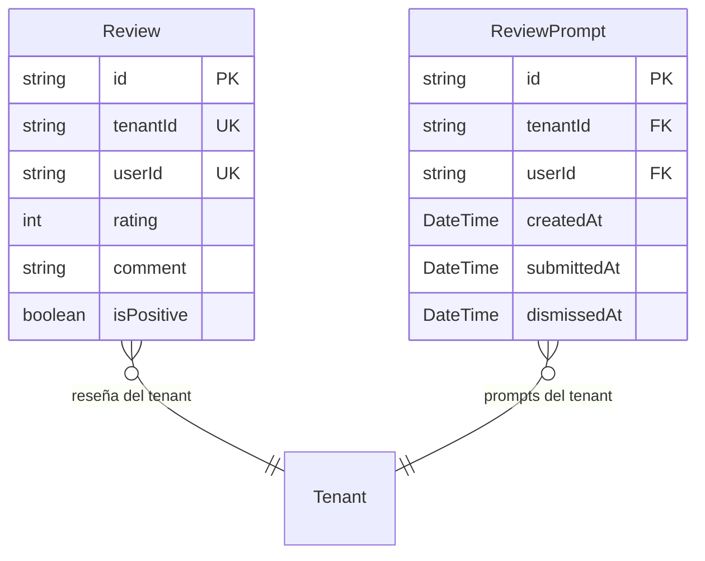

# Reviews (Reseñas del Sistema)

> **Feature**: `src/features/reviews/`
> **Modelos Prisma**: `Review`, `ReviewPrompt`
> **Ruta**: Ruta embebida (modal/dialog en el dashboard)

---

## Descripción

Sistema de reseñas y calificaciones del producto. Permite a los usuarios calificar el sistema (rating 1-5) con comentarios opcionales. Incluye un sistema de `ReviewPrompt` que muestra recordatorios periódicos a usuarios que aún no han calificado.

## Modelos de Datos

## Funcionalidades

### Calificar Sistema

**Descripción**: `submitReviewAction` — Crea una reseña con rating (1-5) y comentario. Un usuario solo puede calificar una vez por tenant (unique constraint `tenantId_userId`). Si rating >= 4, se marca como `isPositive`.

### Aprobación/Rechazo de Review Prompt

**Descripción**: Los users pueden aceptar (`approveReviewAction`) o rechazar (`rejectReviewAction`) el prompt de calificación. Si lo aprueban, se abre el formulario de reseña.

### Stats de Reviews

**Descripción**: `getReviewStatsAction` — Métricas agregadas: promedio de rating, total de reseñas, distribución.

## Server Actions

| Action | Propósito |
|--------|-----------|
| `submitReviewAction` | Enviar reseña (rating + comentario) |
| `approveReviewAction` | Aceptar prompt de reseña |
| `rejectReviewAction` | Rechazar prompt |
| `getReviewStatsAction` | Estadísticas de reseñas |

## Reglas de Negocio

1. Una reseña por usuario por tenant (unique constraint).
2. Rating válido: 1-5.
3. `isPositive` se calcula automáticamente: `rating >= 4`.
4. Si existe un `ReviewPrompt` activo, se vincula y marca como `submittedAt`.

## Permisos

| Acción | Rol |
|--------|-----|
| Calificar | Cualquier autenticado |
| Ver stats | `admin` |
