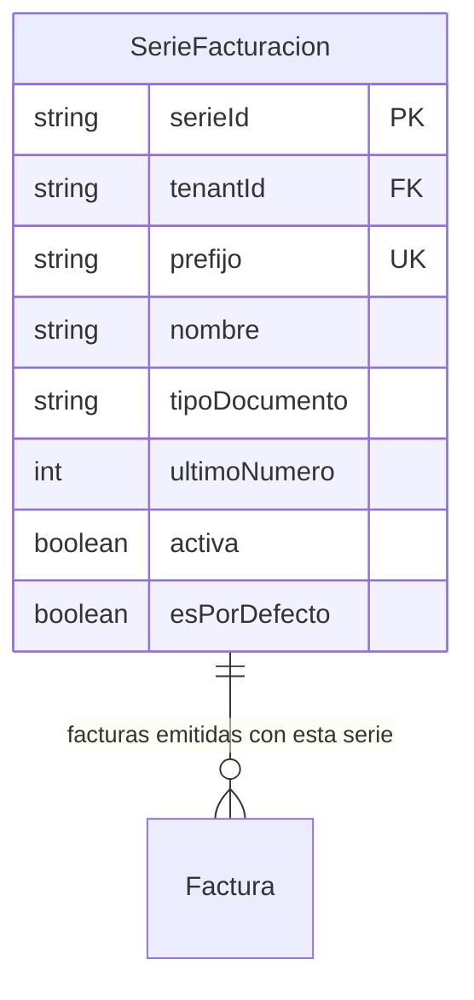

# Series de Facturación

> **Feature**: `src/features/series-facturacion/`
> **Modelos Prisma**: `SerieFacturacion`, `Factura`
> **Ruta**: `/busy/configuracion/series-facturacion`

---

## Descripción

Módulo de gestión de series fiscales para facturación. Define prefijos, tipos de documento (factura, NC, ND), numeración automática y estado activo/inactivo. Complementa el módulo de [Facturación](../facturas/README.md).

## Modelos de Datos

## Funcionalidades

### CRUD de Series

**Descripción**: Creación, consulta, actualización y eliminación de series fiscales.

**Campos**: prefijo, nombre, tipo de documento (`FACTURA`, `N_CREDITO`, `N_DEBITO`, `RECIBO`), último número, activa, esPorDefecto.

### Serie por Defecto

**Descripción**: Una serie puede marcarse como `esPorDefecto`. Al marcar una nueva, las demás pierden ese estado.

## Server Actions

| Action | Propósito |
|--------|-----------|
| `getSeriesFacturacionAction` | Listar series (con _count de facturas) |
| `createSerieFacturacionAction` | Crear serie (valida prefijo único por tenant) |
| `updateSerieFacturacionAction` | Actualizar serie |
| `deleteSerieFacturacionAction` | Eliminar serie |

## Reglas de Negocio

1. **Feature flag**: Requiere `series-facturacion` habilitado.
2. **Prefijo único**: No puede haber dos series con el mismo prefijo en el mismo tenant.
3. **Default único**: Solo una serie puede ser `esPorDefecto` por tenant.
4. **Protección**: No se puede eliminar una serie con facturas asociadas.
5. **Numeración**: `ultimoNumero` se incrementa automáticamente al emitir cada factura.

## Integraciones

| Módulo | Relación |
|--------|----------|
| `facturas` | Toda factura usa una serie |
| `configuracion` | Vista previa de numeración (`getNextSerieNumberAction`) |

## Permisos

| Acción | Rol |
|--------|-----|
| Ver series | `admin`, `manager` |
| Crear/Editar/Eliminar | `admin`, `manager` |
