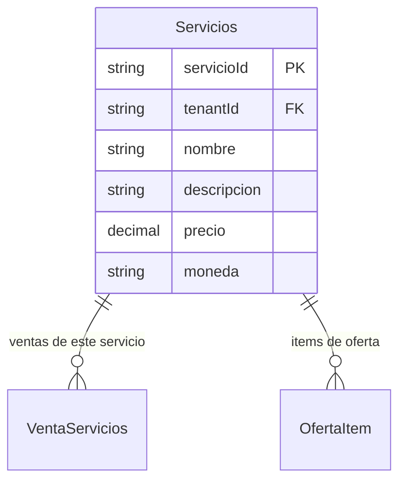

# Servicios

> **Feature**: `src/features/servicios/`
> **Modelos Prisma**: `Servicios`
> **Ruta**: `/busy/servicios`

---

## Descripción

Módulo de catálogo de servicios ofrecidos. Define los servicios que la empresa puede vender (consultoría, instalación, mantenimiento, fletes, etc.). Cada servicio tiene nombre, descripción, precio y moneda.

Los servicios se referencian desde **Ventas de Servicios** y **Ofertas**.

## Modelos de Datos



| Modelo | Propósito | PK |
|--------|-----------|----|
| `Servicios` | Servicio ofrecido por la empresa | `servicioId` |

## Funcionalidades

### CRUD de Servicios

**Descripción**: Operaciones básicas de creación, lectura, actualización y eliminación de servicios del catálogo.

**Campos**: nombre, descripción, precio, moneda.

## Server Actions

| Action | Propósito | Input | Output |
|--------|-----------|-------|--------|
| `getServiciosAction` | Listar servicios del tenant | `void` | `ServicioResponse[]` |
| `getServicioByIdAction` | Obtener servicio por ID | `servicioId: string` | `ServicioResponse` |
| `createServicioAction` | Crear servicio | `{ nombre, descripcion?, precio, moneda? }` | `ServicioResponse` |
| `updateServicioAction` | Actualizar servicio | `{ servicioId, nombre?, precio?, ... }` | `ServicioResponse` |
| `deleteServicioAction` | Eliminar servicio | `servicioId: string` | `{ success }` |

## Reglas de Negocio

1. **Nombre**: Obligatorio.
2. **Precio**: Numérico obligatorio.
3. **Moneda**: Por defecto "CUP". Puede ser USD, EUR.
4. **Aislamiento**: Scoped por `tenantId`.
5. **Protección**: No se puede eliminar un servicio con ventas u ofertas asociadas.

## UI y Navegación

| Ruta | Componente | Propósito |
|------|-----------|-----------|
| `/busy/servicios` | ServiciosPage | Listado y gestión de servicios |

## Integraciones

| Módulo | Relación |
|--------|----------|
| `venta-servicios` | Las ventas de servicios referencian este catálogo |
| `ofertas` | Las ofertas pueden incluir servicios como items |
| `compras-servicios` | Independiente (compras usan descripción textual, no el catálogo) |

## Permisos y Roles

| Acción | Rol requerido |
|--------|---------------|
| Ver servicios | `admin`, `manager`, `economico`, `dependiente` |
| Crear/Editar/Eliminar | `admin`, `manager` |

## Tests

- **Archivos**: `src/features/servicios/__tests__/`

```bash
pnpm test -- src/features/servicios/
```

## Notas Técnicas

- El modelo `Servicios` se llama `servicios` en Prisma (en plural), por lo que `prisma.servicios.findMany()` es la forma correcta de consultarlo.
- Las respuestas se serializan con `serialize()` que convierte `Date` a ISO string y mantiene `precio` como `number`.
- `updateServicioAction` usa `Record<string, unknown>` para construir el update data dinámicamente.
