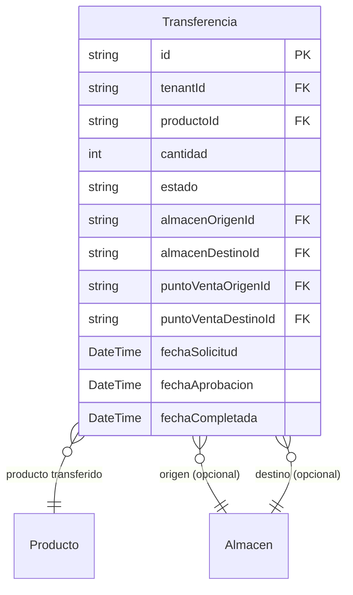

# Transferencias

> **Feature**: `src/features/transferencias/`
> **Modelos Prisma**: `Transferencia`, `StockUbicacion`, `Producto`, `Almacen`, `PuntoDeVenta`
> **Ruta**: `/busy/transferencias`

---

## Descripción

Módulo de transferencias de stock entre almacenes y puntos de venta. Permite mover productos entre ubicaciones con trazabilidad completa: origen, destino, productos, cantidades, y estado (pendiente, completada, cancelada).

## Modelos de Datos



| Modelo | Propósito | PK |
|--------|-----------|----|
| `Transferencia` | Movimiento de stock entre ubicaciones | `id` |

## Funcionalidades

### Flujo de Transferencia

**Descripción**: Las transferencias siguen un flujo de estados:

```
SOLICITADA → APROBADA → COMPLETADA
                ↓
          RECHAZADA
```

### Registro de Transferencia

**Descripción**: Solicita una transferencia de un producto entre dos ubicaciones (almacén origen → almacén destino, o POS origen → POS destino).

### Aprobación/Rechazo

**Descripción**: Un manager puede aprobar o rechazar una transferencia pendiente. Se verifica stock disponible en origen.

### Completado

**Descripción**: Al completar una transferencia, se descuenta stock del origen via `upsertStockUbicacion()` y se agrega al destino.

### Notificaciones

**Descripción**: Al crear una transferencia, se notifica a los managers del tenant via `notificarTransferencia()`.

## Server Actions

| Action | Propósito |
|--------|-----------|
| `getTransferenciasAction` | Listar transferencias |
| `getTransferenciaByIdAction` | Obtener por ID |
| `createTransferenciaAction` | Solicitar transferencia |
| `updateTransferenciaAction` | Actualizar datos |
| `aprobarTransferenciaAction` | Aprobar (solo manager) |
| `completarTransferenciaAction` | Completar (mueve stock) |
| `rechazarTransferenciaAction` | Rechazar con motivo |
| `deleteTransferenciaAction` | Eliminar |

## Reglas de Negocio

1. No se puede aprobar una transferencia sin stock suficiente en origen.
2. Al completar, se ajusta `StockUbicacion` de origen y destino.
3. No se puede rechazar una transferencia ya completada.
4. Las notificaciones se envían a managers al crear la transferencia.

## Integraciones

| Módulo | Relación |
|--------|----------|
| `almacenes` | Origen/destino de la transferencia |
| `puntos-venta` | Origen/destino alternativo |
| `productos` | Stock involucrado |
| `notificaciones` | Alertas de transferencia |

## Permisos

| Acción | Rol |
|--------|-----|
| Ver | `admin`, `manager`, `economico`, `dependiente` |
| Solicitar | `admin`, `manager`, `dependiente` |
| Aprobar/Completar | `admin`, `manager` |
