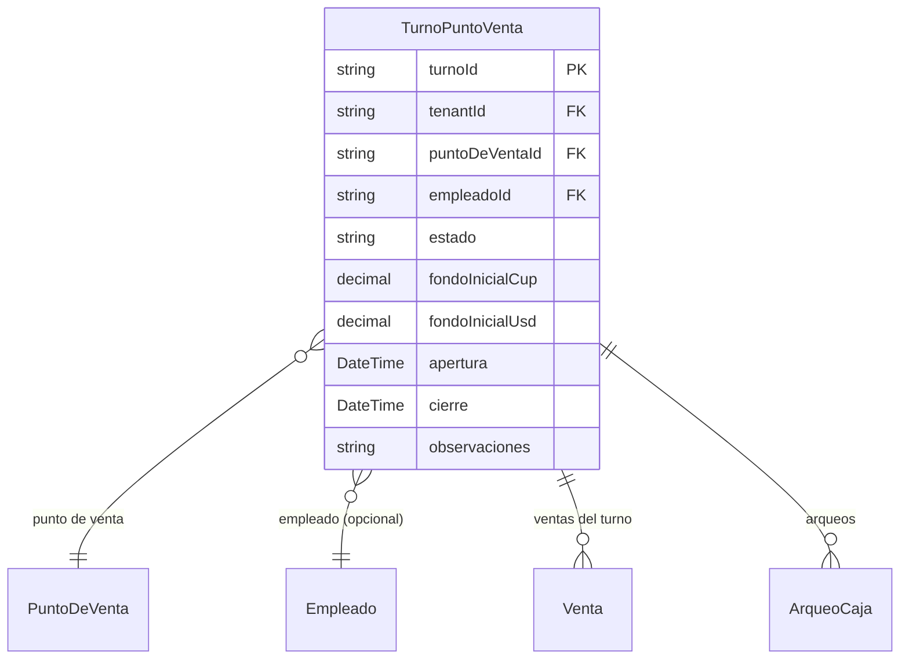

# Turnos POS

> **Feature**: `src/features/turnos-pos/`
> **Modelos Prisma**: `TurnoPuntoVenta`, `PuntoDeVenta`, `Empleado`, `ArqueoCaja`, `Venta`
> **Ruta**: `/busy/puntosDeVenta`

---

## Descripción

Módulo de gestión de turnos en puntos de venta. Controla la apertura y cierre de turnos de empleados en cada POS, con fondo inicial de caja (CUP/USD), y provee el contexto necesario para registrar ventas y realizar arqueos.

Cada venta se asocia a un turno activo. No se puede vender sin un turno abierto en el punto de venta.

## Modelos de Datos



| Modelo | Propósito | PK |
|--------|-----------|----|
| `TurnoPuntoVenta` | Turno laboral en un punto de venta | `turnoId` |

## Funcionalidades

### Apertura de Turno (`abrirTurnoAction`)

**Descripción**: Abre un nuevo turno en un punto de venta. Requiere feature flag `turnos-pos`.

**Reglas**:
- No puede haber otro turno `ABIERTO` en el mismo POS
- El punto de venta debe existir y pertenecer al tenant
- Opcional: empleado asignado, fondo inicial en CUP y USD

### Cierre de Turno (`cerrarTurnoAction`)

**Descripción**: Cierra un turno activo. Cambia el estado a `CERRADO`. Si hay arqueo de caja pendiente, se requiere completarlo antes del cierre.

### Obtener/Reusar Turno Activo (`getOrCreateTurnoActivo`)

**Descripción**: Busca un turno activo para un POS o lo crea automáticamente si no existe. Usado por `createVentaAction` y `facturarOfertaAction` para asociar ventas a un turno sin requerir apertura manual.

### Cuadre de Turno (`getCuadreTurnoAction`)

**Descripción**: Obtiene el cuadre detallado del turno: total de ventas, métodos de pago, productos vendidos, diferencias de caja. Ver [Cuadre de Turno](../cuadre-diario/README.md).

## Server Actions

| Action | Propósito | Input destacado |
|--------|-----------|-----------------|
| `abrirTurnoAction` | Abrir turno en POS | `{ puntoDeVentaId, empleadoId?, fondoInicialCup?, fondoInicialUsd?, observaciones? }` |
| `cerrarTurnoAction` | Cerrar turno | `{ turnoId }` |
| `getTurnosAction` | Listar turnos | `{ puntoDeVentaId?, estado?, fechaDesde?, fechaHasta? }` |
| `getOrCreateTurnoActivo` | Obtener/crear turno activo | `puntoDeVentaId: string` |
| `getCuadreTurnoAction` | Cuadre detallado del turno | `turnoId: string` |

## UI y Navegación

| Ruta | Componente | Propósito |
|------|-----------|-----------|
| — | `AperturaTurnoDialog` | Diálogo de apertura de turno |
| — | `CierreTurnoDialog` | Diálogo de cierre de turno |
| — | `CabeceraTurno` | Cabecera con información del turno activo |

## Integraciones

| Módulo | Relación |
|--------|----------|
| `ventas` | Las ventas se asocian al turno activo |
| `puntos-venta` | Los turnos pertenecen a un punto de venta |
| `arqueo-caja` | El arqueo de caja se realiza al cerrar turno |
| `empleados` | Un empleado puede tener un turno asignado |
| `cuadre-diario` | El cuadre diario consolida turnos |

## Permisos y Roles

| Acción | Rol requerido |
|--------|---------------|
| Abrir/Cerrar turno | `admin`, `manager`, `dependiente` |
| Ver turnos | `admin`, `manager`, `economico` |
| Cuadre de turno | `admin`, `manager`, `economico` |

## Tests

- **Archivos**: `src/features/turnos-pos/__tests__/`

```bash
pnpm test -- src/features/turnos-pos/
```

## Notas Técnicas

- `getOrCreateTurnoActivo` está exportada desde `turnos-pos` y es consumida por `createVentaAction` y `facturarOfertaAction` para apertura automática.
- Los estados del turno: `ABIERTO`, `CERRADO`, `ARQUEADO`.
- El fondo inicial se registra en CUP y USD por separado.
- `abrirTurnoAction` verifica que no haya turno duplicado abierto en el mismo POS (unique constraint lógica).
- `getTurnosAction` soporta filtros por POS, estado, y rango de fechas.
