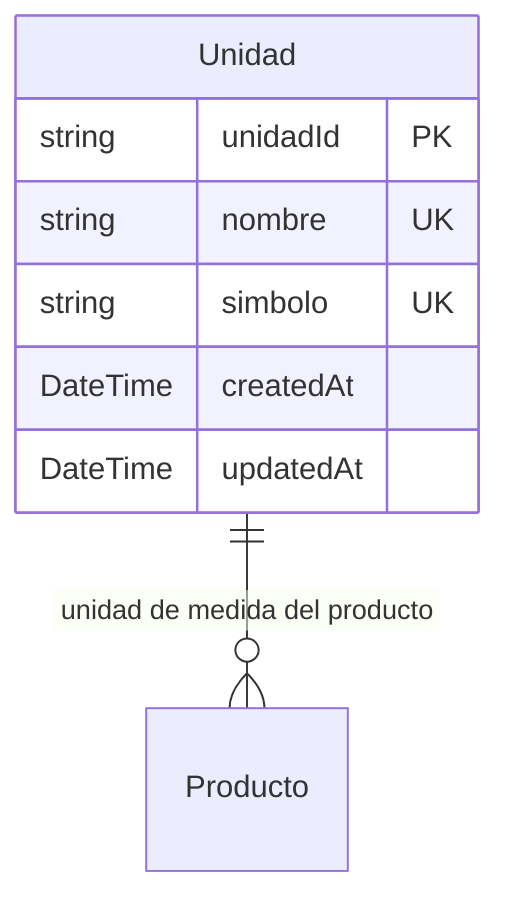

# Unidades de Medida

> **Feature**: `src/features/unidades/`
> **Modelos Prisma**: `Unidad`
> **Ruta**: `/busy/unidades`

---

## Descripción

Módulo de unidades de medida para productos. Define las unidades base del sistema (kg, unidad, litro, metro, etc.). Es un modelo **global** — las unidades son compartidas entre todos los tenants.

Cada `Producto` tiene exactamente una `Unidad` asociada.

## Modelos de Datos



| Modelo | Propósito | PK | Restricciones |
|--------|-----------|----|---------------|
| `Unidad` | Unidad de medida para productos | `unidadId` | `nombre` unique, `simbolo` unique |

## Funcionalidades

### CRUD de Unidades

**Descripción**: Operaciones básicas de creación, lectura, actualización y eliminación de unidades de medida.

**Reglas de negocio**:
- `nombre` y `simbolo` son únicos a nivel global (no por tenant)
- `nombre` y `simbolo` son obligatorios
- `simbolo` ej: "kg", "unid", "L", "m"
- No se puede eliminar una unidad que tenga productos asociados

## Server Actions

| Action | Propósito | Input | Output |
|--------|-----------|-------|--------|
| `getUnidadesAction` | Listar todas las unidades | `void` | `Unidad[]` |
| `getUnidadByIdAction` | Obtener unidad por ID | `unidadId: string` | `Unidad` |
| `createUnidadAction` | Crear unidad | `{ nombre, simbolo }` | `Unidad` |
| `updateUnidadAction` | Actualizar unidad | `{ unidadId, nombre?, simbolo? }` | `Unidad` |
| `deleteUnidadAction` | Eliminar unidad | `unidadId: string` | `{ success }` |

## Reglas de Negocio

1. **Global**: Las unidades no tienen `tenantId`. Son compartidas entre todos los tenants.
2. **Unicidad**: `nombre` y `simbolo` deben ser únicos en toda la base de datos.
3. **Protección**: No se puede eliminar una unidad referenciada por productos existentes.
4. **Validación**: Se verifica unicidad antes de crear/actualizar via `checkUnidadUniqueness`.

## UI y Navegación

| Ruta | Componente | Propósito |
|------|-----------|-----------|
| `/busy/unidades` | UnidadesPage | Listado y gestión de unidades |

## Integraciones

| Módulo | Relación |
|--------|----------|
| `productos` | Cada producto tiene una unidad de medida asignada |
| `categorias` | Independiente, pero usado en conjunto para el catálogo |

## Permisos y Roles

| Acción | Rol requerido |
|--------|---------------|
| Ver unidades | `admin`, `manager`, `economico`, `dependiente` |
| Crear/Editar/Eliminar | `admin`, `manager` |

## Tests

- **Archivos**: `src/features/unidades/__tests__/`

```bash
pnpm test -- src/features/unidades/
```

## Notas Técnicas

- Es el único modelo de negocio que NO tiene `tenantId`. Las unidades son un catálogo global.
- Las Server Actions NO usan `requireTenant()` porque no hay aislamiento por tenant.
- `updateUnidadAction` usa `Record<string, unknown>` para el update data.
- Los validadores de unicidad (`checkUnidadUniqueness`) se encuentran en `src/features/unidades/validators.ts`.
