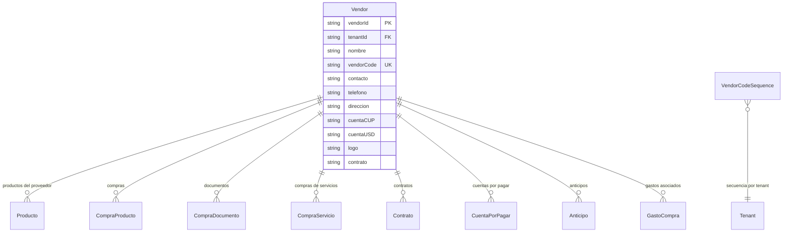

# Proveedores (Vendors)

> **Feature**: `src/features/vendors/`
> **Modelos Prisma**: `Vendor`, `VendorCodeSequence`
> **Ruta**: `/busy/vendors`

---

## Descripción

Módulo de gestión de proveedores. Cada proveedor tiene un código interno único de 2 dígitos por tenant, datos de contacto, cuentas bancarias, y puede tener compras, contratos, anticipos y cuentas por pagar asociadas.

Los proveedores también participan en la generación de códigos EAN-13: el código de proveedor forma parte de la estructura del código de barras.

## Modelos de Datos



| Modelo | Propósito | PK |
|--------|-----------|----|
| `Vendor` | Proveedor con datos de contacto y cuentas | `vendorId` |
| `VendorCodeSequence` | Secuencia para asignación de códigos internos | `seqId` |

## Funcionalidades

### CRUD de Proveedores

**Descripción**: Operaciones completas de creación, lectura, actualización y eliminación de proveedores.

**Campos**: nombre, contacto, teléfono, dirección, cuentas bancarias (CUP/USD), logo, contrato.

### Asignación de Código Interno

**Descripción**: Al crear un proveedor, se le asigna automáticamente un código de 2 dígitos (`vendorCode`) secuencial (01-99). La secuencia es independiente por tenant.

**Reglas**:
- El código se genera automáticamente al crear el proveedor
- Rango: 01 a 99 (máximo 99 proveedores por tenant)
- Es único por tenant (`@@unique([tenantId, vendorCode])`)
- Se usa como parte del código EAN-13 del producto

### Generación de EAN-13

**Descripción**: Cada proveedor expone `ean13Code` derivado de su `vendorCode` para usar en la estructura del código de barras de sus productos.

## Server Actions

| Action | Propósito | Input | Output |
|--------|-----------|-------|--------|
| `getVendorsAction` | Listar proveedores del tenant | `void` | `Vendor[]` (enriquecidos con ean13Code) |
| `getVendorByIdAction` | Obtener proveedor por ID | `vendorId: string` | `Vendor` |
| `createVendorAction` | Crear proveedor | `{ nombre, contacto?, telefono?, direccion?, ... }` | `Vendor` |
| `updateVendorAction` | Actualizar proveedor | `{ vendorId, nombre?, ... }` | `Vendor` |
| `deleteVendorAction` | Eliminar proveedor | `vendorId: string` | `{ success }` |

## Reglas de Negocio

1. **Código de proveedor**: Se asigna automáticamente al crear. Es un string de 2 dígitos (01-99), único por tenant.
2. **Límite**: Máximo 99 proveedores por tenant (por el rango de 2 dígitos).
3. **EAN-13**: El `vendorCode` se usa para generar el código EAN-13 de los productos de ese proveedor.
4. **Cuentas bancarias**: Cada proveedor puede tener cuenta en CUP y USD.
5. **Protección**: No se puede eliminar un proveedor con compras o productos asociados.

## UI y Navegación

| Ruta | Componente | Propósito |
|------|-----------|-----------|
| `/busy/vendors` | VendorsPage | Listado y gestión de proveedores |

## Integraciones

| Módulo | Relación |
|--------|----------|
| `productos` | Cada producto puede tener un proveedor asociado |
| `compras-productos` | Compras a proveedores |
| `compras-servicios` | Compras de servicios a proveedores |
| `contratos` | Contratos con proveedores |
| `contabilidad` | Cuentas por pagar, anticipos, gastos |
| `listas-precios` | Independiente, pero los precios pueden variar por proveedor |

## Permisos y Roles

| Acción | Rol requerido |
|--------|---------------|
| Ver proveedores | `admin`, `manager`, `economico`, `dependiente` |
| Crear/Editar/Eliminar | `admin`, `manager` |

## Tests

- **Archivos**: `src/features/vendors/__tests__/`

```bash
pnpm test -- src/features/vendors/
```

## Notas Técnicas

- `getNextVendorCode()` y `initializeVendorCodeSequence()` se encuentran en `src/lib/vendor-code-utils.ts`.
- `generateVendorEan13(vendorCode)` genera el código EAN-13 base del proveedor usando el código de 2 dígitos.
- `enrichVendor()` es una función helper que agrega `ean13Code` y `vendorCode` a cada vendor response.
- La secuencia de códigos se maneja con el modelo `VendorCodeSequence` para garantizar atomicidad.
