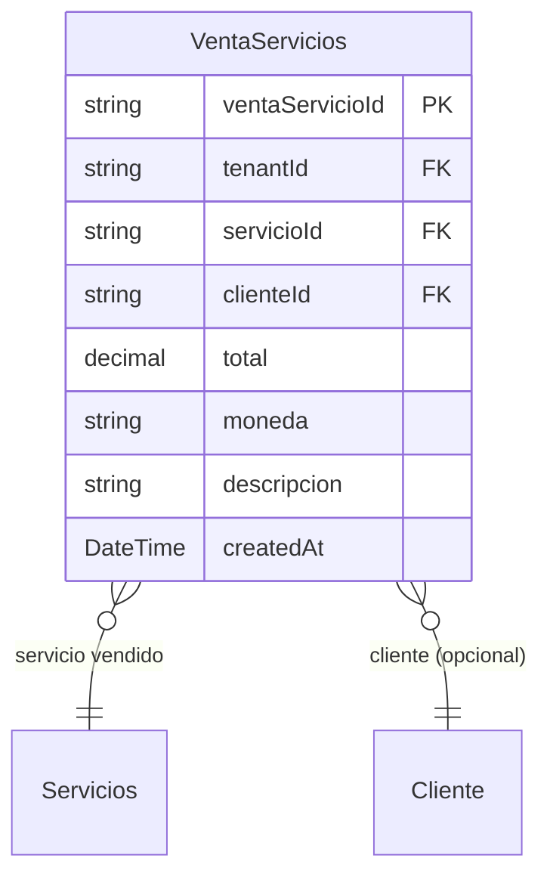

# Ventas de Servicios

> **Feature**: `src/features/venta-servicios/`
> **Modelos Prisma**: `VentaServicios`, `Servicios`, `Cliente`
> **Ruta**: `/busy/venta-servicios`

---

## Descripción

Módulo de registro de ventas de servicios. Complementa el módulo de ventas de productos, permitiendo facturar servicios de forma independiente o combinada. Soporta ventas simples (un servicio), ventas mixtas (múltiples líneas de servicios), y aplicación de anticipos.

## Modelos de Datos

| Modelo | Propósito | PK |
|--------|-----------|----|
| `VentaServicios` | Venta de uno o más servicios | `ventaServicioId` |

## Funcionalidades

### Venta Simple

**Descripción**: Venta de un solo servicio a un cliente (legacy). Input directo: `{ servicioId, clienteId, total, moneda, descripcion }`.

### Venta Mixta (Multi-línea)

**Descripción**: Venta con múltiples líneas de servicios. Cada línea tiene tipo `SERVICIO` con referencia a un servicio del catálogo.

### Aplicación de Anticipos

**Descripción**: Las ventas de servicios pueden aplicar anticipos de clientes existentes via `applyAnticipoAllocations()`.

## Server Actions

| Action | Propósito | Input | Output |
|--------|-----------|-------|--------|
| `getVentaServiciosAction` | Listar ventas de servicios | `void` | `VentaServicios[]` (incluye servicio, cliente) |
| `getVentaServicioByIdAction` | Obtener venta por ID | `id: string` | `VentaServicios` |
| `createVentaServicioAction` | Crear venta (simple o mixta) | `{ servicioId, total, ... }` o `{ lineas: [...], total, ... }` | `VentaServicios` |
| `updateVentaServicioAction` | Actualizar venta | `{ ventaServicioId, ... }` | `VentaServicios` |
| `deleteVentaServicioAction` | Eliminar venta | `id: string` | `{ success }` |

## Reglas de Negocio

1. **Período contable**: Requiere período abierto (envuelto con `withPeriodValidation`).
2. **Líneas de producto no soportadas**: Las ventas mixtas con productos deben ir por el endpoint de ventas (`/api/ventas`).
3. **Anticipos**: Se pueden aplicar anticipos de clientes como forma de pago.
4. **Moneda**: Cada venta de servicio especifica su moneda (CUP, USD, EUR).
5. **Aislamiento**: Scoped por `tenantId`.

## UI y Navegación

| Ruta | Componente | Propósito |
|------|-----------|-----------|
| `/busy/venta-servicios` | VentaServiciosPage | Listado y registro de ventas de servicios |

## Integraciones

| Módulo | Relación |
|--------|----------|
| `servicios` | Catálogo de servicios ofrecidos |
| `clientes` | Asociación de venta a cliente |
| `contabilidad` | Registro contable (via `withPeriodValidation`) |
| `compras-servicios` | Independiente, pero complementa el ciclo de servicios |

## Permisos y Roles

| Acción | Rol requerido |
|--------|---------------|
| Ver ventas de servicios | `admin`, `manager`, `economico`, `dependiente` |
| Crear/Editar/Eliminar | `admin`, `manager` |

## Notas Técnicas

- El schema acepta dos formatos: `ventaServicioLegacySchema` (servicio único) y `ventaMixtaSchema` (múltiples líneas).
- El modo se detecta automáticamente por la presencia del campo `lineas` en el input.
- Si se detectan líneas de tipo `PRODUCTO`, la acción rechaza la operación (debe usarse el módulo de ventas de productos).
- `createVentaServicioAction` está envuelta con `withPeriodValidation` que verifica período contable abierto.
