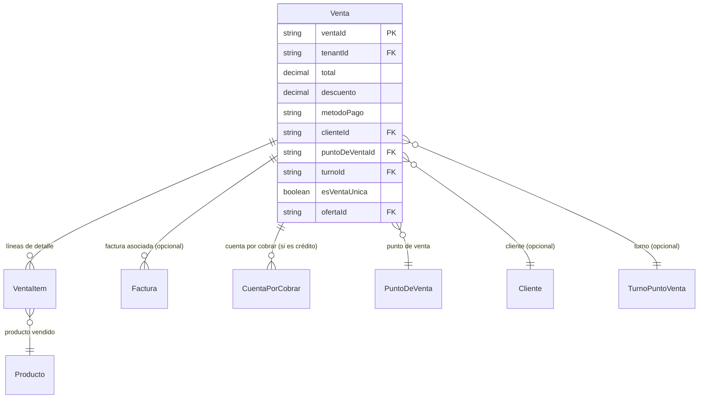

# Ventas

> **Feature**: `src/features/ventas/`
> **Modelos Prisma**: `Venta`, `VentaItem`, `CuentaPorCobrar`, `Factura`
> **Ruta**: `/busy/ventas`, `/busy/punto-venta`

---

## Descripción

Módulo de registro de ventas. Es el motor transaccional del sistema: soporta ventas POS (punto de venta) con cálculo automático de totales, descuento de stock (FIFO), generación de facturas, cuentas por cobrar, y registro contable automático.

Las ventas pueden ser **POS** (contado, afectan stock inmediatamente) o **facturadas** (generan cuenta por cobrar).

## Modelos de Datos



| Modelo | Propósito | PK |
|--------|-----------|----|
| `Venta` | Transacción de venta | `ventaId` |
| `VentaItem` | Línea de detalle de una venta (producto + cantidad + precio) | `id` |

## Funcionalidades

### Registro de Venta POS (`createVentaAction`)

**Descripción**: Registra una venta con sus líneas de productos. Calcula totales, descuenta stock (FIFO), y opcionalmente genera factura y/o cuenta por cobrar.

**Reglas de negocio**:
- Verifica feature flag `ventas-pos`
- Valida schema con Zod (productos, cantidades, precios)
- Usa `allocateFifoForSale()` para descontar stock con método FIFO
- Crea o reusa el turno POS activo via `getOrCreateTurnoActivo()`
- Si tiene cliente, puede generar factura automáticamente
- Soporta múltiples métodos de pago: efectivo, tarjeta, transferencia, crédito
- Idempotencia via `idempotencyKey` para evitar duplicados

### Anulación de Venta (`anularVentaAction`)

**Descripción**: Anula una venta existente. No elimina el registro (soft delete via `deletedAt`).

**Reglas**: 
- Solo se puede anular si no tiene factura asociada o la factura está cancelable
- Las ventas anuladas reaparecen en consultas con filtro específico

### Listado de Ventas

**Descripción**: Lista paginada de ventas del tenant con filtros por fecha, cliente, método de pago, estado.

### Venta Única (`esVentaUnica`)

**Descripción**: Modalidad de venta sin items (monto fijo). Se usa para ventas rápidas donde no se necesita desglosar productos.

## Server Actions

| Action | Propósito | Input destacado | Output |
|--------|-----------|-----------------|--------|
| `getVentasAction` | Listar ventas | `void` | `Venta[]` |
| `getVentaByIdAction` | Obtener venta por ID | `ventaId: string` | `Venta` |
| `createVentaAction` | Crear venta | `{ items, metodoPago, clienteId?, puntoDeVentaId?, ... }` | `Venta` |
| `updateVentaAction` | Actualizar venta | `{ ventaId, ... }` | `Venta` |
| `anularVentaAction` | Anular venta | `{ ventaId, motivo? }` | `{ success }` |

## UI y Navegación

| Ruta | Componente | Propósito |
|------|-----------|-----------|
| `/busy/ventas` | `VentasPageClient` | Listado de ventas |
| `/busy/punto-venta` | `PvInterface` | Interfaz POS para registro de ventas |

### Componentes Principales

| Componente | Propósito |
|-----------|-----------|
| `pv-interface.tsx` | Interfaz táctil de punto de venta |
| `venta-form.tsx` | Formulario detallado de venta |
| `enhanced-venta-form.tsx` | Formulario mejorado con búsqueda de productos |
| `cart-item.tsx` | Item del carrito de compras |
| `producto-card.tsx` | Tarjeta de producto para POS |
| `pv-invoice-dialog.tsx` | Diálogo de facturación post-venta |
| `ventas-table.tsx` | Tabla de ventas con filtros |

## Integraciones

| Módulo | Relación |
|--------|----------|
| `productos` | Descuento de stock via FIFO |
| `facturas` | Generación automática de factura |
| `clientes` | Asociación de venta a cliente |
| `turnos-pos` | Asignación de venta a turno activo |
| `puntos-venta` | PV donde se realiza la venta |
| `ofertas` | Aplicación de ofertas en ventas |
| `contabilidad` | Registro contable automático de ventas |
| `cuadre-diario` | Las ventas alimentan el cuadre diario |
| `arqueo-caja` | Ventas del turno para arqueo |

## Permisos y Roles

| Acción | Rol requerido |
|--------|---------------|
| Ver ventas | `admin`, `manager`, `economico`, `dependiente` |
| Crear venta | `admin`, `manager`, `dependiente` |
| Anular venta | `admin`, `manager` |

## Tests

- **Archivos**: `src/features/ventas/__tests__/`

```bash
pnpm test -- src/features/ventas/
```

## Notas Técnicas

- `createVentaAction` usa un workflow de facturación dedicado (`facturacion-workflow.ts`) que decide si crear factura, cuenta por cobrar, o ambos.
- El descuento de stock usa `allocateFifoForSale()` que implementa FIFO (First In, First Out) basado en `StockUbicacion` y fechas de entrada.
- Las ventas eliminadas (soft delete) tienen `deletedAt` seteado pero no se eliminan físicamente.
- `esVentaUnica` permite montos fijos sin desglose de productos (venta rápida).
- La idempotencia se maneja via `idempotencyKey` para prevenir duplicados en caso de errores de red.
- Los montos se serializan como `Number()` (no `Decimal`) en las respuestas para compatibilidad con el cliente.
