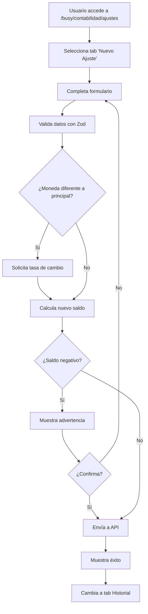
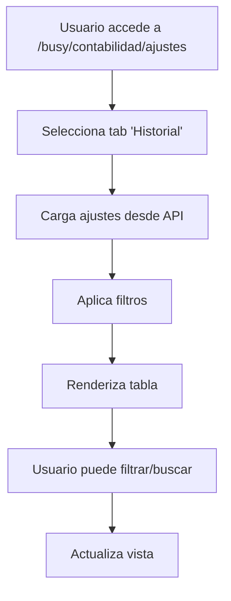

# Sistema de Ajustes Bancarios

## Descripción General

El Sistema de Ajustes Bancarios es una funcionalidad integrada del módulo de contabilidad que permite realizar ajustes manuales en las cuentas bancarias para corregir discrepancias, registrar movimientos externos o corregir errores contables. Este sistema mantiene un registro completo de auditoría y proporciona controles de seguridad para evitar errores.

## Ubicación en el Sistema

- **Ruta Principal**: `/busy/contabilidad/ajustes`
- **Acceso**: Dashboard de Contabilidad → Acciones Rápidas → Ajustes Bancarios
- **Módulo**: Contabilidad → Ajustes

## Funcionalidades Principales

### 1. Creación de Ajustes Manuales

#### Tipos de Ajustes
- **Ajustes de Ingreso**: Para aumentar el saldo de la cuenta
  - Depósitos no registrados automáticamente
  - Correcciones por errores de registro (sobrestimación)
  - Intereses bancarios
  - Otros ingresos externos al sistema

- **Ajustes de Egreso**: Para disminuir el saldo de la cuenta
  - Comisiones bancarias
  - Retiros no registrados
  - Correcciones por sobrestimación
  - Otros gastos externos al sistema

#### Campos Requeridos
- **Cuenta Bancaria**: Selección de cuenta activa
- **Tipo**: Ingreso o Egreso
- **Monto**: Valor numérico mayor a 0
- **Moneda**: Moneda del ajuste (conversión automática si es diferente a la principal)
- **Descripción**: Detalles del ajuste (mínimo 10 caracteres, máximo 500)
- **Motivo**: Razón del ajuste (mínimo 5 caracteres, máximo 200)

### 2. Validaciones y Controles

#### Validación de Saldo
- **Cálculo automático del nuevo saldo** basado en el ajuste
- **Advertencia de saldo negativo** con confirmación obligatoria
- **Preview del impacto** en la cuenta antes de confirmar

#### Validación de Conversión de Moneda
- **Detección automática** cuando la moneda del ajuste difiere de la principal
- **Diálogo de tasa de cambio** para especificar el valor de conversión
- **Cálculo automático del monto convertido**

#### Validación de Datos
- **Validación con Zod** en frontend y backend
- **Campos obligatorios** con mensajes de error específicos
- **Formato de datos** validado antes del envío

### 3. Historial y Auditoría

#### Registro Completo
- **Fecha y hora** del ajuste
- **Usuario** que realizó el ajuste
- **Detalles completos** del ajuste
- **Tasa de cambio** utilizada (si aplica)
- **Monto convertido** (si aplica)

#### Filtros y Búsqueda
- **Filtro por cuenta** bancaria específica
- **Filtro por tipo** (ingreso/egreso)
- **Filtro por moneda**
- **Búsqueda por descripción** o motivo
- **Paginación** para grandes volúmenes

## Arquitectura del Sistema

### Componentes Frontend

#### 1. `AjustesBancariosPage.tsx`
**Ubicación**: `src/components/contabilidad/ajustes-bancarios-page.tsx`

**Funcionalidades**:
- Página principal con sistema de tabs
- Integración de formulario e historial
- Resumen rápido de cuentas activas
- Información educativa sobre tipos de ajustes

**Props**:
```typescript
// No requiere props, es un componente autónomo
```

#### 2. `AjusteBancarioForm.tsx`
**Ubicación**: `src/components/contabilidad/ajuste-bancario-form.tsx`

**Funcionalidades**:
- Formulario completo con validación Zod
- Cálculo automático de nuevo saldo
- Manejo de conversión de monedas
- Validación de saldo negativo
- Integración con Redux para envío de datos

**Props**:
```typescript
interface AjusteBancarioFormProps {
  onSuccess?: () => void    // Callback después de crear exitosamente
  onCancel?: () => void     // Callback para cancelar
}
```

#### 3. `HistorialAjustesTable.tsx`
**Ubicación**: `src/components/contabilidad/historial-ajustes-table.tsx`

**Funcionalidades**:
- Tabla responsive con todos los ajustes
- Filtros avanzados y búsqueda
- Paginación y ordenamiento
- Resumen estadístico
- Integración con Redux para obtención de datos

**Props**:
```typescript
interface HistorialAjustesTableProps {
  cuentaId?: string        // Filtrar por cuenta específica
  showAllAccounts?: boolean // Mostrar todas las cuentas
}
```

### API Endpoints

#### 1. Crear Ajuste
```
POST /api/contabilidad/ajustes
```

**Request Body**:
```typescript
{
  cuentaId: string
  tipo: 'ingreso' | 'egreso'
  monto: number
  moneda: string
  tasaCambio?: number
  descripcion: string
  motivo: string
}
```

**Response**:
```typescript
{
  ajusteId: string
  cuentaId: string
  tipo: 'ingreso' | 'egreso'
  monto: number
  moneda: string
  tasaCambio?: number
  montoConvertido?: number
  descripcion: string
  motivo: string
  realizadoPor: string
  createdAt: string
}
```

#### 2. Obtener Ajustes por Cuenta
```
GET /api/contabilidad/ajustes/:cuentaId
```

**Parámetros**:
- `cuentaId`: ID de la cuenta (use 'all' para todas las cuentas)

**Response**:
```typescript
AjusteBancario[]
```

### Integración Redux

#### Servicios API
**Ubicación**: `src/lib/redux/services/contabilidadApi.tsx`

**Endpoints Utilizados**:
```typescript
// Crear nuevo ajuste
createAjusteBancario: builder.mutation<AjusteBancario, CreateAjusteBancarioRequest>

// Obtener ajustes por cuenta
getAjustesByCuenta: builder.query<AjusteBancario[], string>
```

#### Slice de Estado
**Ubicación**: `src/lib/redux/slices/contabilidadSlice.tsx`

**Estado**:
```typescript
interface ContabilidadState {
  ajustes: AjusteBancario[]
  // ... otros estados
}
```

## Flujo de Trabajo

### 1. Creación de Ajuste



### 2. Consulta de Historial



## Casos de Uso

### 1. Ajuste por Depósito no Registrado
**Escenario**: Un cliente realizó un depósito en la cuenta bancaria pero no se registró en el sistema.

**Pasos**:
1. Acceder a Ajustes Bancarios
2. Seleccionar cuenta bancaria correspondiente
3. Tipo: "Ingreso"
4. Monto: valor del depósito
5. Descripción: "Depósito en efectivo - Cliente Juan Pérez"
6. Motivo: "Registro manual de depósito no incluido en ventas"

### 2. Ajuste por Comisión Bancaria
**Escenario**: El banco cobró una comisión que no está en el sistema.

**Pasos**:
1. Acceder a Ajustes Bancarios
2. Seleccionar cuenta bancaria correspondiente
3. Tipo: "Egreso"
4. Monto: valor de la comisión
5. Descripción: "Comisión por mantenimiento de cuenta - Enero 2024"
6. Motivo: "Gasto operativo no registrado"

### 3. Ajuste por Corrección de Error
**Escenario**: Se registró incorrectamente una venta con monto mayor al real.

**Pasos**:
1. Acceder a Ajustes Bancarios
2. Seleccionar cuenta bancaria correspondiente
3. Tipo: "Egreso"
4. Monto: diferencia incorrecta
5. Descripción: "Corrección de venta #1234 - monto sobreestimado"
6. Motivo: "Ajuste por error de digitación"

## Validaciones de Seguridad

### Frontend
- **Validación de formulario** con Zod
- **Confirmación de saldo negativo** obligatoria
- **Campos obligatorios** marcados visualmente
- **Longitud mínima/máxima** de textos
- **Formato numérico** validado

### Backend
- **Validación de entrada** en endpoints API
- **Autorización** de usuario autenticado
- **Existencia de cuenta** bancaria verificada
- **Saldo positivo** después del ajuste (con advertencia)
- **Tasa de cambio válida** si se proporciona

### Auditoría
- **Registro automático** de usuario y fecha
- **Descripción detallada** obligatoria
- **Motivo específico** requerido
- **Historial inmutable** de todos los ajustes

## Consideraciones de Rendimiento

### Optimizaciones Implementadas
- **Lazy loading** de componentes
- **Paginación** en consultas de historial
- **Filtros en frontend** para reducir carga de servidor
- **Memoización** de cálculos de saldo
- **Loading states** para mejor UX

### Recomendaciones
- **Limitar registros** mostrados por página (50 por defecto)
- **Indexar base de datos** por cuentaId y createdAt
- **Cache de tasas de cambio** para conversiones frecuentes
- **Limpiar formulario** después de envío exitoso

## Troubleshooting

### Problemas Comunes

#### 1. Error al Crear Ajuste
**Síntoma**: "Error al crear el ajuste bancario"

**Posibles Causas**:
- Cuenta bancaria no existe o está inactiva
- Usuario no tiene permisos
- Datos inválidos en formulario
- Problema de conectividad con API

**Solución**:
- Verificar que la cuenta esté activa
- Confirmar autenticación del usuario
- Revisar logs del servidor
- Validar formato de datos

#### 2. Tasa de Cambio Requerida
**Síntoma**: Dialog de tasa de cambio aparece repetidamente

**Posibles Causas**:
- Moneda seleccionada diferente a principal
- Tasa de cambio no proporcionada
- Error en validación de moneda

**Solución**:
- Proporcionar tasa de cambio válida
- Verificar configuración de monedas
- Confirmar moneda principal del sistema

#### 3. Advertencia de Saldo Negativo
**Síntoma**: Dialog de confirmación aparece constantemente

**Posibles Causas**:
- Monto del ajuste muy alto
- Cuenta con saldo bajo
- Error en cálculo de saldo

**Solución**:
- Verificar saldo actual de la cuenta
- Dividir ajuste en múltiples transacciones
- Confirmar cálculo de nuevo saldo

## Mantenimiento

### Logs del Sistema
El sistema registra automáticamente:
- Creación de ajustes
- Errores de validación
- Problemas de conversión de moneda
- Advertencias de saldo negativo

### Respaldos
- **Base de datos**: Respaldar tabla `ajustesbancarios` regularmente
- **Configuración**: Respaldar tasas de cambio
- **Logs**: Mantener logs de auditoría por al menos 1 año

### Monitoreo
- **Frecuencia de uso** de ajustes por período
- **Volumen de ajustes** por cuenta
- **Errores recurrentes** en creación
- **Tiempos de respuesta** de API

## Actualizaciones Futuras

### Funcionalidades Planeadas
- **Plantillas de ajustes** para casos comunes
- **Ajustes automáticos** basados en reglas
- **Integración con sistemas bancarios** externos
- **Reportes específicos** de ajustes
- **Aprobación de ajustes** por supervisor

### Mejoras Técnicas
- **API GraphQL** para consultas más eficientes
- **Websockets** para actualizaciones en tiempo real
- **Exportación a Excel/PDF** del historial
- **Búsqueda avanzada** con criterios múltiples
- **Dashboard de métricas** de ajustes

---

**Versión del Documento**: 1.0  
**Fecha de Creación**: 29 de Diciembre, 2024  
**Última Actualización**: 29 de Diciembre, 2024  
**Autor**: Sistema de Documentación Kilo Code