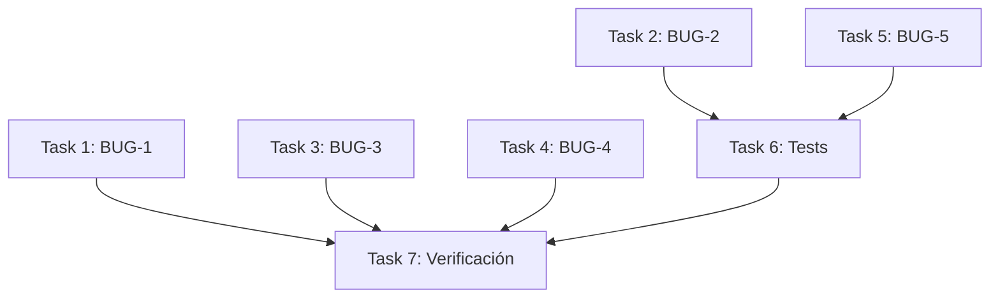

# Tasks: Fix transferencias bugs

## Task 1 — BUG-1: Agregar schema y tipos faltantes en TransferenciaForm

**Archivo:** `src/features/transferencias/components/transferencias-form.tsx`

**Dependencias:** Ninguna

**Cambio:**
- [ ] 1.1 Agregar `transferenciaSchema` (Zod object con productos array, tipoOrigen, origenId, tipoDestino, destinoId, descripcion)
- [ ] 1.2 Agregar `type TransferenciaFormValues = z.infer<typeof transferenciaSchema>`
- [ ] 1.3 Agregar `interface TransferenciaFormProps` con `initialData` opcional

**Verificación:** Cargar `/busy/transferencias/new` sin `ReferenceError`

---

## Task 2 — BUG-2: Agregar tenantId al count de paginación

**Archivo:** `src/features/transferencias/actions.ts`

**Dependencias:** Ninguna

**Cambio:**
- [ ] 2.1 En `getTransferenciasAction`, agregar `tenantId` al where del `prisma.transferencia.count()`

**Verificación:** Test `retorna lista paginada` pasa

---

## Task 3 — BUG-3: Filtrar transferencias canceladas en stock de PV

**Archivo:** `src/features/transferencias/actions.ts`

**Dependencias:** Ninguna

**Cambio:**
- [ ] 3.1 En `getStockDisponibleEnPuntoVenta`, agregar `deletedAt: null` al where del aggregate de entrada
- [ ] 3.2 En `getStockDisponibleEnPuntoVenta`, agregar `deletedAt: null` al where del aggregate de salida
- [ ] 3.3 En ambos aggregates, agregar `estado: { notIn: ['CANCELADA', 'RECHAZADA'] }`

**Verificación:** Tests de `createTransferenciaAction` pasan

---

## Task 4 — BUG-4: Construir data dinámicamente en updateTransferenciaAction

**Archivo:** `src/features/transferencias/actions.ts`

**Dependencias:** Ninguna

**Cambio:**
- [ ] 4.1 Reemplazar el objeto `data` hardcodeado en `updateTransferenciaAction` con construcción dinámica según `tipoOrigen`/`tipoDestino`

**Verificación:** Tests de update pasan, revisión visual del diff

---

## Task 5 — BUG-5: Validar stock contra StockUbicacion en almacén

**Archivo:** `src/features/transferencias/actions.ts`

**Dependencias:** Task 3 (misma área de código, mismo archivo)

**Cambio:**
- [ ] 5.1 En `createTransferenciaAction`, reemplazar validación `producto.stock < item.cantidad` por consulta a `prisma.stockUbicacion.findUnique` con `cantidadDisponible`

**Verificación:** Tests de `createTransferenciaAction` pasan con mocks actualizados

---

## Task 6 — Actualizar tests existentes

**Archivo:** `src/features/transferencias/__tests__/actions.test.ts`

**Dependencias:** Task 2, Task 5

**Cambio:**
- [ ] 6.1 Agregar `stockUbicacion: { findUnique: vi.fn() }` al mock de `prisma`
- [ ] 6.2 Actualizar test `rechaza stock insuficiente` para mockear `stockUbicacion.findUnique` con stock bajo
- [ ] 6.3 Actualizar test `crea transferencia exitosamente` para mockear `stockUbicacion.findUnique` con stock suficiente
- [ ] 6.4 Agregar assertion sobre `tenantId` en el mock de `count` para paginación

**Verificación:** `pnpm run test:run src/features/transferencias/__tests__/actions.test.ts` pasa

---

## Task 7 — Verificación final

**Dependencias:** Tasks 1–6

**Cambio:**
- [ ] 7.1 Ejecutar `pnpm run test:run` para toda la suite de transferencias
- [ ] 7.2 Ejecutar `pnpm exec eslint src/features/transferencias/` sin errores
- [ ] 7.3 Levantar dev server y verificar que `/busy/transferencias/new` carga sin errores

**Verificación:** Sin errores de compilación, tests pasan, página carga

---

## Dependencias entre tareas

Tasks 1, 2, 3, 4 son independientes y pueden ejecutarse en paralelo.
Task 5 depende de Task 3 (mismo archivo, evitar conflictos de merge).
Task 6 depende de Tasks 2 y 5 (mocks actualizados).
Task 7 es la verificación final.
