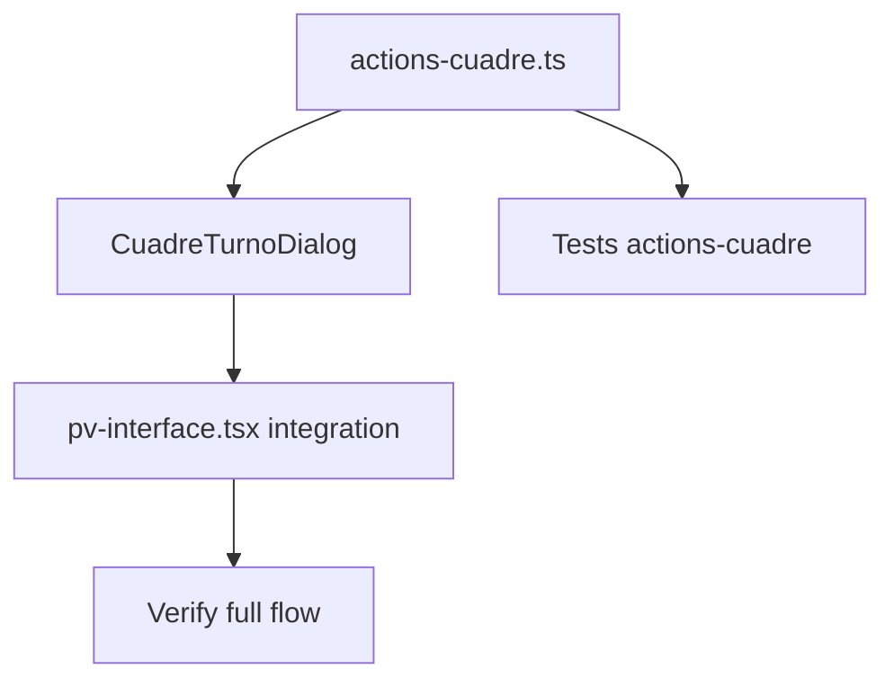

# Tasks: Cuadre de Turno POS

## Dependencias



## Task List

### T1: Server Action `getCuadreTurnoAction`

**Archivo nuevo**: `src/features/turnos-pos/actions-cuadre.ts`

**Dependencias**: Ninguna (puede empezar ya)

**Implementación**:
- Crear `getCuadreTurnoAction` con `withAction`
- Input: `{ turnoId: string }` con schema Zod
- Validar que el turno existe, pertenece al tenant, está ABIERTO
- Validar que tiene arqueo (ActionError `NO_ARQUEO` si no)
- `Promise.all` con 3 queries:
  1. Turno + arqueo + empleado
  2. VentaItems del turno (agrupados por productoId)
  3. StockUbicacion del punto de venta (con include de producto + unidad + fotos)
- Procesar: agrupar ventaItems por productoId → mapear stockUbicacion con vendidoEnTurno → calcular totales
- Retornar `{ turno, arqueo, totalVentaTurno, productos[], resumen }` según spec

**Criterios de aceptación**:
- Query correcta con datos reales
- Promise.all funcional (las 3 queries dependen entre sí: stock necesita puntoDeVentaId del turno)
- Tipado correcto del retorno

---

### T2: Componente `CuadreTurnoDialog`

**Archivo nuevo**: `src/features/turnos-pos/components/cuadre-turno-dialog.tsx`

**Dependencias**: T1 (necesita la action para cargar datos)

**Implementación**:
- Props según spec: `open`, `onOpenChange`, `turnoId`, `puntoDeVentaId`, `onRepetirArqueo`, `onSuccess`
- Cargar datos con `getCuadreTurnoAction` al abrir
- Estados: Loading, Error, Loaded-OK, Loaded-Diff, Submitting, SubmitError
- Tabla de productos con columnas: [foto] nombre | stock | vendido | precio | restante
- Fila de totales al final
- Indicador de diferencia: verde si =0, rojo si ≠0
- Botón "Aprobar y Cerrar Turno" → llama `cerrarTurnoAction`
  - Deshabilitado si diferencia ≠ 0
  - Deshabilitado si isSubmitting
- Botón "Repetir Arqueo" → visible solo si diferencia ≠ 0 → llama `onRepetirArqueo`
- Botón "Cancelar" → cierra diálogo
- Manejo de errores con toast

**UX**:
- Scroll interno en tabla (max-h de 60vh)
- Foto del producto (thumbnail 40x40)
- Formato de moneda con `formatCurrency` / formato simple
- Tooltip "Diferencia" con detalle si es necesario

---

### T3: Integración en `pv-interface.tsx`

**Archivo modificado**: `src/features/ventas/components/pv-interface.tsx`

**Dependencias**: T2

**Implementación**:
- Importar `CuadreTurnoDialog`
- Agregar estado `isCuadreDialogOpen`
- En `ArqueoForm.onSuccess`: abrir `CuadreTurnoDialog` en lugar de solo refrescar
- Renderizar `CuadreTurnoDialog` condicional (si turnoActivo)
- `onRepetirArqueo`: cerrar cuadre, abrir arqueo
- `onSuccess` del cuadre: limpiar turnoActivo, refresh

**Fragmento clave**:
```tsx
const [isCuadreDialogOpen, setIsCuadreDialogOpen] = useState(false);

// En ArqueoForm.onSuccess:
onSuccess={() => {
  setIsArqueoDialogOpen(false);
  setIsCuadreDialogOpen(true);
}}

// Render:
{turnoActivo && (
  <CuadreTurnoDialog
    open={isCuadreDialogOpen}
    onOpenChange={setIsCuadreDialogOpen}
    turnoId={turnoActivo.id}
    puntoDeVentaId={selectedPuntoVenta}
    onRepetirArqueo={() => {
      setIsCuadreDialogOpen(false);
      setIsArqueoDialogOpen(true);
    }}
    onSuccess={() => setTurnoActivo(null)}
  />
)}
```

---

### T4: Tests de `getCuadreTurnoAction`

**Archivo nuevo**: `src/features/turnos-pos/__tests__/actions-cuadre.test.ts`

**Dependencias**: T1

**Implementación**:
- Mock de prisma con datos de turno, arqueo, ventaItems, stockUbicacion
- Test 1: cuadre completo con productos y ventas
- Test 2: falla si turno no existe
- Test 3: falla si turno no tiene arqueo
- Test 4: totalVentaTurno calculado correctamente
- Test 5: productos con vendidoEnTurno agrupados correctamente

---

### T5: Verificación del flujo completo

**Dependencias**: T2, T3, T4

**Pasos**:
1. Ejecutar tests unitarios
2. Verificar lint (`pnpm run lint`)
3. Verificación visual (browser):
   - Abrir POS con turno abierto
   - Ir a "Cerrar Turno"
   - Ir a Arqueo y registrar
   - Ver cuadre con productos
   - Aprobar y verificar que turno se cierra

---

## Orden de aplicación

```
T1 → T4  (paralelo: T1 primero, T4 después)
T2 → T3  (secuencial)
T5       (final)
```
