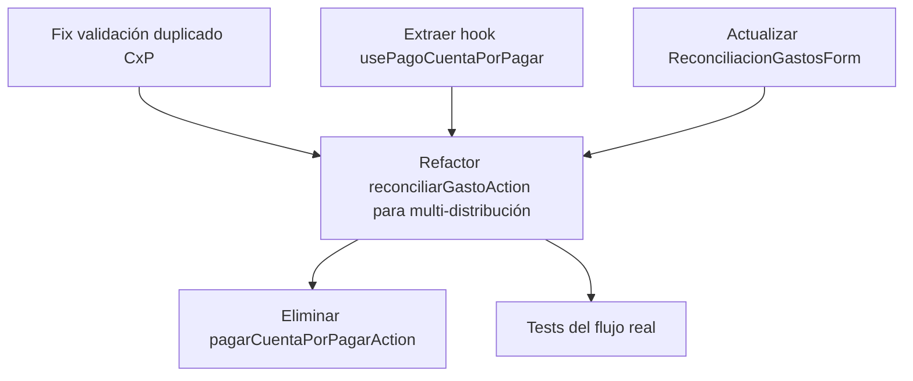

# Tasks: Cuentas por Pagar — Fixes

## Dependencias



**Strict TDD**: Cada tarea con cambios de lógica DEBE tener test antes del código (RED → GREEN).

---

## T-1: Fix validación duplicado en createCuentaPorPagarAction

**Archivo**: `src/features/contabilidad/actions-cuentas.ts` (línea ~520)

**Cambio**: Agregar `proveedorId` al `where` de la validación de duplicado.

```typescript
// De:
where: { numeroFactura: p.numeroFactura, tenantId, deletedAt: null }
// A:
where: { numeroFactura: p.numeroFactura, proveedorId: p.proveedorId, tenantId, deletedAt: null }
```

**Test**: Escribir test que verifique que se permiten dos facturas con mismo número pero diferente proveedor.

**Criterio**: `pnpm run test:run` pasa. Lint pasa.

**Dependencias**: Ninguna.

---

## T-2: Refactor reconciliarGastoAction para soportar distribución multi-cuenta

**Archivos**:
- `src/features/contabilidad/actions-reconciliacion.ts`
- `src/lib/services/pago-gastos-workflow.ts` (lectura, no modificar)

**Cambios**:

### 2a. Modificar interfaz de entrada

Agregar campo `distribucion` opcional al input de `reconciliarGastoAction`:

```typescript
{
  // ... campos existentes ...
  cuentaPorPagarId?: string;
  distribucion?: Array<{
    cuentaId: string;
    monto: number;
    tipoPagoId: string;
    moneda: string;
    tasaCambio?: number;
    numeroTransaccion?: string;
    observaciones?: string;
    porcentaje?: number;
  }>;
}
```

### 2b. Cuando `cuentaPorPagarId` está presente, delegar a `applyPagoGastoWorkflow`

En lugar de la lógica inline actual (crear ReconciliacionGasto, descontar saldo, actualizar CxP), construir `ApplyPagoGastoWorkflowParams` dentro de `$transaction`:

```typescript
if (input.cuentaPorPagarId) {
  const result = await prisma.$transaction(async (tx) => {
    return applyPagoGastoWorkflow(tx, {
      tipoGasto: determinarTipoGasto(input),
      referenciaId: input.gastoCompraId || input.pgId || input.compraServicioId || input.ventaServicioId,
      reconciliadoPor: user.userId,
      descripcion: input.descripcion || '',
      monto: input.monto,
      moneda: input.moneda || 'CUP',
      tenantId,
      cuentaPorPagarId: input.cuentaPorPagarId,
      distribucion: input.distribucion?.map(d => ({
        cuentaId: d.cuentaId,
        monto: d.monto,
      })),
      tipoPagoId: input.distribucion?.[0]?.tipoPagoId, // Usar primer tipoPago como default
      numeroTransaccion: input.distribucion?.[0]?.numeroTransaccion,
      cuentaProveedor: input.distribucion?.[0]?.observaciones,
      gastoCompraId: input.gastoCompraId,
      gastosDEId: input.gastosDEId,
      pgId: input.pgId,
    });
  });

  revalidatePath('/busy/contabilidad/cuentas-por-pagar');
  return result;
}
```

### 2c. Mantener lógica inline para flujos no-CxP

Cuando NO hay `cuentaPorPagarId`, mantener el código actual sin cambios. Esto protege salarios, gastosDE, servicios y venta_servicio.

**Criterio**: Pagos CxP existentes siguen funcionando. Pagos multi-cuenta descuentan de todas las cuentas. Flujos no-CxP no rotos.

**Tests**: T-6 cubre la validación.

**Dependencias**: T-3 (hook), T-4 (form).

---

## T-3: Extraer hook usePagoCuentaPorPagar

**Archivo nuevo**: `src/features/contabilidad/hooks/use-pago-cuenta-por-pagar.ts`

**Responsabilidad**:
- Recibir `cuentaPorPagarId` y `gasto` (GastoPendiente)
- Exponer `onSubmit` que construye `distribucion` y llama a `reconciliarGastoAction`
- Manejar estados loading/success/error
- Calcular monto restante y validar que no exceda saldo

```typescript
interface UsePagoCuentaPorPagarOptions {
  cuentaPorPagarId: string;
  gasto: GastoPendiente;
  cuentas: CuentaBancaria[];
  onSuccess?: () => void;
  onClose?: () => void;
}

export function usePagoCuentaPorPagar(options: UsePagoCuentaPorPagarOptions) {
  // Lógica extraída del form
}
```

**Criterio**: Hook exportable, tipado, testeable.

**Dependencias**: Ninguna.

---

## T-4: Actualizar ReconciliacionGastosForm para pasar distribución completa

**Archivo**: `src/features/contabilidad/components/reconciliacion/reconciliacion-gastos-form.tsx`

**Cambios**:

1. Cuando `isCuentaPorPagar = true`, integrar `usePagoCuentaPorPagar` hook
2. En `onSubmit`, en lugar de pasar solo `data.distribuciones[0].cuentaId`:
   - Construir array `distribucion` completo con todas las distribuciones
   - Pasar a `reconciliarGastoAction`
3. Cuando `isCuentaPorPagar = false`, mantener el comportamiento actual sin cambios

```typescript
// onSubmit, sección CxP:
if (isCuentaPorPagar && cuentaPorPagarId) {
  const result = await reconciliarGastoAction({
    ...baseData,
    cuentaPorPagarId,
    distribucion: data.distribuciones.map(d => ({
      cuentaId: d.cuentaId,
      monto: d.monto,
      tipoPagoId: d.tipoPagoId,
      moneda: d.moneda,
      tasaCambio: d.tasaCambio,
      numeroTransaccion: d.numeroTransaccion,
      observaciones: d.observaciones,
      porcentaje: Math.round((d.monto / gasto.monto) * 100 * 100) / 100,
    })),
  });
}
```

**Deshabilitar botón "Agregar Pago"** cuando `isCuentaPorPagar = false`? No — dejarlo, ya funciona para gastos generales. Solo aseguramos que CxP pase la distribución completa.

**Criterio**: UI no cambia visualmente. Pagos multi-cuenta funcionan.

**Dependencias**: T-2, T-3.

---

## T-5: Eliminar pagarCuentaPorPagarAction

**Archivos**:
- `src/features/contabilidad/actions-cuentas.ts` — eliminar función `pagarCuentaPorPagarAction` (líneas 552-650)
- `src/features/contabilidad/schemas-cuentas.ts` — eliminar `pagarCuentaPorPagarSchema` y `PagarCuentaPorPagarInput`
- `src/features/contabilidad/index.ts` — eliminar export de `pagarCuentaPorPagarAction` y `PagarCuentaPorPagarResult`
- `src/features/contabilidad/api/__tests__/cuentas-por-pagar-pagar.test.ts` — eliminar archivo (reemplazado por T-6)

**Criterio**: `pnpm run build` sin errores de import/referencia. `pnpm run lint` sin errores.

**Dependencias**: T-2 (la funcionalidad debe estar cubierta por reconciliarGastoAction).

---

## T-6: Tests del flujo real de CxP

**Archivo nuevo**: `src/features/contabilidad/__tests__/reconciliar-gasto-cxp.test.ts`

**Test cases** (RED → GREEN):

| # | Test | Mock |
|---|------|------|
| 1 | Pago total simple → estado PAGADA, saldo 0 | `applyPagoGastoWorkflow` resuelve |
| 2 | Pago parcial → estado PARCIAL, saldo > 0 | `applyPagoGastoWorkflow` resuelve |
| 3 | Pago multi-cuenta (2 distribuciones) → 2 reconciliaciones | `applyPagoGastoWorkflow` resuelve con 2 reconciliaciones |
| 4 | Monto excede saldo → error MONTO_EXCEDE_SALDO | `applyPagoGastoWorkflow` rechaza |
| 5 | CxP ya pagada → error CUENTA_YA_PAGADA | `applyPagoGastoWorkflow` rechaza |
| 6 | Sin `cuentaPorPagarId` → comportamiento legacy preservado | Flujo no-CxP |

**Estructura** similar al test existente pero probando `reconciliarGastoAction`:

```typescript
import { reconcileGastoAction } from '@/features/contabilidad/actions-reconciliacion'
// ...
const result = await reconciliarGastoAction({
  gastoCompraId: 'gc-1',
  cuentaId: 'cb-1',
  tipoPagoId: 'tp-1',
  monto: 100,
  moneda: 'CUP',
  descripcion: 'Pago FAC-001',
  cuentaPorPagarId: 'cxp-1',
})
```

**Criterio**: `pnpm run test:run` — todos los tests nuevos pasan.

**Dependencias**: T-2.

---

## Orden de ejecución propuesto

```
1. T-1 (fix duplicado) — cambio mínimo, sin dependencias
2. T-3 (hook) — prepara la lógica extraída
3. T-2 (refactor action) — el cambio central
4. T-4 (actualizar form) — integra el cambio en UI
5. T-5 (eliminar código muerto) — solo después de verificar que T-2 cubre el caso
6. T-6 (tests) — después de T-2
```

## Estimación de diffs

| Tarea | Archivos | Líneas estimadas |
|-------|----------|-----------------|
| T-1 | 1 | +2 / -1 |
| T-2 | 2 | +80 / -60 |
| T-3 | 1 (nuevo) | +80 |
| T-4 | 1 | +30 / -15 |
| T-5 | 4 | +0 / -120 |
| T-6 | 1 (nuevo) | +180 |
| **Total** | **10** | **~370 / ~196** |

El diff total estimado (~370 líneas agregadas, ~196 eliminadas) está dentro del presupuesto de 400 líneas para un solo PR.

## Validación final

```bash
# Lint
pnpm run lint

# Type check
pnpm run typecheck

# Tests
pnpm run test:run

# Build
pnpm run build
```
